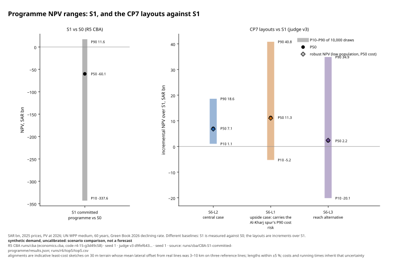

> **Document version:** docs/policy-brief.md v0.5 | 12 Nov 2026 | Author: PUBLISH_PREP (v0.5: public-release banner replaces the CP6 draft banner, CP7 item 6); report-writer (v0.2: phase vs construction years, verify-R8); FIX_R8 (v0.3: S1 table 'in the model', spur figure as a layout difference, five-metro reach qualifier, R8-checkpoint review item 9); R8_L6_PANEL (v0.4: S6-L6 comparison paragraph) | Status: reviewed

# Adding to the Saudi rail programme: options, evidence and what would change the answer

Policy brief, KSA Rail Twin (an independent, non-partisan feasibility study). Reviewed by the author at checkpoint CP6 and prepared for public release at checkpoint CP7. It is an independent simulation on synthetic, uncalibrated demand: not a government plan, and not endorsed by any agency, operator or company.

> Labels: synthetic demand, uncalibrated: scenario comparison, not a forecast. alignments are indicative least-cost sketches on 30 m terrain whose mean lateral offset from real lines was 3–10 km on three reference lines; lengths within ±5 %; costs and running times inherit that uncertainty.

**How to read the figures.** Every result below is "in the model": a comparison of scenarios on a synthetic, uncalibrated demand base, not a forecast of what any line would carry or earn. Money is SAR million at 2025 prices, discounted to 2026 on the Green Book 2026 declining schedule[^S-cp1-060] (A-cba-001, A-cba-301) over 60 years (A-cba-004). Every modelled programme figure comes from the frozen appraisal model ("judge v3", SHA-256 `d9fef643…`, `docs/r6/judge-hashes.md`) run with seed 1 and 10,000 Monte Carlo draws; costs and benefits are P10 / P50 / P90 ranges. "Robust NPV" is the net present value at median cost in the worst of three population cases (UN WPP low, medium, high). The appraisal follows UK TAG and the Green Book with departures stated in `docs/cba.md` §3.

## 1. The decision in brief

Saudi Arabia has a large rail programme announced or under procurement (the study's "committed" layer). The question this brief answers is narrower: **which additions to that programme hold up in the model once honest cost overruns, weak demand and different appraisal values are allowed for, and who would carry the fiscal exposure?**

The study screened every region and governorate (`docs/coverage.md`), scored each of the 71 searchable corridors on its own (`runs/r6/library/`), and searched their combinations with an exact optimiser and a genetic search (`docs/r6-topology.md`). The search space is thin on value: in the model only the three station additions and the Al-Kharj spur (plus two retired Jubail station variants) keep a positive robust NPV at their best phase; every new trunk line, every commuter belt and every other spur loses money in every population case. Three programmes are put forward for decision, each against the committed programme:

- **S6-L2, the central case:** three new stations on committed or existing lines (Al Jubayl and Dhahran in 2030, Duruma in 2050).
- **S6-L1, the upside case that carries the Al-Kharj spur's P90 cost risk** (NPV at P90 cost −2,958 / −724 / +1,631 SAR m, low / medium / high): S6-L2 plus the Al-Kharj spur in 2050 (`runs/r6/top5/top5.csv`).
- **S6-L3, the reach alternative:** Al Jubayl and Dhahran stations, the Al-Kharj spur and a Riyadh commuter belt (225–270°).

Layouts and phases: `scenarios/S6-L1..L3.yaml`, `runs/r6/top5/top5.csv`. 2030 and 2050 are phase (opening) years; construction starts three years earlier, in 2027 and 2047 (A-r6-002).

None of them is a recommendation to build. Each is a set of options with its evidence; the choice depends on how much cost risk, and how much fiscal exposure, a decision-maker is prepared to carry for value and reach.

## 2. The baseline: the committed programme (S1)

S1 is the Saudi Landbridge Riyadh–Jeddah line (announced/planned[^S-054]), its Riyadh section (under procurement[^S-r1a-055]) and the Saudi section of the GCC Railway (announced/planned, design stage[^S-029]), all three in the study's "committed/under procurement" layer; the press sources are secondary and their primary documents are still to be found. S1 is not one of the options here: it is the baseline every option is added to (rule 6). For context, appraised against today's network (S0, `runs/cba/CBA-S1-committed-programme`, medium population, 60 years), in the model:

> Labels: synthetic demand, uncalibrated: scenario comparison, not a forecast. alignments are indicative least-cost sketches on 30 m terrain whose mean lateral offset from real lines was 3–10 km on three reference lines; lengths within ±5 %; costs and running times inherit that uncertainty.

| committed programme S1 vs S0, in the model (`runs/cba/CBA-S1-committed-programme`) | P10 | P50 | P90 |
|---|---|---|---|
| NPV, SAR m | −337,555 | −60,103 | 11,607 |
| benefit–cost ratio (without wider impacts) | 0.07 | 0.31 | 1.26 |
| fiscal cost to the state, fully public, low population case, SAR m | 46,359 | 99,309 | 413,986 |

> Labels: synthetic demand, uncalibrated: scenario comparison, not a forecast. alignments are indicative least-cost sketches on 30 m terrain whose mean lateral offset from real lines was 3–10 km on three reference lines; lengths within ±5 %; costs and running times inherit that uncertainty.

In the model, S1 reaches a benefit–cost ratio of 1 only if demand is 163 % of the modelled level or capital cost is 0.26 times the uplifted estimate (`switching_values.json` of the same run). Its median uplifted capital cost, SAR 101,508 m, also sets the study's budget ceilings (A-r6-003). Freight benefits are not monetised (no open freight data, A-cba-309), so the mixed-traffic lines in S1 are understated; this matters for reading S1, not for comparing the options below, which are passenger additions.

## 3. The three options against S1

> Labels: synthetic demand, uncalibrated: scenario comparison, not a forecast. alignments are indicative least-cost sketches on 30 m terrain whose mean lateral offset from real lines was 3–10 km on three reference lines; lengths within ±5 %; costs and running times inherit that uncertainty.

| option (judge v3, seed 1; `runs/r6/top5/top5.csv`) | capex P10 / P50 / P90, SAR m | robust NPV | NPV at P90 cost, low / medium / high | NPV P10 / P50 / P90, medium | BCR P10 / P50 / P90, medium |
|---|---|---|---|---|---|
| S6-L2, central case | 801 / 1,423 / 5,286 | 6,792 | 3,986 / 4,771 / 5,589 | 1,051 / 7,053 / 18,604 | 1.52 / 5.96 / 22.23 |
| S6-L1, upside: carries the spur's P90 cost risk (NPV at P90 cost −2,958 / −724 / +1,631) | 6,233 / 11,194 / 41,304 | 11,023 | −2,958 / −724 / +1,631 | −5,243 / 11,301 / 40,819 | 0.60 / 2.33 / 9.33 |
| S6-L3, reach alternative | 10,684 / 19,630 / 73,799 | 2,427 | −21,745 / −19,225 / −16,624 | −20,113 / 2,215 / 34,873 | 0.32 / 1.12 / 3.48 |

> Labels: synthetic demand, uncalibrated: scenario comparison, not a forecast. alignments are indicative least-cost sketches on 30 m terrain whose mean lateral offset from real lines was 3–10 km on three reference lines; lengths within ±5 %; costs and running times inherit that uncertainty.

Source: `runs/r6/top5/top5.csv` and `runs/r6/top5/<L>/score.json` (capex uplifted and undiscounted; "NPV at P90 cost" is the held-out test with every cost at its P90). S6-L1 carries the Al-Kharj spur's P90 cost risk: NPV at P90 cost −2,958 / −724 / +1,631 SAR m (low / medium / high), runs/r6/top5/top5.csv. Figure: `report/figures/fig05-programme-npv-ranges.svg`.

> Labels: synthetic demand, uncalibrated: scenario comparison, not a forecast. alignments are indicative least-cost sketches on 30 m terrain whose mean lateral offset from real lines was 3–10 km on three reference lines; lengths within ±5 %; costs and running times inherit that uncertainty.

**S6-L2 (central case).** Three stations on lines that exist or are committed: Al Jubayl on the GCC Railway, Dhahran on the existing east passenger line, Duruma on the Landbridge. In the model it is the only one of the five top layouts that stays positive with every cost at its P90 in every population case, and its BCR P10 is above 1 (1.52, medium). It is small: about one-eighth of the median capital cost of S6-L1 (which carries the spur's P90 cost risk: NPV at P90 cost −2,958 / −724 / +1,631 SAR m, low / medium / high). In the model it adds about 1.78 M rail trips in 2050 (medium case), and on the five-metro reach measure it brings 3.56 M people (2025 population) within 120 minutes door to door, the same as S6-L1, most of it from the Dhahran station (`runs/r6/top5/top5.csv`). Two of its three stations depend on host lines that are committed, not yet built, so their timing and procurement depend on the host line (open question `host_line_procurement`, section 7).

**S6-L1 (upside case, carrying the Al-Kharj spur's P90 cost risk).** S6-L2 plus a branch from the Riyadh area to Al-Kharj in 2050. It has the highest robust NPV the search found (11,023); the difference between S6-L1 and the same layout without the spur (S6-L2) is SAR 4,231 m of robust NPV. The spur also carries the risk: S6-L1's capex P90 is 41,304 against S6-L2's 5,286, and at P90 cost it turns negative in two of three population cases: **NPV at P90 cost −2,958 / −724 / +1,631 SAR m (low / medium / high)** (`runs/r6/top5/top5.csv`, columns `npv_p90cost_*`). Its NPV P10 over the draws is negative (−5,243, medium). In the model it adds about 4.29 M rail trips in 2050. A non-electrified spur narrows the P90-cost loss (low case −2,008) but lowers the robust NPV to 10,648 (`runs/r6/v3/cp7/cp7.csv`); it stays a design option.

**S6-L3 (reach alternative).** Replaces Duruma with a Riyadh commuter belt (Al Muzahimiyah and Duruma) and keeps the spur. It reaches more people: 4.25 M within 120 minutes door to door from the five metros. In the model that extra reach costs robust NPV: going from S6-L1 (itself carrying the spur's P90 cost risk, NPV at P90 cost −2,958 / −724 / +1,631 SAR m, low / medium / high) to S6-L3 gives up SAR 8,596 m of robust NPV for 0.68 M more people within 120 minutes door to door from the five metros, about SAR 12,600 per person (rounded; from `runs/r6/top5/top5.csv`). Its robust NPV at median cost is small (2,427), it is negative at P90 cost in every population case, and negative at 30 years (−46) or at a flat 5 % rate (−716).

**Trade-off illustrations only (S6-L4, S6-L5).** Further along the reach trade-off the search found layouts that add further commuter belts around Riyadh and around Makkah, Jeddah and Madinah. They are shown only to illustrate the price of reach, with no recommendation, delivery model or stage gate: S6-L5 puts 5.30 M people within 120 minutes door to door from the five metros for a robust NPV of −112,565 SAR m (`runs/r6/top5/top5.csv`). Figure: `report/figures/fig08-reach-tradeoff.svg` (trade-off illustration only).

**Comparison layout, not the recommended programme (S6-L6).** S6-L6 is a connectivity comparison, not a reach trade-off and not a search result: the smallest-capex set of 16 library options that joins every required city into one connected rail system, scored afterwards with the full judge v3. In the model it adds the most rail trips (+9.03 M in 2050, medium population) and the most national reach (+6.64 M people within 120 minutes of a station, reported only) of the six layouts, but the least reach from the five metros (0.43 M), for a robust NPV of −191,660 SAR m on capex P50 227,213 SAR m (`runs/r6/l6/score/S6-L6.csv`). It carries no recommendation, delivery model or stage gate. Figures: `report/figures/fig08-reach-tradeoff.svg` and `report/figures/fig16-l6-connected-map.svg` (comparison layout).

## 4. Who pays: fiscal exposure and delivery models

No option pays for itself in the model: fares cover a fraction of operating and renewal costs (farebox ratios of 0.19 to 0.46, low case, `docs/fiscal-exposure.md`), so under every delivery model the state pays. The delivery analysis (`docs/delivery-models.md`, `runs/r7/fiscal/fiscal.json`, `runs/r7/vfm/vfm.json`) compared fully public delivery by the state rail company with an availability-payment PPP and, where there is revenue to carry, a demand-risk concession.

> Labels: synthetic demand, uncalibrated: scenario comparison, not a forecast. alignments are indicative least-cost sketches on 30 m terrain whose mean lateral offset from real lines was 3–10 km on three reference lines; lengths within ±5 %; costs and running times inherit that uncertainty.

| programme, low population case (`runs/r7/fiscal/fiscal.json`) | net fiscal cost 60 y, fully public, P10 / P50 / P90 (expected) | availability PPP, P10 / P50 / P90 (expected) | value for money of the PPP (share of PSC) | peak share of state spending at P90 capex (year) |
|---|---|---|---|---|
| S6-L2 | 695 / 1,283 / 4,088 (2,171) | 2,166 / 2,166 / 4,866 (3,065) | −894 (−41.2 %) | 0.091 % (2027) |
| S6-L1 (spur's P90 cost risk: NPV at P90 cost −2,958 / −724 / +1,631) | 4,676 / 8,441 / 23,615 (13,177) | 13,443 / 13,443 / 28,054 (18,301) | −5,124 (−38.9 %) | 0.662 % (2047) |
| S6-L3 | 12,696 / 18,962 / 45,343 (27,275) | 27,495 / 27,495 / 53,113 (36,054) | −8,779 (−32.2 %) | 1.230 % (2047) |

> Labels: synthetic demand, uncalibrated: scenario comparison, not a forecast. alignments are indicative least-cost sketches on 30 m terrain whose mean lateral offset from real lines was 3–10 km on three reference lines; lengths within ±5 %; costs and running times inherit that uncertainty.

SAR m, PV 2026; incremental to S1. PPP figures have P10 = P50 by construction (a fixed price; capex enters only through overruns above the private cushion); expected values use a lognormal cost tail (A-fund-108). The budget share is against total state expenditure in the Ministry of Finance's FY2026 pre-budget statement[^S-fund-026], projected beyond 2028 (A-fund-005). Figure: `report/figures/fig10-fiscal-exposure.svg`.

What the evidence says, both ways:

- **In the model, public delivery is cheaper in expected present value** for every programme and corridor, across every registered parameter range. A PPP breaks even only if the fixed-price bid is about 80 % below the un-uplifted estimate, if private finance is cheaper than sovereign borrowing, or if transaction costs are negative (switching values −0.81 / −0.018 / −0.77 for S6-L1, the upside case with NPV at P90 cost −2,958 / −724 / +1,631 SAR m, low / medium / high; `runs/r7/vfm/vfm.json`). The finance premium is the one sourced driver, and its source is a UK reference class[^S-fund-r7-001]; no Saudi PPP cost of capital was found.
- **A PPP does not remove the cost tail.** Under an availability PPP the state keeps a contingent liability for overruns beyond the private cushion: for S6-L1, 4,859 expected and 14,611 at P90 capex (PV); for the spur alone at 2050, 3,963 and 11,921. That exposure arises in the same cost cases in which S6-L1's NPV turns negative (NPV at P90 cost −2,958 / −724 / +1,631 SAR m, low / medium / high).
- **For a PPP:** a fixed price protects the budget up to the private cushion, and the case for it would strengthen if Saudi bids priced risk well below the reference class. **For public delivery:** the corridors are small or bound to a host line, and their fares do not carry their costs. Public delivery has its own record of delay and demand shortfall: the Haramain line opened about six years late, and its 2023 ridership is reported at about an eighth of the design projection (secondary source[^S-fund-265]).
- Funding sources (budget, PIF, the state rail company, land value capture) are a separate choice from the delivery model. They change who finances and reports the cost, not who carries the delivery risk, and how each would be reported is an open question (section 7).

## 5. The three biggest uncertainties and their switching values

In the tornado analyses (`runs/cba/<case>/tornado.csv`) capital cost and demand are the two largest drivers for the committed programme and for nearly every corridor in the three options; appraisal values (value of time, carbon value, discount rate) come next. Switching values are the value of one input at which the result changes sign, holding everything else at the central row (medium population, 60 years, Green Book 2026; standalone appraisal with construction from 2027, A-cba-301, so they describe each corridor, not its place in a layout).

> Labels: synthetic demand, uncalibrated: scenario comparison, not a forecast. alignments are indicative least-cost sketches on 30 m terrain whose mean lateral offset from real lines was 3–10 km on three reference lines; lengths within ±5 %; costs and running times inherit that uncertainty.

| case (`runs/cba/CBA-<case>/switching_values.json`) | demand for BCR = 1, share of modelled | capex multiplier for BCR = 1 | value-of-time multiplier for BCR = 1 | real discount rate for NPV = 0 |
|---|---|---|---|---|
| S1-committed-programme | 163 % | 0.26 | 8.94 | 0.27 % |
| S3-branch_spur-al-kharj (in S6-L1, the upside case with NPV at P90 cost −2,958 / −724 / +1,631; and in S6-L3) | 66 % | 1.09 | 0.85 | 3.03 % |
| S5-station_addition-duruma (in S6-L2, S6-L1) | 52 % | 1.46 | 0.72 | 4.02 % |
| S5-station_addition-dhahran (in all three) | 17 % | 5.43 | not reached | 10.37 % |

> Labels: synthetic demand, uncalibrated: scenario comparison, not a forecast. alignments are indicative least-cost sketches on 30 m terrain whose mean lateral offset from real lines was 3–10 km on three reference lines; lengths within ±5 %; costs and running times inherit that uncertainty.

These are standalone cases; in the layout, S6-L1 carries the Al-Kharj spur's P90 cost risk: NPV at P90 cost −2,958 / −724 / +1,631 SAR m (low / medium / high), runs/r6/top5/top5.csv. The Al Jubayl station (in all three options) switches only at 6 % of modelled demand, a capex multiplier of 15.29 or a rate of 18.69 %. Figure: `report/figures/fig14-tornado-switching.svg`.

**1. Capital cost and overruns.** The cost draws carry a reference-class uplift, and their tail is long (P90 about 3.7 times P50, A-fund-108). For S1 the capex swing between its P10 and P90 is the largest single driver (333,630 SAR m of NPV). For the options, cost risk is what separates them: the Al-Kharj spur switches at only 9 % above the median of its uplifted cost, Duruma at 46 % above it, while Dhahran and Al Jubayl tolerate multiples of it. This is why S6-L2 stays positive at P90 cost and S6-L1 does not (NPV at P90 cost −2,958 / −724 / +1,631 SAR m, low / medium / high; `report/figures/fig06-l1-p90-cost-risk.svg`).

**2. Demand.** Demand is synthetic and uncalibrated; every draw already applies the reference-class ratio of outturn to forecast ridership (median about 0.69, 0.693 in `runs/cba/CBA-S1-committed-programme/switching_values.json`; A-rcf-029). For the spur, demand is the largest driver (NPV swing 24,528 SAR m). The spur and Duruma need about half to two-thirds of the modelled demand to pass; Dhahran and Al Jubayl need far less. S1 needs more than the model gives it.

**3. Appraisal values: value of time, carbon value and discount rate.** No Saudi value-of-time study was found (S-soc-308, unverified); the appraisal transfers UK values, and the choice of conversion route is still open (A-cba-106). The spur passes only if value of time is at least 0.85 times the central value and the rate stays below about 3 %. At a flat 7 % rate, S6-L2 (1,535) and S6-L1 (946) stay positive at median cost and S6-L3 (−1,433) does not (`runs/r6/top5/top5.csv`). At P90 cost S6-L1 does not hold: it carries the Al-Kharj spur's P90 cost risk (NPV at P90 cost −2,958 / −724 / +1,631 SAR m, low / medium / high).

## 6. What would have to be true

- **For S6-L2 to be the right choice:** the three stations can be built and operated within or alongside their host lines' procurement; demand at Duruma reaches at least about half of the modelled level (52 %, standalone case); the decision-maker values cost robustness over the extra value and trips the spur offers.
- **For S6-L1 to be preferred** (it carries the spur's P90 cost risk, NPV at P90 cost −2,958 / −724 / +1,631 SAR m, low / medium / high): the Al-Kharj spur's cost stays within about 9 % of its uplifted median, or a stage gate before construction (2047 for the 2050 phase, A-r6-002) confirms its cost and demand; and the state accepts a fiscal exposure that, at P90 cost, rises to 23,615 SAR m (60-year PV, fully public) against 4,088 for S6-L2.
- **For S6-L3 to be preferred:** the extra reach (about 0.68 M people within 120 minutes door to door from the five metros) is judged worth about SAR 12,600 per person of robust NPV forgone, and a cost tail of up to 73,799 SAR m capex at P90 is acceptable, knowing the programme is negative at P90 cost in every population case.
- **For a PPP to beat public delivery:** Saudi bids price construction risk far below the reference class, or private finance costs no more than sovereign borrowing; neither has support in the sources read.
- **For any of these to be more than a scenario comparison:** a fielded travel survey (designed, not fielded: `docs/survey/`), observed origin–destination data and a Saudi value-of-time study.

## 7. Open legal and institutional questions (13 of 16 items unclear)

The study infers no legal position on these; each is a question for the competent authority or counsel (`cities/ksa/funding/recommendations.yaml`, `docs/delivery-models.md`).

1. `sar_ownership_form`: who are the state rail company's shareholders, and what is its legal form?
2. `fiscal_reporting`: are its capex and debt consolidated in the budget or general-government statistics, and would PPP commitments or guarantees be disclosed?
3. `pif_role`: does PIF finance the rail company's capex, and what does the PIF Law say on domestic infrastructure and guarantees?
4. `fare_setting_authority`: who sets and approves passenger fares on intercity and commuter rail? (Railway Law Art. 18 covers access fees only[^S-fund-016].)
5. `railway_law_regulation`: which cases of the Implementing Regulation allow existing assets to pass to a concessionaire, and is there a published usage-fee policy?
6. `psp_regulations_thresholds`: what do the amended PSP Implementing Regulations say on thresholds, procurement, the VfM study and fiscal approval?
7. `psp_relevant_agency`: which body is the relevant and executive agency for a rail PPP, and is the rail company a contracting authority?
8. `psp_railway_interaction`: does a rail concession under the Railway Law also follow the PSP Law procedures?
9. `ncp_vfm_method`: has the National Center for Privatization published a VfM or public sector comparator method?
10. `om_contract_status`: is a long O&M-only rail contract a PPP under the PSP Law[^S-fund-002] or ordinary procurement?
11. `host_line_procurement`: can a station be added within a committed host line's procurement, and how are the Landbridge phases being let?
12. `lvc_instruments`: which Saudi instruments could legally be earmarked for rail through land value capture?
13. `land_expropriation`: what expropriation procedure and timetable apply to a new rail alignment?

## 8. Limits and named sensitivities

- Alignments are least-cost sketches, not engineering designs; the label above states their offset and length tolerance. Alignment weights v1 are the base for every figure here. Under weights v2 (a named sensitivity, not adopted, `docs/alignments.md` §4c) S6-L1's robust NPV moves from 11,023 to 11,297 SAR m and no value-for-money sign changes (A-align-100; `docs/fiscal-exposure.md`, `runs/r7/fiscal/fiscal.json`); under the base weights S6-L1 carries the spur's P90 cost risk (NPV at P90 cost −2,958 / −724 / +1,631 SAR m, low / medium / high).
- Wider economic impacts are indicative only and excluded from every ranking (`docs/cba.md` §7). Foreign pilgrims and visitors carry no user benefits. Freight is not monetised. Jeddah decongestion is set to zero, a lower bound.
- Distribution by region and the people-and-culture evidence are in `docs/distribution.md` and `docs/social.md`. No income-by-zone data exist, so the income lens is a regional proxy.
- The phase years (2030, 2050) are opening-year conventions, with construction starting in 2027 and 2047 (A-r6-002; the opening year itself is drawn from the cost schedule); this is not a real-options model. The stage gates in `report/figures/fig09-stage-gates.svg` mark where a decision can be revisited with better data.

[^S-cp1-060]: HM Treasury, The Green Book (2026), STPR schedule; verified, accessed 2026-10-31 (`docs/sources/index.csv`).
[^S-054]: MEED, "Saudi Landbridge rail scheme to be delivered by 2034", 2026-01-21; secondary, accessed 2026-10-30 (`docs/sources/index.csv`).
[^S-r1a-055]: MEED, "Contract award nears for Saudi Landbridge Riyadh section", 2026-08-31; secondary, accessed 2026-10-31 (`docs/sources/index.csv`).
[^S-029]: MEED, "Saudi Arabia tenders GCC rail link from Kuwait to UAE border", 2026-05-12; secondary, accessed 2026-10-30 (`docs/sources/index.csv`).
[^S-fund-026]: Ministry of Finance, FY2026 pre-budget statement; verified, accessed 2026-10-31 (`docs/sources/index.csv`).
[^S-fund-r7-001]: National Audit Office (UK), PFI and PF2, HC 718, 2018-01-18; verified, accessed 2026-11-04 (`docs/sources/index.csv`).
[^S-fund-265]: Wikipedia, "Haramain High Speed Railway" (citing press reports); secondary, accessed 2026-10-31; primary to find: SAR annual report or GASTAT rail statistics (`docs/sources/index.csv`).
[^S-fund-016]: Ministry of Investment, Railway Law, Royal Decree M/159 (English translation), Art. 18; verified, accessed 2026-10-31 (`docs/sources/index.csv`).
[^S-fund-002]: Ministry of Investment, Private Sector Participation Law, Royal Decree M/63 (English translation); verified, accessed 2026-10-31 (`docs/sources/index.csv`).
