> **Document version:** docs/report/feasibility-report.md v1.3 | 5 Nov 2026 | Author: report-writer (generated by `uv run python -m common.report build`; v1.1: fig09 title, FIX_R8 item 1; v1.2: wording checks, FIX_R8 item 9; v1.3: neutral framing, FIX_R8 item 7) | Status: draft

# KSA Rail Twin: national rail feasibility study (report)

> Labels: synthetic demand, uncalibrated: scenario comparison, not a forecast. alignments are indicative least-cost sketches on 30 m terrain whose mean lateral offset from real lines was 3–10 km on three reference lines; lengths within ±5 %; costs and running times inherit that uncertainty.

Assembled from `docs/report/sections/*.md` by `uv run python -m common.report build`; do not edit this file by hand. Source notes at the end resolve every `[^S-…]` reference against `docs/sources/index.csv`; `A-…` ids are rows of `docs/assumptions.md` (`docs/report/annex-assumptions.md`); `runs/…` paths are run outputs with their `meta.json`.

## Contents

- [0. Front matter](#0-front-matter)
  - [0.1 Scope](#01-scope)
  - [0.2 The three rail layers](#02-the-three-rail-layers)
  - [0.3 How to read the figures](#03-how-to-read-the-figures)
  - [0.4 Decision framing used throughout](#04-decision-framing-used-throughout)
  - [0.5 Independence](#05-independence)
- [1. Executive summary](#1-executive-summary)
  - [1.1 What was screened](#11-what-was-screened)
  - [1.2 What the model finds](#12-what-the-model-finds)
  - [1.3 Who pays](#13-who-pays)
  - [1.4 What would change the answer](#14-what-would-change-the-answer)
  - [1.5 Evidence from other countries](#15-evidence-from-other-countries)
- [2. Decision questions](#2-decision-questions)
- [3. Methods, standards and departures](#3-methods-standards-and-departures)
  - [3.1 Data](#31-data)
  - [3.2 Screening (W2)](#32-screening-w2)
  - [3.3 Demand and mode choice (W8)](#33-demand-and-mode-choice-w8)
  - [3.4 Network, running times and alignments (W1, W8)](#34-network-running-times-and-alignments-w1-w8)
  - [3.5 Costs (W3)](#35-costs-w3)
  - [3.6 Cost–benefit analysis (W4)](#36-costbenefit-analysis-w4)
  - [3.7 Optimisation and phasing (W9)](#37-optimisation-and-phasing-w9)
  - [3.8 Delivery models and fiscal exposure (W6)](#38-delivery-models-and-fiscal-exposure-w6)
- [4. Results](#4-results)
  - [4.1 The committed programme (S1 against S0)](#41-the-committed-programme-s1-against-s0)
  - [4.2 Corridor families (each corridor alone, against S1)](#42-corridor-families-each-corridor-alone-against-s1)
  - [4.3 The five CP7 corridors, standalone at their CP7 phase](#43-the-five-cp7-corridors-standalone-at-their-cp7-phase)
  - [4.4 Programmes against S1: central, upside and reach](#44-programmes-against-s1-central-upside-and-reach)
  - [4.5 Fiscal exposure and delivery models](#45-fiscal-exposure-and-delivery-models)
  - [4.6 Trade-offs: the Pareto front and the reach front](#46-trade-offs-the-pareto-front-and-the-reach-front)
  - [4.7 People, equity and the 30-minute lens](#47-people-equity-and-the-30-minute-lens)
- [5. Benchmarks: what other countries did](#5-benchmarks-what-other-countries-did)
  - [5.1 Cost per km](#51-cost-per-km)
  - [5.2 Overruns](#52-overruns)
  - [5.3 Ridership against forecast](#53-ridership-against-forecast)
  - [5.4 Farebox recovery](#54-farebox-recovery)
  - [5.5 The 200–800 km band](#55-the-200800-km-band)
  - [5.6 Small towns and intermediate stations](#56-small-towns-and-intermediate-stations)
  - [5.7 Delivery models observed](#57-delivery-models-observed)
  - [5.8 Gaps carried forward](#58-gaps-carried-forward)
- [6. Risks, sensitivities and open questions](#6-risks-sensitivities-and-open-questions)
  - [6.1 Cost overruns](#61-cost-overruns)
  - [6.2 Demand shortfall](#62-demand-shortfall)
  - [6.3 Fiscal exposure and delivery risk](#63-fiscal-exposure-and-delivery-risk)
  - [6.4 Alignment weights v2 (sensitivity only; not in any headline)](#64-alignment-weights-v2-sensitivity-only-not-in-any-headline)
  - [6.5 Open legal and institutional questions](#65-open-legal-and-institutional-questions)
  - [6.6 Other limits](#66-other-limits)
- [7. Phased programme as stage-gates](#7-phased-programme-as-stage-gates)
  - [7.1 Gates](#71-gates)
  - [7.2 Delivery model at each gate](#72-delivery-model-at-each-gate)
  - [7.3 What is not on the gates](#73-what-is-not-on-the-gates)
- [8. Annexes](#8-annexes)
  - [8.1 Annex R. Regions (one file per region)](#81-annex-r-regions-one-file-per-region)
  - [8.2 Annex S. Sources](#82-annex-s-sources)
  - [8.3 Annex A. Assumptions](#83-annex-a-assumptions)
  - [8.4 Figures and dashboard screenshots](#84-figures-and-dashboard-screenshots)
  - [8.5 Workstream documents](#85-workstream-documents)

<!-- section: 00-front-matter.md -->
# 0. Front matter

**KSA Rail Twin: a national, investment-grade economic feasibility study of a Saudi rail network.** Milestone R8 deliverable, reviewed by the author at checkpoint CP6 and prepared for public release at checkpoint CP7. It is an independent simulation on synthetic, uncalibrated demand: not a government plan, and not endorsed by any agency, operator or company. The author decides when it is published.

> Labels: synthetic demand, uncalibrated: scenario comparison, not a forecast. alignments are indicative least-cost sketches on 30 m terrain whose mean lateral offset from real lines was 3–10 km on three reference lines; lengths within ±5 %; costs and running times inherit that uncertainty.

## 0.1 Scope

The study compares options for extending Saudi Arabia's rail network: which corridors, in what order, at what cost, with what long-term benefit, funded and owned by whom, and with what effect on people. It covers all 13 regions and all 150 GASTAT governorates (coverage audit `docs/coverage.md`, GASTAT Census 2022[^S-cp2-gastat-007]), the committed programme (S1: the Landbridge, the Riyadh Rail Link and the Saudi GCC section, each "announced/planned" with its source) and every generated corridor family (S2 trunk gaps, S3 branches and spurs, S4 commuter belts, S5 station additions), appraised against the matched baseline (runs/cba/CBA-S1-committed-programme for S1 against S0; S1 for everything else).

The simulation is the tool; the decision case is the product. The report gives options and evidence. It does not advocate for any entity, body, firm or programme, and Vision 2030 alignment appears only as a qualitative scorecard (`docs/cba-scorecard.md`), not as an argument.

## 0.2 The three rail layers

Every map, table and figure keeps three layers apart: **existing** (lines in service, from OpenStreetMap and published operator facts), **committed / under procurement** (announced or planned lines, never shown as existing; each with a source and date) and **hypothetical (ours)** (every corridor this study generated). Maps carry the OpenStreetMap credit (ODbL) and the layer legend.

## 0.3 How to read the figures

- **Labels.** Every modelled output carries the two labels printed above. The first says the demand is synthetic and uncalibrated beyond three 2025 totals, so results compare scenarios and are not forecasts. The second says the routed alignments are indicative sketches; lengths, costs and running times built on them inherit that uncertainty (`docs/alignments.md` §0).
- **Model language.** The report writes "in the model, X is reduced by …", never as a prediction of what a line does in reality.
- **Ranges.** Costs and benefits are P10 / P50 / P90 ranges over 10,000 Monte Carlo draws (seed 1), never single points (runs/r6/top5/top5.csv; runs/cba/summary.parquet). P10 is the value that 10 % of the draws fall below, P50 the median, P90 the value 90 % of draws fall below. A wide range is a finding, not a defect.
- **Robust NPV.** The score used to rank layouts is the worst of the three UN WPP population cases (low, medium, high) of P50 benefits minus P50 costs, 60 years, Green Book 2026 declining rate (A-r6-001, A-cba-001). "NPV at P90 cost" replaces P50 costs by P90 costs: the held-out cost-risk test.
- **Phase years.** 2030, 2035, 2040 and 2050 are the optimiser's phase years; construction starts three years earlier (2027, 2032, 2037, 2047; A-r6-002) and the opening year is drawn from the reference-class schedule distribution. A stage-gate falls before construction, so the gate for a 2050 phase is in 2047.
- **Money.** SAR million at 2025 prices, present value at 2026, unless a table says otherwise (A-cost-001, A-cba-301). Rounding: whole SAR million in tables; BCRs to two decimals; every figure is rounded half away from zero from the run file (so 2,426.50 prints as 2,427), and no rounding changes a sign or a ranking.
- **Provenance.** Every number carries a source footnote `[^S-…]` (resolved in the source notes and in Annex S), an assumption id `A-…` (Annex A) or a run path `runs/…` with its `meta.json` (seed, config hash, data hash, code version). Every R6/R7 figure comes from the frozen judge v3 (`v3-variants`, SHA-256 `d9fef643…`, `docs/r6/judge-hashes.md`), seed 1, with the frozen alignment weights v1 (`align_weights.yaml`, hash `2b718ecb…`).

## 0.4 Decision framing used throughout

- **S6-L2** (the three station additions) is the **central case**.
- **S6-L1** (S6-L2 plus the Al-Kharj spur in phase 2050, construction from 2047 by A-r6-002) is the **upside case that carries the Al-Kharj spur's P90 cost risk**: NPV at P90 cost −2,958 / −724 / +1,631 SAR m (low / medium / high), runs/r6/top5/top5.csv.
- **S6-L3** is the **reach alternative**.
- All three are presented **against S1**, the committed programme (runs/cba/CBA-S1-committed-programme).
- Two further layouts from the optimisation appear only as trade-off illustrations on the Pareto and reach figures (§4.6); they carry no recommendation, delivery model or stage-gate.

## 0.5 Independence

This is a personal, open-source, non-partisan study. It uses only public, licence-compatible data and open-source tools (licence and openness register `docs/licences.md`). Naming a public body (for example the state rail company, the Transport General Authority, the National Center for Privatization or the Ministry of Finance) states a legal or institutional fact with its source; it is not an endorsement. Delivery-model findings are the analyst's judgement of the best fit given the evidence, set out side by side with the alternatives.

<!-- section: 01-executive-summary.md -->
# 1. Executive summary

> Labels: synthetic demand, uncalibrated: scenario comparison, not a forecast. alignments are indicative least-cost sketches on 30 m terrain whose mean lateral offset from real lines was 3–10 km on three reference lines; lengths within ±5 %; costs and running times inherit that uncertainty.

Every figure below is "in the model": a scenario comparison on synthetic, uncalibrated demand, SAR million at 2025 prices, PV 2026, P10 / P50 / P90 over 10,000 draws, judge v3 (`d9fef643…`), seed 1 (runs/r6/top5/top5.csv). The answers are options with their evidence, not advice to any entity.

## 1.1 What was screened

- Every one of the 150 GASTAT governorates in all 13 regions is in the coverage table, screened or excluded with a reason; 1,224 register settlements went through the funnel to a long list of 198 and a short list of 60 (runs/r2/long-list/longlist.parquet, runs/r2/score/summary.json; GASTAT Census 2022[^S-cp2-gastat-007]).
- The short list generated 71 searchable corridors in four families: 23 trunk gaps, 19 branches and spurs, 20 commuter belts and 9 station additions, each costed bottom-up with reference-class uplifts and appraised against S1 (runs/r6/v3/library/library.json; uplift class A-rcf-031).

## 1.2 What the model finds

- **The committed programme itself does not pass in the model.** S1 against S0, medium population: BCR P10 / P50 / P90 0.07 / 0.31 / 1.26 and NPV P50 −60,103 SAR m (runs/cba/CBA-S1-committed-programme). S1 is committed, so the study treats it as the baseline and asks what to add to it.
- **Value is thin and concentrated in small additions.** Of the 71 searchable corridors, four have a positive robust NPV at their best phase (2030, 2035, 2040 or 2050; construction three years earlier, A-r6-002) when scored alone: the Al Jubayl, Dhahran and Duruma station additions and the Al-Kharj spur; no trunk gap, no commuter belt and no other spur does at any phase (runs/r6/v3/library/). Whole families built at 2030 lose between −1,174 (all station additions) and −957,580 SAR m (all trunk gaps) of robust NPV (runs/r6/compare/).
- **Central case, S6-L2** (Al Jubayl and Dhahran stations in phase 2030, construction from 2027; Duruma station in phase 2050, construction from 2047; A-r6-002): robust NPV 6,792; NPV at P90 cost 3,986 / 4,771 / 5,589 (low / medium / high), positive in every population case; capex P10 / P50 / P90 801 / 1,423 / 5,286; BCR P10 / P50 / P90 1.52 / 5.96 / 22.23 (medium) (runs/r6/top5/top5.csv).
- **Upside case, S6-L1** (S6-L2 plus the Al-Kharj spur in phase 2050, construction from 2047): robust NPV 11,023 on capex P10 / P50 / P90 6,233 / 11,194 / 41,304. It carries the Al-Kharj spur's P90 cost risk: NPV at P90 cost −2,958 / −724 / +1,631 SAR m (low / medium / high), runs/r6/top5/top5.csv. The difference between S6-L1 and the same layout without the spur is SAR 4,231 m of robust NPV (S6-L1 − S6-L2, runs/r6/top5/top5.csv).
- **Reach alternative, S6-L3** (Al Jubayl, Dhahran, the Al-Kharj spur and the Riyadh commuter belt 225): it raises the population within 120 door-to-door minutes of the five metros from 3.56 M to 4.25 M, for a robust NPV of 2,427 that turns negative at P90 cost in every case (−21,745 / −19,225 / −16,624) and at 30 years or flat 5 % / 7 % rates (runs/r6/top5/top5.csv).
- **Reach costs money.** Moving along the reach front to the largest reach the B1 budget buys (5.30 M people within 120 door-to-door minutes of the five metros) costs SAR 123.6 bn of robust NPV against S6-L1 (runs/r6/top5/top5.csv; budget levels A-r6-003). No layout brings any new zone within 60 door-to-door minutes of a metro (runs/r6/top5/top5.csv, `access_gain_60` = 0).

## 1.3 Who pays

- No option is self-financing in the model: in the robust (low) population case fares cover less than half of operating and renewal costs on every CP7 programme (PV fares ÷ PV opex and renewals 0.46 for S6-L2, 0.41 for S6-L1, 0.19 for S6-L3; runs/r7/fiscal/fiscal.json), before any capex.
- Net fiscal cost to the state over 60 years, fully public delivery, P10 / P50 / P90: S6-L2 695 / 1,283 / 4,088; S6-L1 4,676 / 8,441 / 23,615; S6-L3 12,696 / 18,962 / 45,343 SAR m, all incremental to S1 (runs/r7/fiscal/fiscal.json).
- An availability PPP is more expensive in expected present value than public delivery for every corridor and programme, and the sign holds across every registered parameter range (value for money S6-L2 −894, S6-L1 −5,124, S6-L3 −8,779 SAR m; runs/r7/vfm/vfm.json). S6-L1 remains the upside case with the spur's cost risk: NPV at P90 cost −2,958 / −724 / +1,631 SAR m (low / medium / high), runs/r6/top5/top5.csv. The decisive driver, the private-finance premium, comes from a UK reference class and is unclear for Saudi Arabia[^S-fund-r7-001] (A-fund-008).
- Thirteen legal and institutional questions stay open (§6.5), among them who sets passenger fares, whether a station can be added inside a committed host line's procurement and how state rail capex is reported; no legal position is inferred (cities/ksa/funding/recommendations.yaml).

## 1.4 What would change the answer

- **Demand.** The demand is synthetic; the reference-class ridership ratio (median 0.69 of forecast in the draws, central ridership ratio 0.693 in runs/cba/CBA-S3-branch_spur-al-kharj/switching_values.json; class A-rcf-029[^S-cost-rcf-013]) is already applied in every draw. A calibrated survey-based demand model is the single largest open item (§6.2).
- **Cost tails.** Capex P90 is about 3.7 × P50 for every CP7 layout (runs/r6/top5/top5.csv), following the published reference class for rail at strategic stage (A-rcf-001[^S-cost-rcf-008]). A design-stage estimate that narrowed the Al-Kharj spur's tail is the condition for S6-L1 to pass its stage-gate (§7).
- **Alignments.** Under the alternative alignment weights v2 (a sensitivity only, not adopted) S6-L1's robust NPV moves 11,023 → 11,297 and S6-L3's 2,427 → 3,180; no sign changes (runs/r7-v2/sensitivity.json, §6.4). Under the base weights v1, S6-L1: NPV at P90 cost −2,958 / −724 / +1,631 SAR m (low / medium / high), runs/r6/top5/top5.csv.

## 1.5 Evidence from other countries

Overruns are the common case in the audited record (every high-speed line audited by the European Court of Auditors overran by more than 25 %[^S-bench-fr-086]); measured ridership is mostly below forecast where it was measured[^S-bench-kr-009][^S-bench-fr-043]; and the effects of intermediate stations on small towns are mixed to negative (no clear regeneration at 15 of 18 audited EU stations[^S-bench-st-014]). §5 has the detail.

<!-- gen:fig-fig05-programme-npv-ranges -->
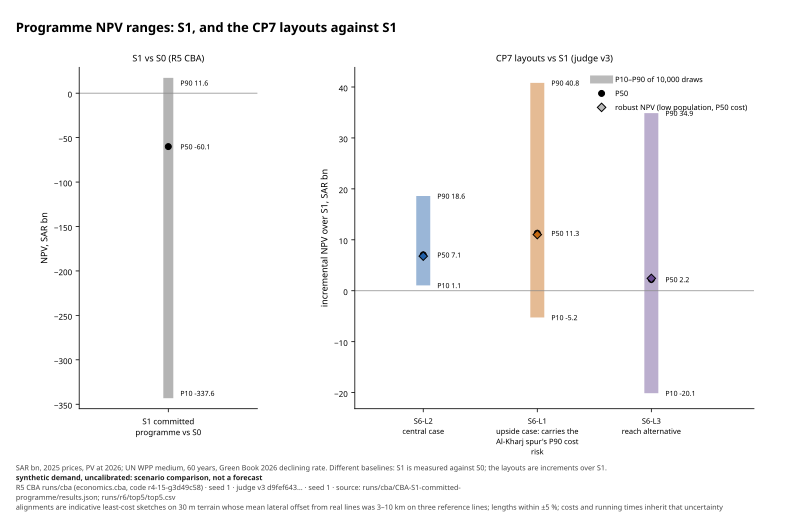
> Labels: synthetic demand, uncalibrated: scenario comparison, not a forecast. alignments are indicative least-cost sketches on 30 m terrain whose mean lateral offset from real lines was 3–10 km on three reference lines; lengths within ±5 %; costs and running times inherit that uncertainty.
*Figure 5.* Left: NPV of the S1 committed programme against S0, P10/P50/P90 (R5 CBA). Right: incremental NPV over S1 of S6-L2 (central), S6-L1 (upside, carries the Al-Kharj spur's P90 cost risk) and S6-L3 (reach), P10–P90 of the judge v3 draws with P50 and the robust NPV; UN WPP medium, 60 years, Green Book 2026.
Source: runs/cba/CBA-S1-committed-programme/results.json; runs/r6/top5/top5.csv. Provenance: R5 CBA runs/cba (economics.cba, code r4-15-g3d49c58) · seed 1 · judge v3 d9fef643… · seed 1. S6-L1: NPV at P90 cost −2,958 / −724 / +1,631 SAR m (low / medium / high), runs/r6/top5/top5.csv.
<!-- /gen:fig-fig05-programme-npv-ranges -->

<!-- section: 02-decision-questions.md -->
# 2. Decision questions

> Labels: synthetic demand, uncalibrated: scenario comparison, not a forecast. alignments are indicative least-cost sketches on 30 m terrain whose mean lateral offset from real lines was 3–10 km on three reference lines; lengths within ±5 %; costs and running times inherit that uncertainty.

The brief (PROJECT.md §1) sets seven decision questions, all at national scope, and keeps the 30-minute commute test as one lens (runs/access/commute-test-s1/). The table gives each question, where the report answers it and the short answer in the model. The short answers are options with their evidence; none is advice to any entity.

> Labels: synthetic demand, uncalibrated: scenario comparison, not a forecast. alignments are indicative least-cost sketches on 30 m terrain whose mean lateral offset from real lines was 3–10 km on three reference lines; lengths within ±5 %; costs and running times inherit that uncertainty.
| # | question (PROJECT.md §1) | where answered | short answer in the model (ranges; run ids in the sections) |
|---|---|---|---|
| 1 | **Network.** Across all 13 regions and every governorate, which links, branches, commuter belts and station additions create the most value? | §4.1–§4.3, Annex R | Four of 71 searchable corridors have a positive robust NPV when scored alone: three station additions and the Al-Kharj spur (runs/r6/v3/library/). No trunk gap or commuter belt does at any phase. |
| 2 | **Cost.** What does each option cost to build, run and renew, with land, financing and a realistic overrun allowance? | §3.5, §4.2–§4.4, §6.1 | Capex is a reference-class range with a heavy tail: P90 about 3.7 × P50 for every CP7 layout (runs/r6/top5/top5.csv; A-rcf-001). |
| 3 | **Benefit.** Do 30–60 year benefits exceed costs under honest assumptions? | §4.2–§4.4 | For the central case S6-L2, yes in every population case even at P90 cost; for the upside case S6-L1, in every case at P50 cost but not in the low and medium cases at P90 cost; for the reach alternative S6-L3, not at P90 cost. S6-L1: NPV at P90 cost −2,958 / −724 / +1,631 SAR m (low / medium / high), runs/r6/top5/top5.csv. |
| 4 | **Who pays and who owns.** Which delivery and funding model fits each corridor; who carries which risk; what is the fiscal exposure? | §4.5, §6.3, §6.5 | Fully public delivery is cheaper in expected PV than an availability PPP for every entity, robust to every registered range (runs/r7/vfm/vfm.json); 13 legal and institutional questions stay open (cities/ksa/funding/recommendations.yaml). |
| 5 | **Benchmarks.** What did France, Japan, Spain, Germany, China, South Korea, Italy, Morocco, Turkey, the UAE, Egypt and others do; did small towns gain? | §5 | Overruns are common, ridership is mostly below forecast where measured, and small-town effects are mixed to negative[^S-bench-st-014][^S-bench-st-001]. |
| 6 | **People.** How would rail change commuting, work, women's mobility, family and religious travel, housing and regional balance; who gains and who loses? | §4.7 | In the model the user benefits of every CP7 corridor fall in the Riyadh and Eastern regions; the high-unemployment tercile of regions gains nothing from them (runs/cba/CBA-S3-branch_spur-al-kharj and the station cases; A-cba-311). |
| 7 | **Optimisation and phasing.** Which network, technology, service pattern, fares and build sequence balance NPV, coverage, emissions and fiscal exposure to 2050/2060? | §4.6, §7 | The robust-NPV optimum is small and the budget levels do not bind (A-r6-003); reach costs NPV; §7 sets the phasing as stage-gates. |

The 30-minute lens: for towns 40–120 road-km from a metro, the committed programme gives no town around Riyadh a 30-minute in-vehicle rail time, while at least one generated candidate does for 49 of 105 such towns (runs/access/commute-test-s1/commute_test.parquet; §4.7).

<!-- section: 03-methods.md -->
# 3. Methods, standards and departures

> Labels: synthetic demand, uncalibrated: scenario comparison, not a forecast. alignments are indicative least-cost sketches on 30 m terrain whose mean lateral offset from real lines was 3–10 km on three reference lines; lengths within ±5 %; costs and running times inherit that uncertainty.

Each step names the standard it follows and states where it departs. The full method notes are the workstream documents named in each subsection; this section summarises them and does not add figures of its own.

## 3.1 Data

- **Rail layers** from OpenStreetMap (ODbL) and published operator facts, with committed lines digitised as "announced/planned" with source and date (`docs/data-sources.md`, `docs/network.md`; for example the Haramain line facts[^S-002]).
- **Settlements and population:** GASTAT Census 2022 governorate totals and the table of cities of 5,000 or more (primary exports[^S-cp2-gastat-007][^S-cp2-gastat-008]); open population grids for towns GASTAT does not tabulate (WorldPop[^S-r1a-505], GHSL[^S-r1a-509]), scaled to the governorate control totals (A-screen-040).
- **Population to 2060:** UN World Population Prospects 2024 low / medium / high[^S-r3-pop-001] (`docs/population-scenarios.md`).
- **Terrain:** Copernicus GLO-30, routed at about 90 m (`docs/alignments.md` §2; licence register `docs/licences.md`).
- **Every dataset** is a row of the manifest `cities/ksa/sources.yaml` with its SHA-256; every run records the manifest hash in its `meta.json`. No Google, TomTom or HERE traffic and no imagery crops are used.

**Departure.** No open national household travel survey, origin–destination matrix, freight OD or road count series was found, so demand is synthetic (§3.3) and freight is not monetised (A-cba-309).

## 3.2 Screening (W2)

The funnel follows the `screening-funnel` method with criteria, weights and thresholds approved at CP1: population at or above 10,000 or a sourced economic role, governorate centres always in (A-screen-001, A-screen-003); towns within 10 km of an existing station go to a served bucket for station additions (A-screen-004); the short list is the top 60 by a weighted score with a ±25 % one-at-a-time weight sweep (A-screen-006, A-screen-029). Corridor families are generated from the short list by rule, never from a hand-picked list (`docs/candidates.md` §4).

<!-- gen:screening -->
| region | GASTAT governorates | register settlements | long list | short list |
|---|---|---|---|---|
| Riyadh | 23 | 705 | 30 | 14 |
| Makkah | 17 | 77 | 20 | 9 |
| Madinah | 9 | 22 | 10 | 5 |
| Qassim | 13 | 37 | 15 | 2 |
| Eastern Province | 12 | 75 | 36 | 8 |
| Asir | 18 | 37 | 20 | 10 |
| Tabuk | 7 | 55 | 8 | 4 |
| Hail | 9 | 17 | 11 | 1 |
| Northern Borders | 4 | 57 | 5 | 1 |
| Jazan | 17 | 51 | 19 | 4 |
| Najran | 7 | 13 | 9 | 1 |
| Al-Baha | 10 | 16 | 10 | 0 |
| Al-Jouf | 4 | 62 | 5 | 1 |
| **total** | **150** | **1,224** | **198** | **60** |
Runs: runs/r2/long-list/longlist.parquet, runs/r2/score/ranks.parquet (short list = the top 60 by base score, A-screen-006; seed 1); register cities/ksa/candidates.parquet; governorates from docs/coverage.md (GASTAT Census 2022[^S-cp2-gastat-007]).
<!-- /gen:screening -->

Rank stability: 23 of the top 30 stay in the top 30 at every sweep corner; Kendall's tau between the base ranking and the corners is at least 0.93 (runs/r2/score/summary.json). **Departure:** the score ranks towns for further study; it is not demand, cost or benefit.

<!-- gen:fig-fig02-screening-funnel -->
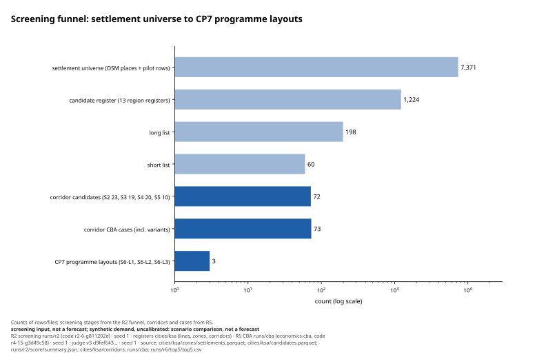
> Labels: synthetic demand, uncalibrated: scenario comparison, not a forecast. alignments are indicative least-cost sketches on 30 m terrain whose mean lateral offset from real lines was 3–10 km on three reference lines; lengths within ±5 %; costs and running times inherit that uncertainty.
*Figure 2.* Log-scale bars of the count at each stage: settlement universe, candidate register, long list, short list, corridor candidates by family, corridor CBA cases and the three CP7 layouts.
Source: cities/ksa/zones/settlements.parquet; cities/ksa/candidates.parquet; runs/r2/score/summary.json; cities/ksa/corridors; runs/cba; runs/r6/top5/top5.csv. Provenance: R2 screening runs/r2 (code r2-6-g811202e) · seed 1 · registers cities/ksa (lines, zones, corridors) · R5 CBA runs/cba (economics.cba, code r4-15-g3d49c58) · seed 1 · judge v3 d9fef643… · seed 1.
<!-- /gen:fig-fig02-screening-funnel -->

<!-- gen:fig-fig03-coverage-by-region -->
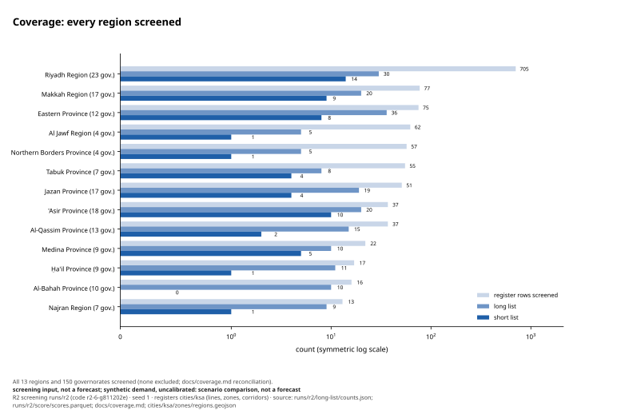
> Labels: synthetic demand, uncalibrated: scenario comparison, not a forecast. alignments are indicative least-cost sketches on 30 m terrain whose mean lateral offset from real lines was 3–10 km on three reference lines; lengths within ±5 %; costs and running times inherit that uncertainty.
*Figure 3.* For each of the 13 regions: register rows screened, long list and short list (symmetric log scale), with the number of governorates in the label.
Source: runs/r2/long-list/counts.json; runs/r2/score/scores.parquet; docs/coverage.md; cities/ksa/zones/regions.geojson. Provenance: R2 screening runs/r2 (code r2-6-g811202e) · seed 1 · registers cities/ksa (lines, zones, corridors).
<!-- /gen:fig-fig03-coverage-by-region -->

## 3.3 Demand and mode choice (W8)

- **Zones:** 423 zones, governorate zones plus hexagons inside the metro governorates (runs/zones/; `docs/demand.md` §3).
- **Trip distribution:** a doubly constrained gravity model by purpose (commute, business, leisure and visiting friends and relatives, pilgrimage, tourism), `docs/demand.md` §6.
- **Mode choice:** a multinomial logit across car, rail, air and bus with literature coefficients (`docs/mode-choice.md`), the summer first/last-mile factor (A-access-011) and car peak factor (A-access-012). Coefficients are "literature-based until survey results exist".
- **Calibration:** three 2025 totals only: SAR East plus North rail passengers, domestic air departures and intercity bus, each fitted to 0.0 % deviation by the alternative-specific constants (runs/r5/demand/calibration-r5-s1/calibration.json). International visitors carry a fixed fitted rail share and no user benefits (A-intl-003, A-cba-310).

**Standard and departure.** DfT TAG expects a calibrated and validated demand model; this one is calibrated on three totals and is not validated against any observed origin–destination matrix. That is why every result carries the synthetic-demand label and why the reference-class ridership ratio (median 0.69 of forecast in the draws, runs/cba/CBA-S3-branch_spur-al-kharj/switching_values.json; class A-rcf-029[^S-cost-rcf-013]) is drawn in every Monte Carlo draw. The stated-preference survey that would replace the literature coefficients is designed (`docs/survey/`) and has not been fielded.

## 3.4 Network, running times and alignments (W1, W8)

- **Running times** come from a kinematic model (acceleration, cruise, braking, dwell per stop) with a timetable factor fitted leave-one-out on published Haramain and SAR East times (A-r4-rt-011; Haramain 2018 timetable[^S-cp2-503], current Makkah–Madinah time[^S-r4-rt-003]); every intermediate stop has an explicit minute cost (`docs/network-evaluation.md` §1).
- **Alignments** are least-cost paths on the 30 m terrain under the frozen weights v1 (`cities/ksa/assumptions/align_weights.yaml`, hash `2b718ecb…`; A-align-080 for the route factor). On three operating reference lines the routed paths drifted 3–10 km on average from the real lines, while lengths stayed within ±5 % (`docs/alignments.md` §4). Station additions on existing or committed track are not routed.
- **Commute sheds** at 30 / 45 / 60 minutes and the 30-minute test use the R4 rail graph and OSRM road skims (runs/access/commute-test-s1/; summer factor A-access-011).

**Departure.** The alignments are not engineering designs; the alternative weights v2 are a sensitivity only (§6.4).

## 3.5 Costs (W3)

- **Register:** 207 items with low / central / high values, unit, currency, price year, source and status, normalised to 2025 SAR through one documented price and exchange-rate index (A-cost-001, A-cost-002; `cities/ksa/costs/cost_register.yaml`, `docs/costs.md`).
- **Bottom-up capex** per km by line type and terrain class (flat desert, dunes, sabkha, escarpment), with tunnels and viaducts from the routed alignment, stations by class, systems, rolling stock, land, design and contingency; reconciled against Saudi and international top-down data points (`docs/costs.md` §4–§5).
- **Opex and renewals** over the appraisal period, including an assumed sand-maintenance uplift on dune km (A-cost-302) and assumed renewal shares (A-cost-016); Saudisation share as a parameter (A-cost-300).
- **Reference-class forecasting** (UK Green Book supplementary guidance on optimism bias[^S-cost-rcf-001] and DfT TAG A1.2[^S-cost-rcf-005]): capex is uplifted with the Oxford Global Projects 2020 rail class at strategic stage, P50 1.19, P80 2.21, P90 3.69 (A-rcf-001, A-rcf-031[^S-cost-rcf-008]); schedule with the matching class; the Saudi schedule record (Haramain, Riyadh Metro) sits at or beyond P80–P90 of the global curve, so schedules are reported at P80 and P90 as well (A-rcf-039).

**Departure.** No published cost exists for desert sand mitigation on railways, so that uplift is an assumption with a wide range; terrain-specific benchmark costs were not found (`docs/benchmarks/synthesis.md` §1).

## 3.6 Cost–benefit analysis (W4)

- **Named standard:** HM Treasury Green Book 2026[^S-cp1-088] and DfT TAG (A1.1[^S-cp1-062], A1.3[^S-r5-cba-029], A2.4[^S-r5-cba-011]), with the EC Guide 2014[^S-cp1-067] and World Bank discounting guidance[^S-cp1-069] as cross-checks. No published Saudi appraisal method was found[^S-r5-cba-028].
- **Rates and horizons:** Green Book 2026 declining social rate 3.00 / 2.50 / 2.25 % (A-cba-001[^S-cp1-060]); sensitivities TAG declining, flat 5 % and 7 % (A-cba-002); 30, 40 and 60 years with residual value (A-cba-004).
- **Benefits:** user time and cost savings by the rule of a half on the logit composite cost, non-fuel vehicle operating costs, safety, carbon, air quality and inter-urban decongestion, with a generated no-double-counting matrix (`docs/cba.md` §5). Wider economic impacts are computed by TAG A2.4 but are **indicative only and excluded from every score** (CP6 P4a). Land value uplift is a capture potential, not a benefit.
- **Uncertainty:** 10,000 Monte Carlo draws per case (seed 1) over capex and schedule (the reference-class draws), opex, ridership ratio, value of time, carbon, crash and congestion values and the discount rate (A-cba-302); tornado charts and switching values (`docs/cba.md` §6).

**Departures** (full table in `docs/cba.md` §3): the value of time is transferred from UK TAG values by income (A-cba-010, A-cba-101…106) because no Saudi value-of-time study exists, and the appraisal and behavioural values differ by about 1.9–2.0× (stated, not resolved); reliability is not monetised in the central case (A-cba-109); freight is zero (A-cba-309); the marginal cost of public funds is 1 (A-cba-123); Jeddah decongestion is zero because no candidate is representable in TrafficTwin (a lower bound); every case starts construction in 2027 and is discounted to 2026 (A-cba-301).

## 3.7 Optimisation and phasing (W9)

- **The judge:** a frozen, read-only copy of the demand model and appraisal (judge v3 `v3-variants`, SHA-256 `d9fef643…`, back-tested to reproduce its predecessor on every figure; `docs/r6/judge-hashes.md`, `docs/r6/judge-v3-backtest.md`).
- **Score:** robust NPV, the worst population case of P50 benefits minus P50 costs, 60 years, Green Book 2026, without wider impacts (A-r6-001); reach as the 2025 population within 120 door-to-door minutes of the five metros (A-r6-007), with national reach as a reported column only (A-r6-104).
- **Search:** an exact MILP (HiGHS) on the fast mode, an NSGA-II over robust NPV, capex and reach (A-r6-013), and an agent loop that edits one layout at a time; every kept or front layout is re-scored by the full judge (A-r6-006, A-r6-107). Budget levels B1 / B2 / B3 = SAR 100 / 250 / 500 bn capex P50 (A-r6-003); each phase must be deliverable alone (A-r6-005); each corridor has a phase year of 2030, 2035, 2040 or 2050, with construction starting three years earlier (A-r6-002).
- **Variants:** line type, electrification and dropped intermediate stations on every searchable line corridor; single track is not searched because the frozen model has no track term (A-r6-102).

**Departure.** Phasing is a construction-start choice, not a real-options model with observed-demand triggers; §7 turns the result into stage-gates by hand, with the conditions stated. The v3 genetic search stopped on its restart cap with the reach end still moving (A-r6-106); the robust-NPV maximum is proven by the MILP.

## 3.8 Delivery models and fiscal exposure (W6)

- **Options** (`docs/funding.md`): fully public, public with private O&M, DBFOM availability PPP, DBFOM demand-risk PPP, a hybrid with station-area land value capture, and station-area value capture alone; each with a risk-allocation matrix (`cities/ksa/funding/risk_matrix_*.yaml`).
- **Metrics:** upfront public capex, net fiscal cost over 30 / 40 / 60 years, peak share of total state expenditure (MoF budget line[^S-fund-026], grown by A-fund-005), contingent liabilities and a termination memorandum item (A-fund-102, A-fund-104, A-fund-006), timing profile (A-fund-106).
- **Value for money:** public sector comparator against an availability PPP following Green Book logic[^S-fund-024] (no NCP method was found[^S-fund-056]); private finance at the sovereign real rate (A-fund-101) plus a premium (A-fund-008[^S-fund-r7-001]); PSP Law term of 30 years (A-fund-010[^S-fund-002]).
- **Approximations:** the judge stores P10 / P50 / P90 summaries, not the draws, so the capex tail is a lognormal through P50 and P90 (A-fund-108), PV components known at P50 are scaled with the capex quantile (A-fund-107) and annual flows are level equivalents (A-fund-109). The P10 / P50 / P90 of the engine series are the sorted values of the three runs at capex P10, P50 and P90 (A-fund-107), a cost range rather than quantiles of a simulated distribution.

**Departure.** No Saudi PPP has a published payment schedule, cost of capital, minimum revenue guarantee or termination record for rail; those parameters are registered assumptions with ranges and the value-for-money test reports their switching values (`docs/fiscal-exposure.md`).

<!-- section: 04-results.md -->
# 4. Results

> Labels: synthetic demand, uncalibrated: scenario comparison, not a forecast. alignments are indicative least-cost sketches on 30 m terrain whose mean lateral offset from real lines was 3–10 km on three reference lines; lengths within ±5 %; costs and running times inherit that uncertainty.

Everything in this section is "in the model": a scenario comparison on synthetic, uncalibrated demand, each case against its matched baseline on the same zones, seed and parameters (rule 6). Money is SAR million at 2025 prices, PV 2026; every cost and benefit is a P10 / P50 / P90 range. R6/R7 figures come from judge v3 (`v3-variants`, SHA-256 `d9fef643…`), seed 1, 10,000 draws, alignment weights v1 (runs/r6/v3/library/library.json). The tables between `gen` markers are regenerated from the run files by `uv run python -m common.report build`.

<!-- gen:fig-fig01-national-map -->
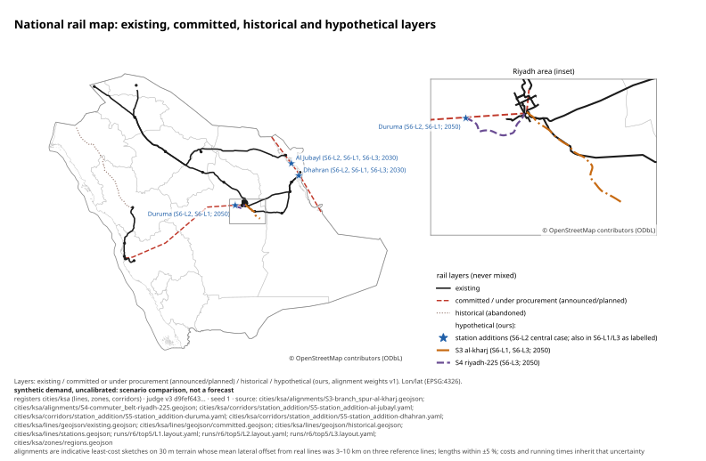
> Labels: synthetic demand, uncalibrated: scenario comparison, not a forecast. alignments are indicative least-cost sketches on 30 m terrain whose mean lateral offset from real lines was 3–10 km on three reference lines; lengths within ±5 %; costs and running times inherit that uncertainty.
*Figure 1.* Map of the existing, committed/under-procurement (announced/planned) and historical lines with the hypothetical CP7 additions: the station additions of S6-L2 (also in S6-L1/S6-L3 as labelled), the Al-Kharj spur (S6-L1, S6-L3) and the Riyadh belt 225 (S6-L3) on the frozen v1 alignments, with a Riyadh inset.
Source: cities/ksa/alignments/S3-branch_spur-al-kharj.geojson; cities/ksa/alignments/S4-commuter_belt-riyadh-225.geojson; cities/ksa/corridors/station_addition/S5-station_addition-al-jubayl.yaml; cities/ksa/corridors/station_addition/S5-station_addition-duruma.yaml; cities/ksa/corridors/station_addition/S5-station_addition-dhahran.yaml; cities/ksa/lines/geojson/existing.geojson; cities/ksa/lines/geojson/committed.geojson; cities/ksa/lines/geojson/historical.geojson; cities/ksa/lines/stations.geojson; runs/r6/top5/L1.layout.yaml; runs/r6/top5/L2.layout.yaml; runs/r6/top5/L3.layout.yaml; cities/ksa/zones/regions.geojson. Provenance: registers cities/ksa (lines, zones, corridors) · judge v3 d9fef643… · seed 1. S6-L1: NPV at P90 cost −2,958 / −724 / +1,631 SAR m (low / medium / high), runs/r6/top5/top5.csv.
<!-- /gen:fig-fig01-national-map -->

## 4.1 The committed programme (S1 against S0)

S1 is the baseline for every other result, so its own appraisal matters for reading them. In the model, S1 against S0 has a P50 BCR well below 1 in every population case; its P90 BCR crosses 1 only in the medium and high cases (runs/cba/CBA-S1-committed-programme). S1 is committed, so this study does not re-decide it; the result says that the committed lines depend on benefits the model does not count (freight, which is zero here, A-cba-309; international visitors' capacity value, A-cba-310) or on demand above the synthetic base.

<!-- gen:s1 -->
> Labels: synthetic demand, uncalibrated: scenario comparison, not a forecast. alignments are indicative least-cost sketches on 30 m terrain whose mean lateral offset from real lines was 3–10 km on three reference lines; lengths within ±5 %; costs and running times inherit that uncertainty.
| population case | NPV in the model, P10 / P50 / P90 (SAR m) | BCR P10 / P50 / P90 (without WEIs) | fiscal cost to the state P10 / P50 / P90 (SAR m, fully public) |
|---|---|---|---|
| UN WPP low | −343,360 / −63,491 / 4,922 | 0.06 / 0.28 / 1.10 | 46,359 / 99,309 / 413,986 |
| UN WPP medium | −337,555 / −60,103 / 11,607 | 0.07 / 0.31 / 1.26 | 45,021 / 98,408 / 412,441 |
| UN WPP high | −333,398 / −56,608 / 18,534 | 0.07 / 0.34 / 1.42 | 43,770 / 97,461 / 410,092 |
Run: runs/cba/CBA-S1-committed-programme (R5 CBA, seed 1, 10,000 draws; S1 against S0; 60 years, Green Book 2026 declining rate A-cba-001; SAR m, 2025 prices, PV 2026).
<!-- /gen:s1 -->

## 4.2 Corridor families (each corridor alone, against S1)

Each of the 71 searchable corridors was scored alone at every phase (2030, 2035, 2040, 2050; construction starts three years earlier, A-r6-002). In the model, only four have a positive robust NPV at their best phase: the Al Jubayl, Dhahran and Duruma station additions and the Al-Kharj spur. Every trunk gap, every commuter belt and every other spur loses money in every population case at every phase; for each loss-maker, deferral to 2050 reduces the loss through the lower present value of capex (runs/r6/v3/library/; `docs/r6-topology.md` §0). No variant (line type, electrification, a dropped stop) turns a negative corridor positive (runs/r6/v3/library/variants-stage1.json).

<!-- gen:families -->
> Labels: synthetic demand, uncalibrated: scenario comparison, not a forecast. alignments are indicative least-cost sketches on 30 m terrain whose mean lateral offset from real lines was 3–10 km on three reference lines; lengths within ±5 %; costs and running times inherit that uncertainty.
| family | corridors (searchable) | robust NPV at 2030, lowest to highest (SAR m) | capex P50 at 2030, lowest to highest (SAR m) | BCR P50 at 2030 (medium), lowest to highest | positive robust NPV at the best phase (SAR m, phase) | whole family at 2030: robust NPV on capex P50 (SAR m) | R5 CBA P50 BCR range (cases ≥ 1), medium, 60 y |
|---|---|---|---|---|---|---|---|
| S2 trunk gaps | 23 | −123,523 to −24,683 | 15,857 to 113,439 | −0.01 to 0.31 | 0 | −957,580 on capex P50 761,974 | −0.01 to 0.24 (0 of 23) |
| S3 branches and spurs | 19 | −35,179 to 2,254 | 4,632 to 26,648 | −0.01 to 1.15 | 1: `S3-branch_spur-al-kharj` 4,309 at 2050 | −308,853 on capex P50 248,441 | −0.01 to 0.99 (0 of 19) |
| S4 commuter belts | 20 | −38,309 to −6,791 | 4,900 to 33,064 | 0.00 to 0.45 | 0 | −405,554 on capex P50 203,343 | −0.01 to 0.38 (0 of 20) |
| S5 station additions | 9 | −4,076 to 4,982 | 474 to 2,950 | −0.50 to 33.21 | 3: `S5-station_addition-al-jubayl` 4,982 at 2030, `S5-station_addition-dhahran` 2,362 at 2030, `S5-station_addition-duruma` 481 at 2050 | −1,174 on capex P50 6,745 | −0.58 to 45.12 (5 of 11) |
Runs: runs/r6/v3/library/<id>/score.json (standalone, every phase; Judge v3 (`v3-variants`, SHA-256 `d9fef643…`, docs/r6/judge-hashes.md), seed 1, 10,000 draws, frozen alignment weights v1); whole families runs/r6/compare/S2…S5/score.json; R5 CBA runs/cba/summary.parquet (seed 1, 10,000 draws, before the CP6 zone split). The two retired Jubail variants (CP6 P6a) are left out of the counts.
<!-- /gen:families -->

The largest variant gain is on the Riyadh–Jeddah trunk gap: in the model, building it as a conventional line instead of high speed improves its robust NPV by 19,758 but leaves it at −47,603 (runs/r6/v3/library/variants-stage1.json; `docs/r6-topology.md` §0.2).

<!-- gen:fig-fig04-bcr-bands-by-family -->
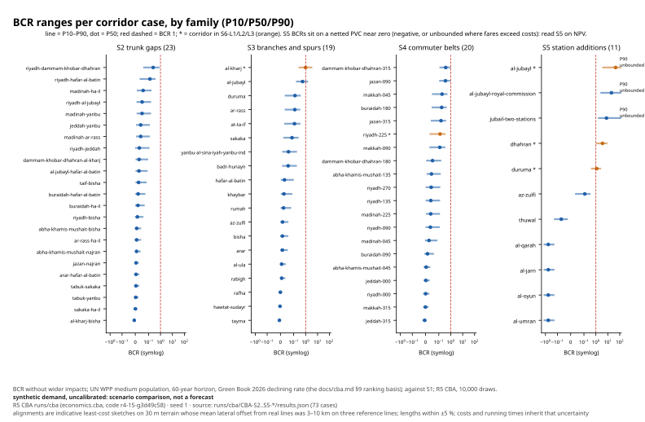
> Labels: synthetic demand, uncalibrated: scenario comparison, not a forecast. alignments are indicative least-cost sketches on 30 m terrain whose mean lateral offset from real lines was 3–10 km on three reference lines; lengths within ±5 %; costs and running times inherit that uncertainty.
*Figure 4.* P10–P90 line and P50 dot of the BCR without wider impacts for every R5 corridor CBA case against S1, in four family panels (S2–S5); UN WPP medium, 60 years, Green Book 2026; corridors of the CP7 layouts in orange.
Source: runs/cba/CBA-S2..S5-*/results.json (73 cases). Provenance: R5 CBA runs/cba (economics.cba, code r4-15-g3d49c58) · seed 1.
<!-- /gen:fig-fig04-bcr-bands-by-family -->

<!-- gen:fig-fig15-capex-ranges -->
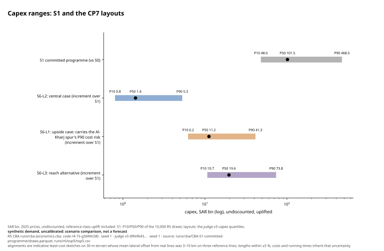
> Labels: synthetic demand, uncalibrated: scenario comparison, not a forecast. alignments are indicative least-cost sketches on 30 m terrain whose mean lateral offset from real lines was 3–10 km on three reference lines; lengths within ±5 %; costs and running times inherit that uncertainty.
*Figure 15.* Undiscounted uplifted capex P10/P50/P90 (log scale) of S1 (the 10,000 R5 draws) and of the increments over S1 of S6-L2, S6-L1 and S6-L3 (judge v3 quantiles).
Source: runs/cba/CBA-S1-committed-programme/draws.parquet; runs/r6/top5/top5.csv. Provenance: R5 CBA runs/cba (economics.cba, code r4-15-g3d49c58) · seed 1 · judge v3 d9fef643… · seed 1. S6-L1: NPV at P90 cost −2,958 / −724 / +1,631 SAR m (low / medium / high), runs/r6/top5/top5.csv.
<!-- /gen:fig-fig15-capex-ranges -->

## 4.3 The five CP7 corridors, standalone at their CP7 phase

<!-- gen:cp7-corridors -->
> Labels: synthetic demand, uncalibrated: scenario comparison, not a forecast. alignments are indicative least-cost sketches on 30 m terrain whose mean lateral offset from real lines was 3–10 km on three reference lines; lengths within ±5 %; costs and running times inherit that uncertainty.
| corridor (standalone, at its CP7 phase) | capex P10 / P50 / P90 (SAR m) | robust NPV (SAR m) | NPV at P90 cost, low / medium / high (SAR m) | BCR P10, low / medium / high | run |
|---|---|---|---|---|---|
| Al Jubayl station (GCC Railway) (`S5-station_addition-al-jubayl`) | 267 / 474 / 1,762 | 4,982 | 4,007 / 4,538 / 5,082 | 2.76 / 3.08 / 3.43 | `runs/r6/v3/library/S5-station_addition-al-jubayl/score.json` |
| Dhahran station (SAR East line) (`S5-station_addition-dhahran`) | 267 / 474 / 1,762 | 2,362 | 1,262 / 1,533 / 1,818 | 1.23 / 1.34 / 1.46 | `runs/r6/v3/library/S5-station_addition-dhahran/score.json` |
| Duruma station (Landbridge) (`S5-station_addition-duruma`) | 267 / 474 / 1,762 | 481 | −121 / −30 / 61 | 0.63 / 0.70 / 0.76 | `runs/r7/corridors/S5-station_addition-duruma@2050/score.json` |
| Al-Kharj spur (`S3-branch_spur-al-kharj`) | 5,433 / 9,771 / 36,018 | 4,309 | −6,870 / −5,419 / −3,866 | 0.37 / 0.42 / 0.47 | `runs/r7/corridors/S3-branch_spur-al-kharj@2050/score.json` |
| Riyadh commuter belt 225 (Al Muzahimiyah, Duruma) (`S4-commuter_belt-riyadh-225`) | 4,717 / 8,910 / 34,256 | −8,293 | −18,991 / −18,663 / −18,329 | 0.06 / 0.06 / 0.07 | `runs/r7/corridors/S4-commuter_belt-riyadh-225@2050/score.json` |
Run: runs/r7/fiscal/fiscal.json, corridor `basis` (Judge v3 (`v3-variants`, SHA-256 `d9fef643…`, docs/r6/judge-hashes.md), seed 1, 10,000 draws, frozen alignment weights v1). Standalone corridors do not add up to a layout: corridors compete for the same trips.
<!-- /gen:cp7-corridors -->

Reading the table: the two 2030 station additions are positive even at P90 cost; Duruma is close to zero at P90 cost; the Al-Kharj spur is positive at P50 cost but negative at P90 cost in every population case when scored alone; the Riyadh commuter belt 225 is negative at P50 cost (runs/r7/fiscal/fiscal.json).

## 4.4 Programmes against S1: central, upside and reach

<!-- gen:programmes -->
> Labels: synthetic demand, uncalibrated: scenario comparison, not a forecast. alignments are indicative least-cost sketches on 30 m terrain whose mean lateral offset from real lines was 3–10 km on three reference lines; lengths within ±5 %; costs and running times inherit that uncertainty.
| (each against S1; SAR m, 2025 prices, PV 2026, 60 years, Green Book 2026) | S6-L2 | S6-L1 | S6-L3 |
|---|---|---|---|
| role | central case | upside case (carries the Al-Kharj spur's P90 cost risk) | reach alternative |
| corridors (phase year; construction starts 3 years earlier, A-r6-002) | Al Jubayl station, Dhahran station (phase 2030); Duruma station (phase 2050) | Al Jubayl station, Dhahran station (phase 2030); Al-Kharj spur, Duruma station (phase 2050) | Al Jubayl station, Dhahran station (phase 2030); Al-Kharj spur, Riyadh commuter belt 225 (phase 2050) |
| robust NPV (worst population case, P50 PVB − P50 PVC) | 6,792 | 11,023 | 2,427 |
| NPV at P50 cost, low / medium / high | 6,792 / 7,572 / 8,384 | 11,023 / 13,255 / 15,556 | 2,427 / 4,890 / 7,428 |
| NPV at P90 cost, low / medium / high (held-out test) | 3,986 / 4,771 / 5,589 | −2,958 / −724 / 1,631 | −21,745 / −19,225 / −16,624 |
| NPV P10 / P50 / P90 of the draws (medium) | 1,051 / 7,053 / 18,604 | −5,243 / 11,301 / 40,819 | −20,113 / 2,215 / 34,873 |
| BCR P10 / P50 / P90 (medium, without WEIs) | 1.52 / 5.96 / 22.23 | 0.60 / 2.33 / 9.33 | 0.32 / 1.12 / 3.48 |
| capex P10 / P50 / P90 (uplifted, undiscounted) | 801 / 1,423 / 5,286 | 6,233 / 11,194 / 41,304 | 10,684 / 19,630 / 73,799 |
| added rail trips 2050, medium (vs S1) | 1.78 M | 4.29 M | 4.85 M |
| new route-km | 0 | 139 | 218 |
| reach gain within 120 door-to-door min of the five metros (2025 population) | 3.56 M | 3.56 M | 4.25 M |
| Green Book 2026 at 30 / 40 years; flat 5 % / 7 % (NPV at P50 cost, medium) | 4,035 / 5,307; 3,225 / 1,535 | 6,227 / 8,020; 3,503 / 946 | −46 / 367; −716 / −1,433 |
Run: runs/r6/top5/top5.csv and runs/r6/top5/L1|L2|L3/score.json (Judge v3 (`v3-variants`, SHA-256 `d9fef643…`, docs/r6/judge-hashes.md), seed 1, 10,000 draws, frozen alignment weights v1). NPV at P90 cost −2,958 / −724 / +1,631 SAR m (low / medium / high), runs/r6/top5/top5.csv for S6-L1.
<!-- /gen:programmes -->

- **S6-L2, the central case.** In the model it stays positive at P90 cost in every population case and its NPV P10 of the draws is positive (1,051, medium); its capex is about one-eighth of S6-L1's at P50 (1,423 against 11,194). It gives up the Al-Kharj spur's added trips (runs/r6/top5/top5.csv).
- **S6-L1, the upside case.** It has the highest robust NPV found by every engine (runs/r6/v3/milp/; runs/r6/v3/ga/), and the difference between S6-L1 and the same layout without the spur (S6-L2) is SAR 4,231 m of robust NPV (11,023 against 6,792); the spur also adds about SAR 36 bn to capex P90 against about SAR 9.8 bn at P50. It carries that risk: NPV at P90 cost −2,958 / −724 / +1,631 SAR m (low / medium / high), runs/r6/top5/top5.csv. A non-electrified spur narrows the P90 loss (low case −2,958 → −2,008) but lowers the robust NPV to 10,648, so it was not adopted (runs/r6/v3/cp7/cp7.csv; A-r6-105).
- **S6-L3, the reach alternative.** In the model it adds 0.68 M people within 120 door-to-door minutes of the five metros relative to S6-L1 and S6-L2 (4.25 M against 3.56 M), for a robust NPV 8,596 below S6-L1's; it is negative at P90 cost in every case and at 30 years or flat 5 % / 7 % (runs/r6/top5/top5.csv). None of the seven variant edits tried on it improved it (runs/r6/v3/cp7/cp7.csv).
- **Wider economic impacts** (TAG A2.4, indicative only, not in any score): PV P50 114,628 (S6-L2), 142,741 (S6-L1), 267,682 (S6-L3), medium case (runs/r6/top5/top5.csv). They are far larger than the user benefits for reasons the CBA note explains (`docs/cba.md` §7); they are not used for any decision here.

<!-- gen:fig-fig06-l1-p90-cost-risk -->
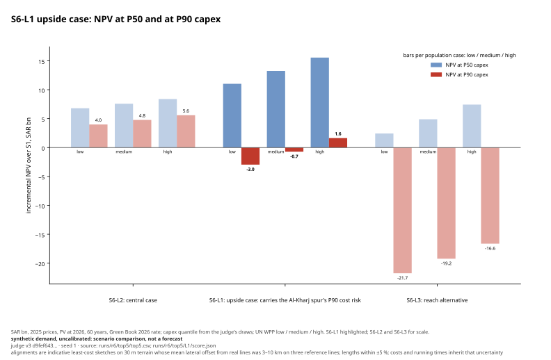
> Labels: synthetic demand, uncalibrated: scenario comparison, not a forecast. alignments are indicative least-cost sketches on 30 m terrain whose mean lateral offset from real lines was 3–10 km on three reference lines; lengths within ±5 %; costs and running times inherit that uncertainty.
*Figure 6.* Incremental NPV over S1 at P50 and at P90 capex for the low, medium and high population cases: S6-L1 highlighted (the Al-Kharj spur's P90 cost risk), S6-L2 and S6-L3 faint for scale.
Source: runs/r6/top5/top5.csv; runs/r6/top5/L1/score.json. Provenance: judge v3 d9fef643… · seed 1. S6-L1: NPV at P90 cost −2,958 / −724 / +1,631 SAR m (low / medium / high), runs/r6/top5/top5.csv.
<!-- /gen:fig-fig06-l1-p90-cost-risk -->

<!-- gen:fig-fig12-isochrones -->
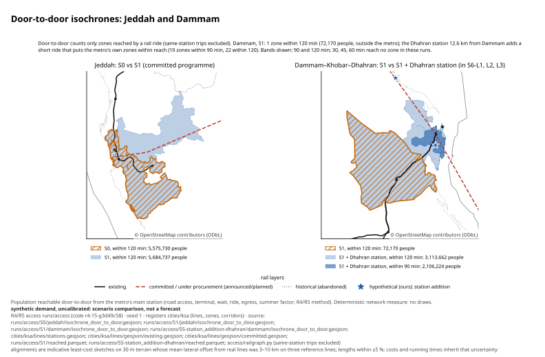
> Labels: synthetic demand, uncalibrated: scenario comparison, not a forecast. alignments are indicative least-cost sketches on 30 m terrain whose mean lateral offset from real lines was 3–10 km on three reference lines; lengths within ±5 %; costs and running times inherit that uncertainty.
*Figure 12.* Door-to-door isochrones from each metro's boarding stations: Jeddah S0 (hatched) against S1 (filled); Dammam–Khobar–Dhahran S1 (hatched) against S1 plus the Dhahran station addition of all three CP7 layouts (filled); the bands drawn are the ones that reach at least one zone (listed on the figure).
Source: runs/access/S0/jeddah/isochrone_door_to_door.geojson; runs/access/S1/jeddah/isochrone_door_to_door.geojson; runs/access/S1/dammam/isochrone_door_to_door.geojson; runs/access/S5-station_addition-dhahran/dammam/isochrone_door_to_door.geojson; cities/ksa/lines/stations.geojson; cities/ksa/lines/geojson/existing.geojson; cities/ksa/lines/geojson/committed.geojson; runs/access/S1/reached.parquet; runs/access/S5-station_addition-dhahran/reached.parquet; access/railgraph.py (same-station trips excluded). Provenance: R4/R5 access runs/access (code r4-15-g3d49c58) · seed 1 · registers cities/ksa (lines, zones, corridors).
<!-- /gen:fig-fig12-isochrones -->

## 4.5 Fiscal exposure and delivery models

<!-- gen:fiscal -->
> Labels: synthetic demand, uncalibrated: scenario comparison, not a forecast. alignments are indicative least-cost sketches on 30 m terrain whose mean lateral offset from real lines was 3–10 km on three reference lines; lengths within ±5 %; costs and running times inherit that uncertainty.
| programme | delivery model | net fiscal cost PV 60 y P10 / P50 / P90 (expected), SAR m | peak share of state expenditure at P50 / P90 capex (year) | contingent liabilities PV expected / P90, SAR m |
|---|---|---|---|---|
| S6-L2 | `fully_public_sar` | 695 / 1,283 / 4,088 (2,171) | 0.024 % / 0.091 % (2027) | 0 / 0 |
| S6-L2 | `ppp_dbfom_availability` | 2,166 / 2,166 / 4,866 (3,065) | 0.007 % / 0.007 % (2050) | 899 / 2,700 |
| S6-L1 | `fully_public_sar` | 4,676 / 8,441 / 23,615 (13,177) | 0.179 % / 0.662 % (2047) | 0 / 0 |
| S6-L1 | `ppp_dbfom_availability` | 13,443 / 13,443 / 28,054 (18,301) | 0.057 % / 0.057 % (2050) | 4,859 / 14,611 |
| S6-L1 | `ppp_dbfom_demand_risk` | 8,409 / 8,409 / 23,592 (13,450) | 0.230 % / 0.230 % (2047) | 5,041 / 15,182 |
| S6-L3 | `fully_public_sar` | 12,696 / 18,962 / 45,343 (27,275) | 0.327 % / 1.230 % (2047) | 0 / 0 |
| S6-L3 | `ppp_dbfom_availability` | 27,495 / 27,495 / 53,113 (36,054) | 0.114 % / 0.114 % (2050) | 8,559 / 25,617 |
| S6-L3 | `ppp_dbfom_demand_risk` | 17,723 / 17,723 / 44,007 (26,495) | 0.479 % / 0.479 % (2047) | 8,771 / 26,283 |
Run: runs/r7/fiscal/fiscal.json, population case un_wpp_low (robust), Judge v3 (`v3-variants`, SHA-256 `d9fef643…`, docs/r6/judge-hashes.md), seed 1, 10,000 draws, frozen alignment weights v1. Availability-PPP figures have P10 = P50 by construction (fixed price; capex enters only through the overrun above the private cushion); expected values rest on the lognormal tail A-fund-108. S6-L1, the upside case: NPV at P90 cost −2,958 / −724 / +1,631 SAR m (low / medium / high), runs/r6/top5/top5.csv.

S1 baseline (fully public, 60 y, un_wpp_low): fiscal cost P10 / P50 / P90 46,359 / 99,309 / 413,986 SAR m (runs/cba/CBA-S1-committed-programme, via runs/r7/fiscal/fiscal.json `baseline_s1`); every programme figure above is incremental to S1.
<!-- /gen:fiscal -->

<!-- gen:vfm -->
> Labels: synthetic demand, uncalibrated: scenario comparison, not a forecast. alignments are indicative least-cost sketches on 30 m terrain whose mean lateral offset from real lines was 3–10 km on three reference lines; lengths within ±5 %; costs and running times inherit that uncertainty.
| entity | E[PSC] (SAR m) | E[availability PPP] (SAR m) | VfM (% of PSC); > 0 favours the PPP | sign robust to every registered range | VfM at flat 5 % / sovereign real rate (SAR m) |
|---|---|---|---|---|---|
| `S6-L2` | 2,171 | 3,065 | −894 (−41.2 %) | yes | −366 / −705 |
| `S6-L1` | 13,177 | 18,301 | −5,124 (−38.9 %) | yes | −1,563 / −3,596 |
| `S6-L3` | 27,275 | 36,054 | −8,779 (−32.2 %) | yes | −2,591 / −6,091 |
| `S3-branch_spur-al-kharj` | 10,986 | 15,216 | −4,230 (−38.5 %) | yes | −1,197 / −2,890 |
| `S4-commuter_belt-riyadh-225` | 14,747 | 18,607 | −3,860 (−26.2 %) | yes | −1,086 / −2,635 |
| `S5-station_addition-al-jubayl` | 476 | 821 | −344 (−72.2 %) | yes | −154 / −282 |
| `S5-station_addition-dhahran` | 991 | 1,335 | −344 (−34.7 %) | yes | −154 / −282 |
| `S5-station_addition-duruma` | 653 | 859 | −205 (−31.4 %) | yes | −58 / −140 |
Run: runs/r7/vfm/vfm.json (60 years, robust case; Judge v3 (`v3-variants`, SHA-256 `d9fef643…`, docs/r6/judge-hashes.md), seed 1, 10,000 draws, frozen alignment weights v1); parameters A-fund-002, A-fund-007, A-fund-008, A-fund-102, A-fund-103. The private-finance premium is sourced from a UK reference class and is unclear for Saudi Arabia[^S-fund-r7-001]. S6-L1, the upside case: NPV at P90 cost −2,958 / −724 / +1,631 SAR m (low / medium / high), runs/r6/top5/top5.csv.
<!-- /gen:vfm -->

What drives the result in the model: fares cover a small share of operating costs, so every option leaves the state paying; private finance at a premium costs about what the transferred construction risk is worth; and the transfer stops at the private equity cushion while the capex tail (P90 about 3.7 × P50) goes far beyond it, so the state keeps the tail under every model (runs/r7/fiscal/fiscal.json; A-fund-102). On that evidence the R7 analysis names fully public delivery as the best fit for every CP7 corridor and programme (analyst's judgement, `docs/delivery-models.md`), with the alternatives set out beside it. The arguments for a PPP are in §6.3; the conditions under which the sign would change are the switching values in `docs/fiscal-exposure.md` (for example, a fixed-price bid about 80 % below the un-uplifted base estimate, A-fund-007).

<!-- gen:fig-fig10-fiscal-exposure -->
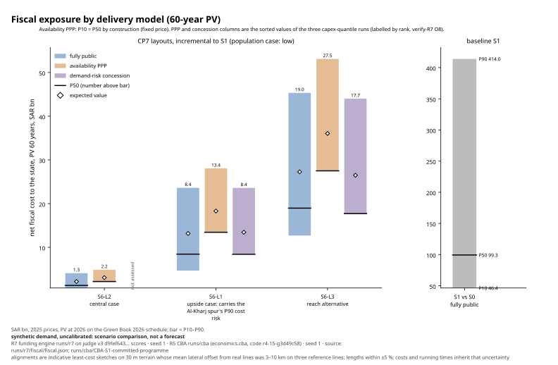
> Labels: synthetic demand, uncalibrated: scenario comparison, not a forecast. alignments are indicative least-cost sketches on 30 m terrain whose mean lateral offset from real lines was 3–10 km on three reference lines; lengths within ±5 %; costs and running times inherit that uncertainty.
*Figure 10.* Net fiscal cost to the state (PV 60 years, low population) of each CP7 layout under fully public delivery, availability PPP and demand-risk concession: P10–P90 bar, P50 line and expected value; S1 baseline (fully public, against S0) beside.
Source: runs/r7/fiscal/fiscal.json; runs/cba/CBA-S1-committed-programme. Provenance: R7 funding engine runs/r7 on judge v3 d9fef643… scores · seed 1 · R5 CBA runs/cba (economics.cba, code r4-15-g3d49c58) · seed 1.
<!-- /gen:fig-fig10-fiscal-exposure -->

<!-- gen:fig-fig11-vfm -->
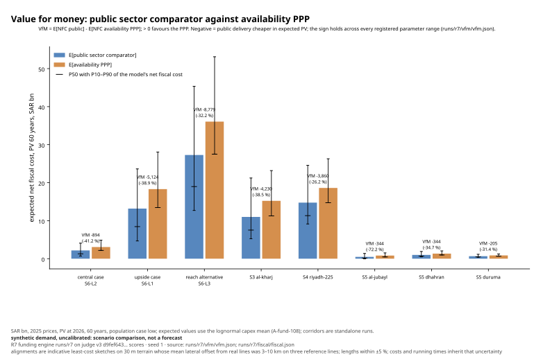
> Labels: synthetic demand, uncalibrated: scenario comparison, not a forecast. alignments are indicative least-cost sketches on 30 m terrain whose mean lateral offset from real lines was 3–10 km on three reference lines; lengths within ±5 %; costs and running times inherit that uncertainty.
*Figure 11.* Expected net fiscal cost (PV 60 years, low population) of the public sector comparator and of an availability PPP for the three CP7 layouts and their five corridors, with P10/P50/P90 whiskers and the VfM difference (% of PSC).
Source: runs/r7/vfm/vfm.json; runs/r7/fiscal/fiscal.json. Provenance: R7 funding engine runs/r7 on judge v3 d9fef643… scores · seed 1.
<!-- /gen:fig-fig11-vfm -->

## 4.6 Trade-offs: the Pareto front and the reach front

In the model the robust-NPV optimum is small and the budget does not bind: the exact MILP gives the same four-corridor layout (S6-L1) at B1, B2 and B3 (runs/r6/v3/milp/; A-r6-003). The trade-off runs on reach. Moving from 3.56 M people within 120 door-to-door minutes of the five metros (S6-L1, S6-L2) up the reach front costs robust NPV at every step, and the overall front ends at about 5.42 M people at SAR 214–235 bn capex, so B3 (SAR 500 bn) never binds (runs/r6/v3/ga/; runs/r6/v3/rescore/). S6-L1, the optimum, carries the Al-Kharj spur's P90 cost risk: NPV at P90 cost −2,958 / −724 / +1,631 SAR m (low / medium / high), runs/r6/top5/top5.csv.

**Trade-off illustrations only (no recommendation, no delivery model, no stage-gate).** Two layouts from the optimisation show what reach (people within 120 door-to-door minutes of the five metros) costs: S6-L4 (S6-L3 plus the Makkah belt 045) reaches 4.67 M people for a robust NPV of −7,934, and S6-L5 (the two 2030 stations plus ten commuter belts in four metros) reaches 5.30 M for −112,565 on capex P50 98,170 (runs/r6/top5/top5.csv). They appear in Figures 7 and 8 only.

<!-- gen:fig-fig07-pareto-front -->
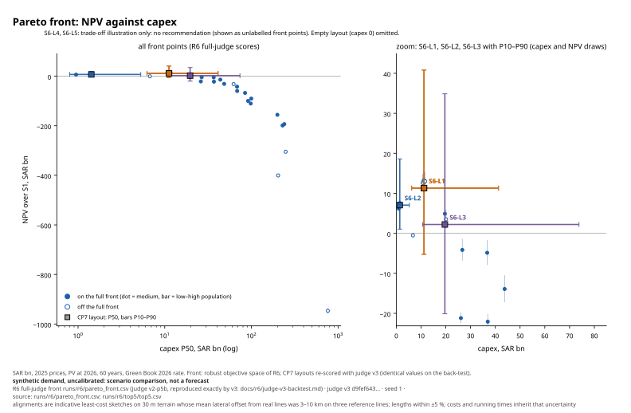
> Labels: synthetic demand, uncalibrated: scenario comparison, not a forecast. alignments are indicative least-cost sketches on 30 m terrain whose mean lateral offset from real lines was 3–10 km on three reference lines; lengths within ±5 %; costs and running times inherit that uncertainty.
*Figure 7.* R6 full-judge front points (medium-population NPV at P50 cost against capex P50, bar = low–high population) with S6-L1, S6-L2 and S6-L3 marked by P10–P90 of the NPV draws and of capex in a zoom panel; S6-L4/L5 are unlabelled front points (trade-off illustration only). S6-L6 is not on the R6 front (it was built by the connectivity search, not the NPV/reach search) and is shown in Figures 8 and 16.
Source: runs/r6/pareto_front.csv; runs/r6/top5/top5.csv. Provenance: R6 full-judge front runs/r6/pareto_front.csv (judge v2-p5b, reproduced exactly by v3: docs/r6/judge-v3-backtest.md) · judge v3 d9fef643… · seed 1. S6-L1: NPV at P90 cost −2,958 / −724 / +1,631 SAR m (low / medium / high), runs/r6/top5/top5.csv.
<!-- /gen:fig-fig07-pareto-front -->

<!-- gen:fig-fig08-reach-tradeoff -->
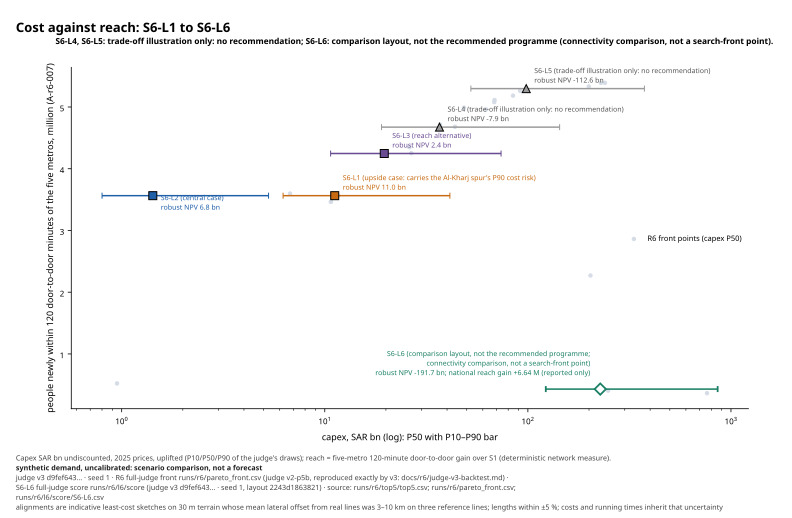
> Labels: synthetic demand, uncalibrated: scenario comparison, not a forecast. alignments are indicative least-cost sketches on 30 m terrain whose mean lateral offset from real lines was 3–10 km on three reference lines; lengths within ±5 %; costs and running times inherit that uncertainty.
*Figure 8.* Capex P50 with P10–P90 bars against the five-metro 120-minute door-to-door reach gain over S1 (A-r6-007) for S6-L1 to S6-L6, over the R6 front points. S6-L4 and S6-L5 are reach trade-off illustrations from the search only: no recommendation. S6-L6 is a connectivity comparison (the smallest-capex connecting set), not a search-front point and not a recommendation; its national reach gain is +6.64 M (reported only, A-r6-104), which the plotted five-metro measure does not show.
Source: runs/r6/top5/top5.csv; runs/r6/pareto_front.csv; runs/r6/l6/score/S6-L6.csv. Provenance: judge v3 d9fef643… · seed 1 · R6 full-judge front runs/r6/pareto_front.csv (judge v2-p5b, reproduced exactly by v3: docs/r6/judge-v3-backtest.md) · S6-L6 full-judge score runs/r6/l6/score (judge v3 d9fef643… · seed 1, layout 2243d1863821). S6-L1: NPV at P90 cost −2,958 / −724 / +1,631 SAR m (low / medium / high), runs/r6/top5/top5.csv.
<!-- /gen:fig-fig08-reach-tradeoff -->

**Comparison layout, not the recommended programme (no recommendation, no delivery model, no stage-gate).** S6-L6 is not a reach trade-off and not a search result: it was built afterwards, by the connectivity MILP, as the smallest-capex connecting set from the R6_V3 single-corridor library: 16 non-electrified options, one rail-graph component, 18 of 18 required cities on the graph (`docs/r6-l6-connected.md`; A-r6-130 to A-r6-134). Scored with the full judge v3 (hash d9fef643…, seed 1), its robust NPV is −191,660 at capex P50 227,213 (P10 / P90 122,532 / 860,035), and its medium-case BCR is 0.06 at P50 (P10 / P90 −0.08 / 0.37) (scenarios/S6-L6.yaml `score:`; runs/r6/l6/score/S6-L6.csv). In the model it adds the most rail trips of the six layouts (+9.03 M in 2050, medium; S6-L4 +6.62 M) and the most national reach (+6.64 M people within 120 minutes of a station, reported only, A-r6-104; S6-L4 +0.79 M), but the smallest five-metro 120-minute gain (0.43 M; S6-L2 3.56 M), because its long trunks and spurs sit far from the five metros and it has no Dhahran station (S6-L1 to S6-L5 from runs/r6/top5/top5.csv). Fast mode gave −200,761, so it understated the full score by 9,101 (4.0 % of capex P50). That is the opposite of R6, where fast mode overstated it; the likely reading (not decomposed) is that these corridors feed each other instead of competing for the same trips (`docs/r6-l6-connected.md` §7a). The judge still uses the access-model site overrides (A-r4-acc-004: Landbridge Jeddah with HHR Al-Sulaimaniyah, GCC Dammam with SAR Dammam) for door-to-door times; those are not rail-graph interchanges, and the access model is unchanged. Labels: synthetic demand, uncalibrated: scenario comparison, not a forecast; alignment limitation: lengths, costs, running times and ridership inherit the indicative-alignment uncertainty (`docs/alignments.md` §0, §4). S6-L6 appears in Figures 8 and 16 only; it is not on the R6 front in Figure 7.

<!-- gen:fig-fig16-l6-connected-map -->
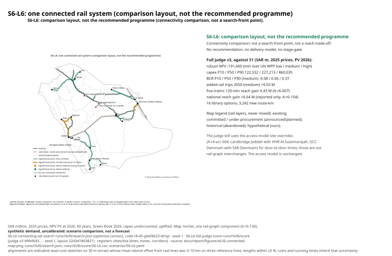
> Labels: synthetic demand, uncalibrated: scenario comparison, not a forecast. alignments are indicative least-cost sketches on 30 m terrain whose mean lateral offset from real lines was 3–10 km on three reference lines; lengths within ±5 %; costs and running times inherit that uncertainty.
*Figure 16.* The existing connected-system map of S6-L6 from the connecting-set search (S6_L6_CONNECTED), reused unchanged: S1 lines and the 16 library options of S6-L6 as one rail-graph component, the corridors joining an S1 island highlighted and the 18 required cities annotated, beside the S6-L6 full-judge v3 scorecard. Comparison layout, not the recommended programme; the access-model site overrides (A-r4-acc-004) are not rail-graph interchanges.
Source: docs/report/figures/s6-l6-connected-map.png; runs/r6/l6/search.json; runs/r6/l6/score/S6-L6.csv; scenarios/S6-L6.yaml. Provenance: S6-L6 connecting-set search runs/r6/l6/search.json (optimise.connect, code r8-45-g0ef4623-dirty) · seed 1 · S6-L6 full-judge score runs/r6/l6/score (judge v3 d9fef643… · seed 1, layout 2243d1863821) · registers cities/ksa (lines, zones, corridors).
<!-- /gen:fig-fig16-l6-connected-map -->

No layout brings any new zone within 60 door-to-door minutes of a metro (runs/r6/top5/top5.csv, `access_gain_60` = 0). The national reach, reported only (a column outside the score, A-r6-104), counts every zone within 120 door-to-station minutes of any station: S1 alone reaches 26.10 M of 35.93 M people, and the CP7 layouts add 0.15 M (S6-L2) to 0.57 M (S6-L1, S6-L3) (runs/r6/v3/national_reach.json; A-r6-104). S6-L1 carries the Al-Kharj spur's P90 cost risk: NPV at P90 cost −2,958 / −724 / +1,631 SAR m (low / medium / high), runs/r6/top5/top5.csv.

## 4.7 People, equity and the 30-minute lens

**Who gains, in the model.** Splitting each case's user benefits half to the origin and half to the destination zone (TAG A4.2 share-of-benefit against share-of-population[^S-soc-051]): the Al-Kharj spur's benefits fall about 90 % in the Riyadh region, the Al Jubayl and Dhahran stations' about 100 % in the Eastern Province, and Duruma's and the Riyadh belt's in the Riyadh region. Grouping regions into terciles of Saudi unemployment (a regional proxy, not household income, A-cba-311; LFS Q4 2025[^S-soc-016]) the high-unemployment tercile (14.6 % of the population) receives 0.0 % of the user benefits of every CP7 corridor (runs/cba/CBA-S3-branch_spur-al-kharj, runs/cba/CBA-S5-station_addition-al-jubayl, runs/cba/CBA-S5-station_addition-dhahran, runs/cba/CBA-S5-station_addition-duruma, runs/cba/CBA-S4-commuter_belt-riyadh-225; `docs/distribution.md`). These are R5 CBA runs (before the CP6 zone split); the regional pattern, not the level, is the finding.

**Who is left out.** In the Riyadh region 17 towns of 10,000 or more (617,718 people) stay more than 30 km from every station after the Al-Kharj spur, and in the Eastern Province 10 towns (638,328 people) after the Al Jubayl station (A-cba-313; runs/cba/CBA-S3-branch_spur-al-kharj, runs/cba/CBA-S5-station_addition-al-jubayl).

**Who pays.** The state, through the net fiscal cost in §4.5; users pay fares (PV in each case's distribution table). Fare-to-income ratios cannot be computed: no income-by-zone source exists (`docs/social.md` B4).

**Social evidence that bears on the results** (`docs/social.md`, literature review; sources verified unless marked):

- Commuting tolerance: in Q4 2025, 46.2 % of unemployed Saudi men and 63.8 % of unemployed Saudi women accept at most one hour of commuting[^S-soc-017].
- Heat and first/last mile: the national mean daily maximum in July is 41.5 °C[^S-soc-025], and safe walking access to public transport in Riyadh is very limited in extreme heat[^S-soc-026]; the model applies a summer access factor (A-access-011) but no Saudi seasonal ridership evidence was found.
- Women's mobility: Saudi female labour-force participation rose from 20.2 % (Q4 2018, secondary) to 34.5 % (Q4 2025)[^S-soc-007][^S-soc-001][^S-soc-002], and 37.7 % of surveyed women switched to driving after 2018[^S-soc-011]; no Saudi evidence was found on the effect of transport access on women's employment.
- Family and religious travel: visiting friends and relatives was 40.4 % of 2025 domestic trips[^S-soc-031]; 25.06 M internal Umrah performers in 2025[^S-soc-029]. International pilgrims carry no user benefits in the model (A-cba-310).
- Land and heritage: the 2025 expropriation law sets compensation at market value plus 20 % and damages (secondary)[^S-soc-043]; the expropriation procedure for a rail alignment is one of the open questions in §6.5.

**The 30-minute lens.** For towns 40–120 road-km from each metro (A-screen-005, A-screen-013), in the model:

<!-- gen:commute -->
> Labels: synthetic demand, uncalibrated: scenario comparison, not a forecast. alignments are indicative least-cost sketches on 30 m terrain whose mean lateral offset from real lines was 3–10 km on three reference lines; lengths within ±5 %; costs and running times inherit that uncertainty.
| metro | towns 40–120 road-km | ≤ 30 min in-vehicle rail: S0 | S1 | with at least one S2–S5 candidate |
|---|---|---|---|---|
| Abha–Khamis Mushait | 13 | 0 | 0 | 0 |
| Buraidah | 42 | 0 | 0 | 0 |
| Dammam–Khobar–Dhahran | 7 | 0 | 0 | 0 |
| Jazan | 36 | 0 | 0 | 0 |
| Jeddah | 23 | 14 | 14 | 17 |
| Madinah | 1 | 0 | 0 | 0 |
| Makkah | 17 | 3 | 3 | 4 |
| Najran | 5 | 0 | 0 | 0 |
| Riyadh | 105 | 0 | 0 | 49 |
| Tabuk | 4 | 0 | 0 | 0 |
| Taif | 26 | 0 | 0 | 2 |
Run: runs/access/commute-test-s1/commute_test.parquet (seed 1; towns from the register, road km from OSRM, running-time band A-r4-rt-011, summer factor A-access-011).
<!-- /gen:commute -->

Around Riyadh no town has a 30-minute in-vehicle rail time under S0 or S1, and at least one generated candidate gives one to 49 of 105 such towns; around Jeddah the existing and committed lines already give it to 14 of 23 (runs/access/commute-test-s1/commute_test.parquet). Door-to-door times are much longer than in-vehicle times once access, waiting and the summer factor are counted (`docs/commute-test.md`).

<!-- section: 05-benchmarks.md -->
# 5. Benchmarks: what other countries did

> Labels: synthetic demand, uncalibrated: scenario comparison, not a forecast. alignments are indicative least-cost sketches on 30 m terrain whose mean lateral offset from real lines was 3–10 km on three reference lines; lengths within ±5 %; costs and running times inherit that uncertainty.

The W5 dossiers (`docs/benchmarks/<country>.md`) cover every country the brief names: France, Japan, Spain, Germany, China, South Korea, Italy, Morocco, Turkey, the UAE and Egypt, plus a cautionary reference class (California high-speed rail, UK HS2 and others) and cross-cutting notes on small towns and population-growth peers. Each dossier lists what it found and, where nothing reliable was found, says so. Observed outcomes abroad are evidence about those countries, not forecasts for Saudi Arabia; this section summarises `docs/benchmarks/synthesis.md` and adds no new figure.

## 5.1 Cost per km

Cost per km varies by more than an order of magnitude across the audited lines, and within one country as much as between countries: France's own record runs from 6.0 to 28.3 M EUR (2023 prices) per km across ten lines[^S-bench-fr-098]. The sources name drivers (urban nodes, land, viaducts and tunnels in Germany[^S-bench-de-003]; standardised designs and a scale supply industry in China, with the World Bank cautioning that transfer "depends on their individual situations"[^S-bench-cn-081]) rather than measure them. No dossier decomposes cost by terrain class, so desert, dune and sabkha costs are not covered by the benchmarks; the cost register fills that gap with assumptions that carry wide ranges (A-cost-302).

<!-- gen:fig-fig13-benchmark-cost-per-km -->
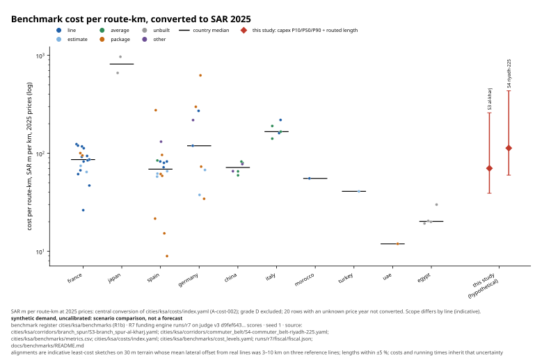
> Labels: synthetic demand, uncalibrated: scenario comparison, not a forecast. alignments are indicative least-cost sketches on 30 m terrain whose mean lateral offset from real lines was 3–10 km on three reference lines; lengths within ±5 %; costs and running times inherit that uncertainty.
*Figure 13.* Cost per route-km of the grade A–C benchmark rows (SAR m per km, 2025 prices, central conversion, log scale) by country with the country median, beside capex P10/P50/P90 ÷ routed length of the two routed CP7 lines (Al-Kharj spur, Riyadh belt 225).
Source: cities/ksa/corridors/branch_spur/S3-branch_spur-al-kharj.yaml; cities/ksa/corridors/commuter_belt/S4-commuter_belt-riyadh-225.yaml; cities/ksa/benchmarks/metrics.csv; cities/ksa/costs/index.yaml; cities/ksa/benchmarks/cost_levels.yaml; runs/r7/fiscal/fiscal.json; docs/benchmarks/README.md. Provenance: benchmark register cities/ksa/benchmarks (R1b) · R7 funding engine runs/r7 on judge v3 d9fef643… scores · seed 1.
<!-- /gen:fig-fig13-benchmark-cost-per-km -->

## 5.2 Overruns

Cost and schedule overruns are the common case in the audited record. The European Court of Auditors found that "all audited high-speed lines had cost overruns of more than 25 %"[^S-bench-fr-086]; Spain's audited lines and the Madrid–Barcelona contracts overran at line and contract level[^S-bench-es-001][^S-bench-es-003]; the UK National Audit Office reports that HS2 costs doubled since 2020[^S-bench-caut-062]; Korea's audit board projected Gyeongbu costs 25.86 % above the 1997 plan[^S-bench-kr-022]. Opening dates moved by years in Egypt[^S-bench-eg-018], Turkey[^S-bench-tr-013] and Japan[^S-bench-jp-010][^S-bench-jp-003]. The record is not uniform: Morocco's completed-cost figure equals the plan figure in the audit court report, so its overrun cannot be settled from the sources read, and China's single recorded observation came in below its estimate (`docs/benchmarks/morocco.md`, `docs/benchmarks/china.md`).

The study's capex ranges already carry this evidence through the reference-class uplift (P90 3.69 × the base for rail at strategic stage, A-rcf-001[^S-cost-rcf-008]). The two Saudi data points (Haramain and the Riyadh Metro) sit at or beyond P80–P90 of the global schedule curve (A-rcf-039).

## 5.3 Ridership against forecast

Ex-post comparisons exist for few lines; where they exist most early-year outturns were below forecast. Korea's first-year ratios sit near one half of the forecast in the abstracts read[^S-bench-kr-009][^S-bench-kr-011]; the Channel Tunnel forecasts "largely and systematically overestimated" the market[^S-bench-caut-043]; Brightline's ridership growth was below its rating case[^S-bench-caut-036]; France's LGV SEA traffic was 4 to 10 % below the public-inquiry forecasts[^S-bench-fr-043]. There are exceptions: LGV Est phase 1 came in 4 % above its expectation[^S-bench-fr-055], and Morocco's Al Boraq rose from 0.43 of its opening forecast in year 3 to 0.93 in year 7 (press-reported operator figures)[^S-bench-ma-026][^S-bench-ma-012]. The study applies the reference-class ridership ratio (median 0.69 of forecast in the draws, runs/cba/CBA-S3-branch_spur-al-kharj/switching_values.json; class A-rcf-029[^S-cost-rcf-013]) in every draw.

## 5.4 Farebox recovery

Line-level operating ratios are rarely public. They were found for Turkey only (ticket revenue covering 73–79 % of cost in 2017–2018, with public service payments)[^S-bench-tr-003]; Spain's operators ran operating losses in 2023–2024 on the regulator's totals[^S-bench-es-005]; China's weaker 200–250 km/h lines are linked by the World Bank to fixed, low fares[^S-bench-cn-084]. In the model, PV fares cover 0.19–0.46 of PV operating and renewal costs on the CP7 programmes in the robust case (runs/r7/fiscal/fiscal.json): no comparator suggests that a Saudi line would be self-financing.

## 5.5 The 200–800 km band

The band has partial support. In Japan rail carried the largest share in the 300–700 km bands in 2000, with air dominant beyond about 700 km[^S-bench-jp-001]; in Spain rail's share was high on 365–621 km corridors and fell sharply beyond about 180 minutes[^S-bench-es-005][^S-bench-es-004]; French evidence puts air dominance at about three to four hours of rail journey[^S-bench-fr-045]. The evidence points to travel time, frequency and price, not distance, as the operative variable; on Berlin–Munich air was faster door-to-door[^S-bench-de-019]. No Gulf or desert-climate evidence exists in the dossiers. In this study's model no generated trunk gap in or near the band has a positive robust NPV (runs/r6/v3/library/).

## 5.6 Small towns and intermediate stations

The clearest audit and peer-reviewed results on in-between and peripheral places are negative or null: no clear regeneration at 15 of 18 audited EU stations[^S-bench-st-014], a sizable employment decrease in in-between Shinkansen municipalities[^S-bench-st-001], and GDP falls in peripheral Chinese counties on upgraded lines[^S-bench-st-032]. Positive results exist but are narrower (GDP, prices or migration at specific stations; `docs/benchmarks/small-towns.md`). No study read gives a planning number for a small town's population, jobs or land value against a matched control. This bears on the station additions that make up S6-L2: their benefits in the model are user time savings, not local regeneration, and no regeneration benefit is added (`docs/cba.md` §5).

## 5.7 Delivery models observed

State-led construction and operation (China, Spain's ADIF and Renfe, Turkey, Morocco, Egypt with an export-credit-financed contractor consortium), concession (France's LGV SEA), private (Brightline), open-access competition on public infrastructure (Italy) and a state developer with an operating joint venture (UAE). The dossiers record what each model allocated, for example that the SEA concession shifted construction-cost risk away from the public budget but did not reduce its cost per km, which "a atteint un niveau record"[^S-bench-fr-032], but they contain no like-for-like comparison of outcomes by model. The Haramain line was delivered through public design-build packages and an EPC plus O&M contract, about six years late, with 2023 ridership about an eighth of the design projection (secondary)[^S-fund-261][^S-fund-265].

## 5.8 Gaps carried forward

Line-level farebox and operating ratios; ex-post ridership against forecast; terrain-specific costs; any Gulf outcome data; and primary audit documents not reached (Cour des comptes 2014, Korea's audit board, Morocco's audit court on the final Al Boraq cost, the California High-Speed Rail Authority plans). The per-dossier "no reliable data found" lists and the gaps table in `docs/benchmarks/README.md` are the full record.

<!-- section: 06-risks.md -->
# 6. Risks, sensitivities and open questions

> Labels: synthetic demand, uncalibrated: scenario comparison, not a forecast. alignments are indicative least-cost sketches on 30 m terrain whose mean lateral offset from real lines was 3–10 km on three reference lines; lengths within ±5 %; costs and running times inherit that uncertainty.

## 6.1 Cost overruns

The capex ranges are reference-class ranges with a heavy upper tail: capex P90 is about 3.7 × P50 for each CP7 layout (S6-L2 5,286 against 1,423; S6-L1 41,304 against 11,194; S6-L3 73,799 against 19,630; runs/r6/top5/top5.csv), because the published rail class at strategic stage has P90 3.69 (A-rcf-001[^S-cost-rcf-008]). The held-out P90-cost test is the study's main cost-risk check: on it every flagged layout among the top 25 contains the Al-Kharj spur (runs/r6/holdout.csv). S6-L2 stays positive at P90 cost in every population case; S6-L1 does not: NPV at P90 cost −2,958 / −724 / +1,631 SAR m (low / medium / high), runs/r6/top5/top5.csv. S6-L3 is negative at P90 cost in every case (runs/r6/top5/top5.csv).

Switching values and the largest one-at-a-time drivers of the five CP7 corridors:

<!-- gen:switching -->
> Labels: synthetic demand, uncalibrated: scenario comparison, not a forecast. alignments are indicative least-cost sketches on 30 m terrain whose mean lateral offset from real lines was 3–10 km on three reference lines; lengths within ±5 %; costs and running times inherit that uncertainty.
| corridor (R5 CBA case, construction start 2027) | central BCR | demand for BCR = 1 (share of the modelled forecast) | capex × for BCR = 1 | value-of-time × for BCR = 1 | constant real rate at NPV = 0 | largest three tornado swings (NPV swing, SAR m) | run |
|---|---|---|---|---|---|---|---|
| Al Jubayl station (GCC Railway) | 129.59 | 6 % | 15.29 | n/a | 18.69 % | ridership actual/forecast (P10/P90) (10,212); discount rate (TAG 3.5 % declining / flat 7 %) (3,377); carbon value (low/high) (2,845) | `runs/cba/CBA-S5-station_addition-al-jubayl` |
| Dhahran station (SAR East line) | 3.84 | 17 % | 5.43 | n/a | 10.37 % | ridership actual/forecast (P10/P90) (3,806); carbon value (low/high) (1,345); capex (uplifted, P10/P90) (1,294) | `runs/cba/CBA-S5-station_addition-dhahran` |
| Duruma station (Landbridge) | 1.24 | 52 % | 1.46 | 0.72 | 4.02 % | capex (uplifted, P10/P90) (1,294); ridership actual/forecast (P10/P90) (1,228); value of time (low/high) (919) | `runs/cba/CBA-S5-station_addition-duruma` |
| Al-Kharj spur | 1.06 | 66 % | 1.09 | 0.85 | 3.03 % | ridership actual/forecast (P10/P90) (24,528); capex (uplifted, P10/P90) (24,264); value of time (low/high) (6,400) | `runs/cba/CBA-S3-branch_spur-al-kharj` |
| Riyadh commuter belt 225 (Al Muzahimiyah, Duruma) | 0.14 | 422 % | n/a | 11.51 | n/a | capex (uplifted, P10/P90) (23,673); discount rate (TAG 3.5 % declining / flat 7 %) (5,059); ridership actual/forecast (P10/P90) (4,937) | `runs/cba/CBA-S4-commuter_belt-riyadh-225` |
Runs: runs/cba/CBA-<id>/switching_values.json and tornado.csv (R5 CBA, seed 1, medium population, 60 years, Green Book 2026; the R5 model before the CP6 zone split, so the levels differ from the judge v3 figures in the other tables; the ordering of the drivers is what this table shows).
<!-- /gen:switching -->

<!-- gen:fig-fig14-tornado-switching -->
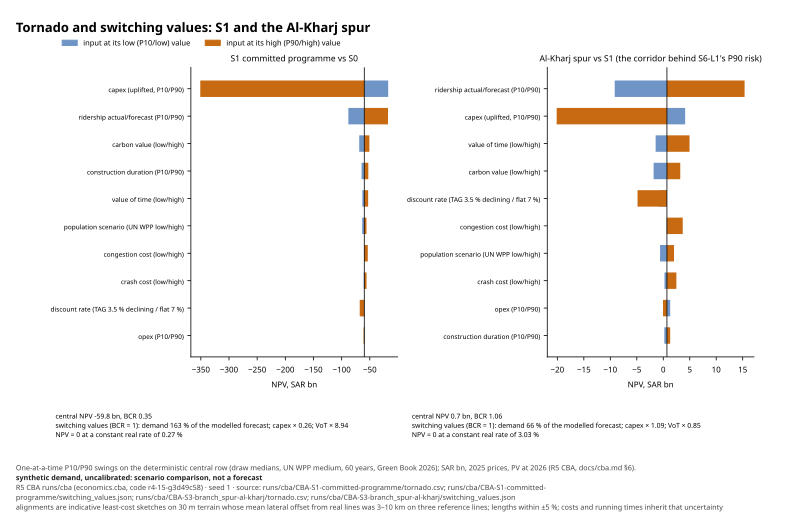
> Labels: synthetic demand, uncalibrated: scenario comparison, not a forecast. alignments are indicative least-cost sketches on 30 m terrain whose mean lateral offset from real lines was 3–10 km on three reference lines; lengths within ±5 %; costs and running times inherit that uncertainty.
*Figure 14.* One-at-a-time NPV tornado (each input at its low/P10 and high/P90 value) and the switching values for the S1 committed programme against S0 and the Al-Kharj spur against S1 (R5 CBA, docs/cba.md §6).
Source: runs/cba/CBA-S1-committed-programme/tornado.csv; runs/cba/CBA-S1-committed-programme/switching_values.json; runs/cba/CBA-S3-branch_spur-al-kharj/tornado.csv; runs/cba/CBA-S3-branch_spur-al-kharj/switching_values.json. Provenance: R5 CBA runs/cba (economics.cba, code r4-15-g3d49c58) · seed 1.
<!-- /gen:fig-fig14-tornado-switching -->

Reading the table: for the Al-Kharj spur, in the model, capex 9 % above its central uplifted value or demand below 66 % of the modelled forecast takes its BCR to 1, and the ridership ratio and capex give the two largest NPV swings (runs/cba/CBA-S3-branch_spur-al-kharj). The two 2030 stations keep a BCR above 1 down to a small share of the modelled demand; Duruma needs about half of it (runs/cba/CBA-S5-station_addition-duruma). The Riyadh belt 225 needs more than four times the modelled demand (runs/cba/CBA-S4-commuter_belt-riyadh-225).

## 6.2 Demand shortfall

- The demand is synthetic: calibrated on three 2025 totals and validated against no observed origin–destination matrix (runs/r5/demand/calibration-r5-s1/calibration.json). This is the largest single uncertainty in the study.
- The reference-class ridership ratio (actual ÷ forecast: median 0.69 in the draws, runs/cba/CBA-S3-branch_spur-al-kharj/switching_values.json; class P10 0.25, P90 1.35, A-rcf-029[^S-cost-rcf-013]) is drawn in every draw, so the ranges already include a typical shortfall; it is a correction from the international record, not a Saudi measurement (A-rcf-035).
- The mode-choice coefficients are literature-based until the designed stated-preference survey is fielded by people, not by this project (`docs/survey/`); the behavioural and appraisal values of time differ by about 1.9–2.0× (A-cba-106).
- International pilgrims and tourists carry no user benefits (A-cba-310) and freight is not monetised (A-cba-309): both make the benefit side a lower bound for lines that would carry them.
- Population: the robust case is always UN WPP low; on the held-out high case only two of the top 25 holdout layouts move more than five places (runs/r6/holdout.csv).

## 6.3 Fiscal exposure and delivery risk

- **Contingent liabilities.** Under an availability PPP the overrun above the private cushion stays with the state: for S6-L1, 4,859 expected and 14,611 at P90 capex (PV, SAR m); for the Al-Kharj spur alone 3,963 and 11,921 (runs/r7/fiscal/fiscal.json; A-fund-102). For S6-L1 these arise in the cases where its economic case fails: NPV at P90 cost −2,958 / −724 / +1,631 SAR m (low / medium / high), runs/r6/top5/top5.csv.
- **Termination** at opening is a memorandum item, not added to the net fiscal cost; the PSP Law allows compensation that may include lost revenues (A-fund-006[^S-fund-008]).
- **Budget share.** The peak share of total state expenditure at P90 capex is 0.091 % (S6-L2, 2027), 0.662 % (S6-L1, 2047) and 1.230 % (S6-L3, 2047) under fully public delivery (runs/r7/fiscal/fiscal.json); beyond 2028 the denominator is a projection (A-fund-005[^S-fund-026]), and no rail or transport budget line was found.
- **Evenhanded reading.** For a PPP: a fixed-price contract can protect the budget from overruns up to the private cushion and has delivered on time elsewhere[^S-fund-047], and the National Center for Privatization targets value for money from PPPs[^S-fund-030]. For public delivery: the corridors are small or interface-bound, their fares do not carry the costs, the tail beyond any cushion stays with the state under every model, and public finance avoids the premium[^S-fund-r7-001]. Public delivery has its own schedule and demand risks, which the state carries in full (Haramain[^S-fund-265]). The value-for-money sign would change only if Saudi bids priced risk far below the reference class (switching values in runs/r7/vfm/vfm.json; A-fund-007, A-fund-008).

## 6.4 Alignment weights v2 (sensitivity only; not in any headline)

The frozen weights v1 are the base for every figure in this report. A second weight set, v2, was routed for the two CP7 line corridors (the Al-Kharj spur and the Riyadh belt 225), re-costed and re-scored with the same frozen judge, and is reported here only (`docs/alignments.md` §4c). Geometry, v1 → v2: the Al-Kharj spur 139.2 → 138.5 km, tunnel plus viaduct 2.0 → 0.6 km, earthworks 4.8 → 12.3 km; the Riyadh belt 225 79.0 → 69.5 km, tunnel plus viaduct 8.0 → 13.7 km (runs/align/corridors-v2-s1/; A-align-100). Every figure that moved:

<!-- gen:alignment-v2 -->
> Labels: synthetic demand, uncalibrated: scenario comparison, not a forecast. alignments are indicative least-cost sketches on 30 m terrain whose mean lateral offset from real lines was 3–10 km on three reference lines; lengths within ±5 %; costs and running times inherit that uncertainty.
| entity (weights v1 → v2) | robust NPV (SAR m) | capex P50 (SAR m) | capex P90 (SAR m) | net fiscal cost 60 y P50, fully public (SAR m) | VfM (% of PSC) |
|---|---|---|---|---|---|
| `S3-branch_spur-al-kharj` | 4,309 → 4,577 | 9,771 → 9,272 | 36,018 → 33,868 | 7,523 → 7,247 | −4,230 → −4,013 (−38.5 % → −38.3 %) |
| `S4-commuter_belt-riyadh-225` | −8,293 → −7,778 | 8,910 → 10,227 | 34,256 → 40,520 | 11,320 → 11,194 | −3,860 → −4,432 (−26.2 % → −28.9 %) |
| `S5-station_addition-al-jubayl` | 4,982 → 4,982 | 474 → 474 | 1,762 → 1,762 | 168 → 168 | −344 → −344 (−72.3 % → −72.3 %) |
| `S5-station_addition-dhahran` | 2,362 → 2,362 | 474 → 474 | 1,762 → 1,762 | 682 → 682 | −344 → −344 (−34.8 % → −34.8 %) |
| `S5-station_addition-duruma` | 481 → 481 | 474 → 474 | 1,762 → 1,762 | 483 → 483 | −205 → −205 (−31.4 % → −31.4 %) |
| `S6-L2` | 6,792 → 6,792 | 1,423 → 1,423 | 5,286 → 5,286 | 1,283 → 1,283 | −894 → −894 (−41.2 % → −41.2 %) |
| `S6-L1` | 11,023 → 11,297 | 11,194 → 10,695 | 41,304 → 39,154 | 8,441 → 8,197 | −5,124 → −4,907 (−38.9 % → −38.8 %) |
| `S6-L3` | 2,427 → 3,180 | 19,630 → 20,448 | 73,799 → 77,912 | 18,962 → 18,478 | −8,779 → −9,135 (−32.2 % → −33.4 %) |
Run: runs/r7-v2/sensitivity.json (weights v2, not adopted; docs/alignments.md §4c; d9fef643… judge v3, seed 1). The three station additions and S6-L2 are not routed and do not change. S6-L1 under the base weights v1: NPV at P90 cost −2,958 / −724 / +1,631 SAR m (low / medium / high), runs/r6/top5/top5.csv.
<!-- /gen:alignment-v2 -->

In the model, no sign changes under v2: the S6-L1 robust NPV rises by 274 and S6-L3's by 754, the value-for-money sign is unchanged everywhere, and S6-L2 does not move because station additions are not routed (runs/r7-v2/sensitivity.json). S6-L1 under v1, the base: NPV at P90 cost −2,958 / −724 / +1,631 SAR m (low / medium / high), runs/r6/top5/top5.csv. Adopting v2 would mean re-running R6 and R7 for every corridor, not only these two.

## 6.5 Open legal and institutional questions

Thirteen of the sixteen legal and institutional items reviewed are unclear on the sources read. Each is kept as an open question; no legal position is inferred from any of them, and none is resolved in this report.

<!-- gen:legal -->
| # | item | open question (no legal position is inferred) | sources |
|---|---|---|---|
| 1 | `sar_ownership_form` | Who are SAR's shareholders per its commercial registration or articles, and what is its legal form? | [^S-fund-034][^S-fund-035] |
| 2 | `fiscal_reporting` | Are SAR's capex and debt consolidated in general-government statistics or the budget, and would PPP payment commitments or guarantees be disclosed? (fully public via budget, PIF or SAR differ in reporting, not in the risk the state carries) | [^S-fund-029][^S-fund-026] |
| 3 | `pif_role` | Does PIF currently finance SAR's capex (equity, loans or guarantees), and what do Arts. 3-4 of the official PIF Law text say on domestic infrastructure and guarantees? | [^S-lb-012][^S-lb-009][^S-fund-036][^S-fund-037] |
| 4 | `fare_setting_authority` | Who sets and approves passenger fares on intercity and commuter rail (the state rail company, TGA, a ministry or a concession contract)? Railway Law Art. 18 covers usage (access) fees under use agreements, not passenger fares; no source read settles it. | [^S-fund-016][^S-fund-012] |
| 5 | `railway_law_regulation` | Which cases of the Railway Law Implementing Regulation allow transfer of existing assets to a concessionaire, and has TGA published a usage-fee policy? | [^S-fund-054][^S-fund-055] |
| 6 | `psp_regulations_thresholds` | What do the amended (2023/2024) Implementing Regulations say on the SAR 200 m PPP threshold (reported by secondary sources), procurement methods, the VfM study and MoF fiscal approval? | [^S-fund-041][^S-fund-053][^S-fund-042] |
| 7 | `psp_relevant_agency` | For an intercity or commuter rail PPP, which body is the relevant and the executive agency (Art. 2 governing rules), and is SAR a contracting authority under Art. 4? | [^S-fund-010] |
| 8 | `psp_railway_interaction` | Does a rail concession tendered under Railway Law Art. 32 also follow PSP Law procedures (NCP study, MoF approval)? | [^S-fund-013][^S-fund-003] |
| 9 | `ncp_vfm_method` | Has NCP published a VfM or PSC method (the R7 test follows the Green Book logic as a named reference)? | [^S-fund-030][^S-fund-056][^S-fund-024] |
| 10 | `om_contract_status` | Is a 5-year-plus O&M-only rail contract (as on Haramain) a PPP under PSP Law Art. 1, with NCP and MoF steps, or ordinary government procurement? | [^S-fund-001][^S-fund-039] |
| 11 | `host_line_procurement` | Can a station on a committed host line (GCC Railway in design; the Landbridge in phased delivery after the PPP talks ended) be added within the host line's procurement, and under what procurement model are the Landbridge phases being let? | [^S-029][^S-059][^S-lb-001][^S-060] |
| 12 | `lvc_instruments` | Which Saudi instruments (development rights on railway land under Railway Law Art. 33, municipal fees, the white-land fee) could legally be earmarked for rail? | [^S-fund-014] |
| 13 | `land_expropriation` | What expropriation procedure and timetable apply to a new rail alignment (not reviewed in R1d or R7)? | [^S-fund-014][^S-fund-006] |
Register: cities/ksa/funding/recommendations.yaml `legal_items` (13 items with status unclear; docs/delivery-models.md, All legal and institutional items).
<!-- /gen:legal -->

The three items found clear (the state rail company's mandate, the Railway Law concession articles and the PSP Law steps) are in `docs/delivery-models.md` with their sources.

## 6.6 Other limits

- **Rates and horizons.** S6-L1 and S6-L2 stay positive at 30 and 40 years and at flat 5 % and 7 % at P50 cost (S6-L1 at P90 cost: NPV at P90 cost −2,958 / −724 / +1,631 SAR m (low / medium / high), runs/r6/top5/top5.csv); S6-L3 is negative at 30 years and at flat 5 % and 7 % (runs/r6/top5/top5.csv; A-cba-002, A-cba-004).
- **Wider economic impacts** are indicative only and excluded from every score: under TAG's own definition the effective density fell in a development test, so the agglomeration estimate is not reliable on governorate-sized zones (`docs/cba.md` §7; A-cba-130).
- **The fast search mode** overstates robust NPV against the full judge (by 72.7 % of capex on S6-L2), so every reported layout is a full-judge score (runs/r6/v3/rescore/rescore.json; A-r6-006).
- **Phasing** is a construction-start convention with a drawn construction duration (A-r6-002), not a real-options model; §7 adds the gates by hand.
- **Track** has no term in the frozen model, so single track was not searched (A-r6-102).

<!-- section: 07-phased-programme.md -->
# 7. Phased programme as stage-gates

> Labels: synthetic demand, uncalibrated: scenario comparison, not a forecast. alignments are indicative least-cost sketches on 30 m terrain whose mean lateral offset from real lines was 3–10 km on three reference lines; lengths within ±5 %; costs and running times inherit that uncertainty.

This section turns the results into a sequence of decisions, each with the conditions that would have to be true to pass it. It is the study's phasing in the sense of W9 (build, expand or defer, triggered by what is observed), set out as options for decision-makers to test. It is not an endorsement of any line, body or delivery model, and every condition is stated so that it can fail. All steps are incremental to S1, the committed programme, whose own appraisal is in §4.1 (runs/cba/CBA-S1-committed-programme).

The central case is S6-L2; the upside case S6-L1 adds one gate to it and carries the Al-Kharj spur's P90 cost risk (NPV at P90 cost −2,958 / −724 / +1,631 SAR m (low / medium / high), runs/r6/top5/top5.csv); the reach alternative S6-L3 is a different path, not a later stage of S6-L2. The years 2030 and 2050 are the optimiser's phase years, not commitments; construction starts three years earlier (2027 and 2047, A-r6-002), so each gate falls before construction: 2027 for the 2030 phase and 2047 for the 2050 phase, as in Figure 9.

<!-- gen:fig-fig09-stage-gates -->
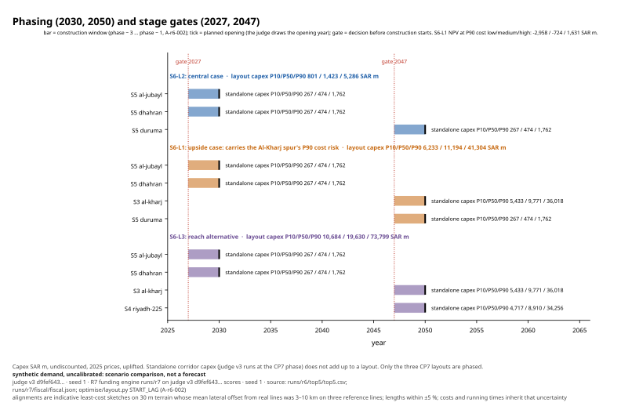
> Labels: synthetic demand, uncalibrated: scenario comparison, not a forecast. alignments are indicative least-cost sketches on 30 m terrain whose mean lateral offset from real lines was 3–10 km on three reference lines; lengths within ±5 %; costs and running times inherit that uncertainty.
*Figure 9.* For each corridor of S6-L2, S6-L1 and S6-L3: construction window (phase − 3 to phase − 1, A-r6-002), planned opening at the phase year and the decision gate at each construction start, with layout capex and standalone corridor capex P10/P50/P90 and the S6-L1 NPV at P90 cost.
Source: runs/r6/top5/top5.csv; runs/r7/fiscal/fiscal.json; optimise/layout.py START_LAG (A-r6-002). Provenance: judge v3 d9fef643… · seed 1 · R7 funding engine runs/r7 on judge v3 d9fef643… scores · seed 1. S6-L1: NPV at P90 cost −2,958 / −724 / +1,631 SAR m (low / medium / high), runs/r6/top5/top5.csv.
<!-- /gen:fig-fig09-stage-gates -->

## 7.1 Gates

> Labels: synthetic demand, uncalibrated: scenario comparison, not a forecast. alignments are indicative least-cost sketches on 30 m terrain whose mean lateral offset from real lines was 3–10 km on three reference lines; lengths within ±5 %; costs and running times inherit that uncertainty.
| gate | what it decides | evidence in the model today (SAR m) | what must be true to pass | what fails it |
|---|---|---|---|---|
| **G0. Evidence** (before any commitment) | whether to spend on the evidence the model lacks | demand calibrated on three totals only (runs/r5/demand/calibration-r5-s1/calibration.json); 13 open legal questions (cities/ksa/funding/recommendations.yaml) | the stated-preference survey is fielded by people and the mode-choice model re-estimated (`docs/survey/`); observed ridership of the GCC Railway and SAR East line hosts, when available, is used to calibrate; the `host_line_procurement`, `fare_setting_authority` and `fiscal_reporting` questions are answered by the competent bodies | survey not fielded; host-line procurement cannot accommodate an added station |
| **G1. Al Jubayl and Dhahran stations** (S6-L2 and S6-L1; phase 2030, gate and construction start 2027) | add two stations to committed and existing host lines | standalone robust NPV 4,982 and 2,362, positive at P90 cost in every case; capex P10 / P50 / P90 267 / 474 / 1,762 each (runs/r7/fiscal/fiscal.json) | recalibrated demand keeps each station's BCR P10 ≥ 1 (switching demand share today 6 % and 17 % of the modelled forecast, runs/cba/CBA-S5-station_addition-al-jubayl, runs/cba/CBA-S5-station_addition-dhahran); the host lines can take the stop within their procurement and timetable (through-passenger time cost per stop, A-r4-rt-011) | a host-line contract or timetable that excludes the stop; calibrated demand below the switching share |
| **G2. Duruma station** (S6-L2 and S6-L1; phase 2050, gate and construction start 2047) | add a station on the Landbridge once it runs | standalone robust NPV 481; NPV at P90 cost −121 / −30 / 61 (low / medium / high) (runs/r7/fiscal/fiscal.json) | the Landbridge is in service ("announced/planned" today) and its observed demand keeps Duruma's NPV positive at P90 cost (switching demand share about 52 %, runs/cba/CBA-S5-station_addition-duruma); the station does not compete with a Riyadh commuter belt (in the model Duruma turns negative next to belt 225, `docs/r6-topology.md` §0) | Landbridge delay or demand below the switching share; a belt 225 decision |
| **G3. Al-Kharj spur** (the S6-L1 upside; phase 2050, gate and construction start 2047) | build the spur on top of S6-L2 | S6-L1 robust NPV 11,023 against 6,792 for S6-L2; NPV at P90 cost −2,958 / −724 / +1,631 SAR m (low / medium / high), runs/r6/top5/top5.csv; spur capex P10 / P50 / P90 5,433 / 9,771 / 36,018 (runs/r7/fiscal/fiscal.json) | a design-stage estimate (beyond the strategic-stage class, A-rcf-001) narrows the capex tail so that S6-L1 stays positive at P90 cost in the low population case; calibrated demand keeps the spur's BCR ≥ 1 (switching demand share today 66 %, capex × 1.09; runs/cba/CBA-S3-branch_spur-al-kharj); the fiscal exposure at P90 (net fiscal cost 60 y P90 23,615, runs/r7/fiscal/fiscal.json) is accepted explicitly | the tail is not narrowed; demand or capex past the switching values; a non-electrified option is the only way to narrow the tail (it lowers the robust NPV, runs/r6/v3/cp7/cp7.csv) |
| **R. Reach alternative S6-L3** (instead of G2 and G3) | buy reach around Riyadh with the belt 225 and the spur | robust NPV 2,427; NPV at P90 cost −21,745 / −19,225 / −16,624; reach gain 4.25 M against 3.56 M within 120 door-to-door minutes of the five metros (runs/r6/top5/top5.csv) | decision-makers put an explicit value on reach that the NPV does not count, of at least the robust NPV given up against S6-L1 (8,596) and accept a negative NPV at P90 cost and at 30 years | no explicit value on reach; the S6-L1 upside passes G3 |

## 7.2 Delivery model at each gate

At every gate the R7 analysis names fully public delivery as the best fit (analyst's judgement; `docs/delivery-models.md`), because an availability PPP is more expensive in expected PV for every entity, robust to every registered parameter range (runs/r7/vfm/vfm.json), and the station additions are small and bound to their host lines' contracts. A gate is also the point to re-test that finding: if Saudi PPP bids or private finance priced risk far below the reference class (A-fund-007, A-fund-008), the value-for-money sign could change, and the PPP and hybrid options with station-area value capture are kept as alternatives in `docs/delivery-models.md`.

## 7.3 What is not on the gates

- The trunk gaps, the other spurs and the other commuter belts: in the model none has a positive robust NPV at any phase when scored alone (runs/r6/v3/library/). A change in that finding would need new evidence (calibrated demand, freight that is zero today, A-cba-309, or a material cost change), not a later gate.
- The two layouts shown only on the trade-off figures (§4.6): they are illustrations of what reach costs and carry no stage-gate.
- S1 itself: committed, and the baseline for every gate (runs/cba/CBA-S1-committed-programme).

<!-- section: 08-annexes.md -->
# 8. Annexes

> Labels: synthetic demand, uncalibrated: scenario comparison, not a forecast. alignments are indicative least-cost sketches on 30 m terrain whose mean lateral offset from real lines was 3–10 km on three reference lines; lengths within ±5 %; costs and running times inherit that uncertainty.

All annexes are generated by `uv run python -m common.report build` from the registers and run files; none is edited by hand.

## 8.1 Annex R. Regions (one file per region)

Each file lists the region's governorates from the coverage audit, its settlement register, its short-listed towns, every generated corridor that touches it with the standalone judge v3 result, and pointers to the region sweep:

- [Riyadh](annex-regions/riyadh.md) · [Makkah](annex-regions/makkah.md) · [Madinah](annex-regions/madinah.md) · [Qassim](annex-regions/qassim.md) · [Eastern Province](annex-regions/eastern.md) · [Asir](annex-regions/asir.md) · [Tabuk](annex-regions/tabuk.md)
- [Hail](annex-regions/hail.md) · [Northern Borders](annex-regions/northern_borders.md) · [Jazan](annex-regions/jazan.md) · [Najran](annex-regions/najran.md) · [Al-Baha](annex-regions/al_baha.md) · [Al-Jouf](annex-regions/al_jouf.md)

## 8.2 Annex S. Sources

[annex-sources.md](annex-sources.md): every row of `docs/sources/index.csv` (id, claim, value, unit, publisher, title, URL, published, accessed, status). The source notes at the end of the report resolve each `[^S-…]` reference used in the text.

## 8.3 Annex A. Assumptions

[annex-assumptions.md](annex-assumptions.md): every `A-…` row of `docs/assumptions.md` (and any track fragment `docs/assumptions-<track>.md`), with value, range, source or reason and status.

## 8.4 Figures and dashboard screenshots

Figures are rendered from run outputs by `uv run python -m common.figures build --out docs/report/figures/`; none is hand-drawn. Their index, with captions, source run ids and labels, is `docs/report/figures/figures-index.csv`, listed at the end of the assembled report when present. The decision dashboard (`web/`, served by `make dashboard`) adds four screenshots, all carrying the synthetic-demand label in the footer and the OpenStreetMap credit on the map:

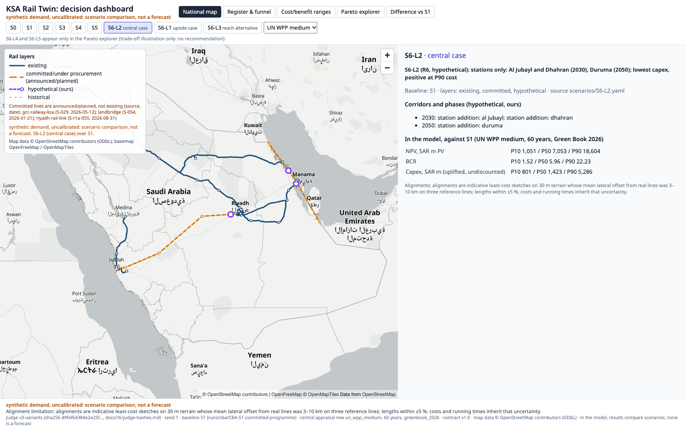
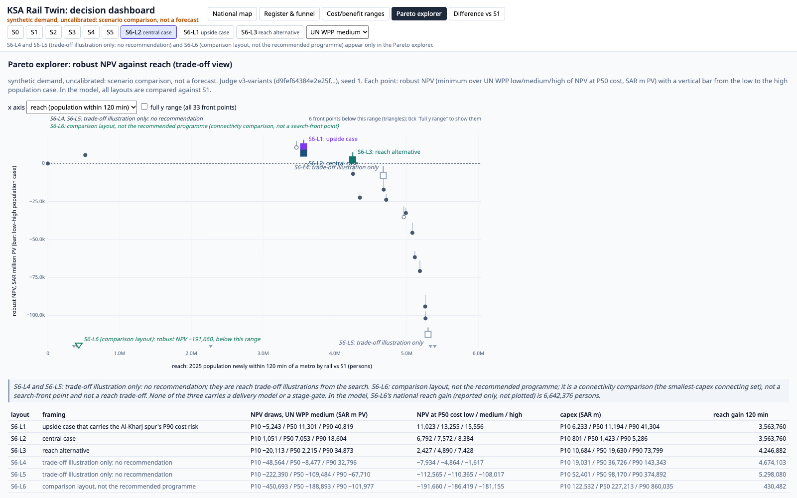
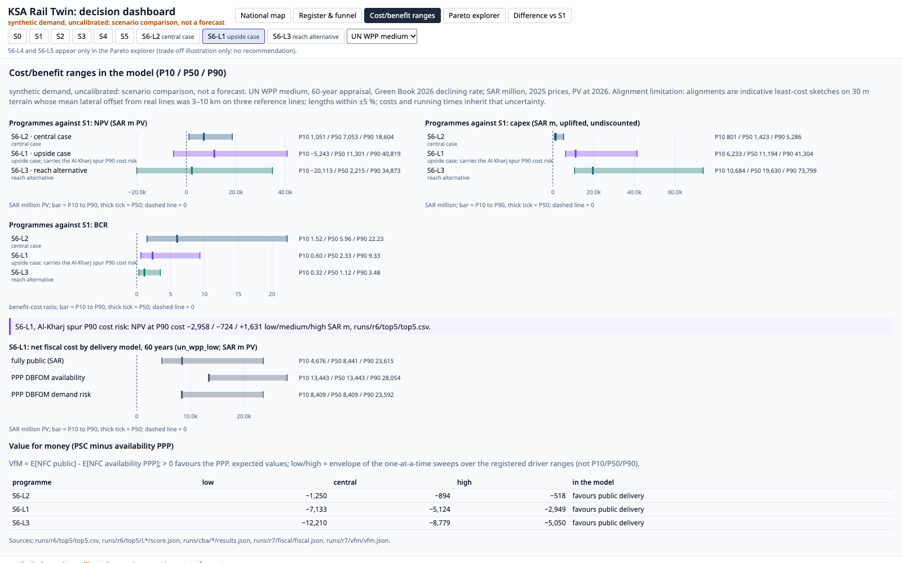
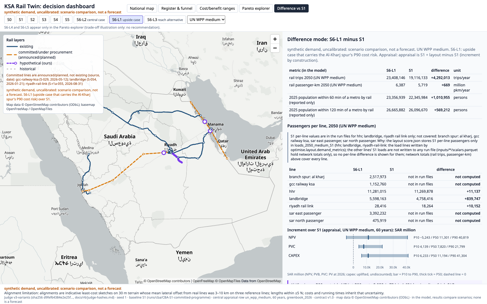
> Labels: synthetic demand, uncalibrated: scenario comparison, not a forecast. alignments are indicative least-cost sketches on 30 m terrain whose mean lateral offset from real lines was 3–10 km on three reference lines; lengths within ±5 %; costs and running times inherit that uncertainty.
Source: `web/` and `api/` serving runs/r6/top5/, runs/r7/ and cities/ksa/ registers; judge v3 (`d9fef643…`), seed 1; map data © OpenStreetMap contributors, ODbL.

## 8.5 Workstream documents

The method notes behind each section, with their own generated tables: `docs/screening.md`, `docs/coverage.md`, `docs/candidates.md`, `docs/demand.md`, `docs/mode-choice.md`, `docs/network.md`, `docs/network-evaluation.md`, `docs/alignments.md`, `docs/commute-test.md`, `docs/costs.md`, `docs/cba.md`, `docs/cba-scorecard.md`, `docs/distribution.md`, `docs/r6-topology.md`, `docs/funding.md`, `docs/delivery-models.md`, `docs/fiscal-exposure.md`, `docs/social.md`, `docs/benchmarks/`, the licence and openness register `docs/licences.md`.

## List of figures (from docs/report/figures/figures-index.csv)

> Labels: synthetic demand, uncalibrated: scenario comparison, not a forecast. alignments are indicative least-cost sketches on 30 m terrain whose mean lateral offset from real lines was 3–10 km on three reference lines; lengths within ±5 %; costs and running times inherit that uncertainty.

| stem | title_en | caption | sources | provenance | labels_present | files |
|---|---|---|---|---|---|---|
| fig01-national-map | National rail map: existing, committed, historical and hypothetical layers | Map of the existing, committed/under-procurement (announced/planned) and historical lines with the hypothetical CP7 additions: the station additions of S6-L2 (also in S6-L1/S6-L3 as labelled), the Al-Kharj spur (S6-L1, S6-L3) and the Riyadh belt 225 (S6-L3) on the frozen v1 alignments, with a Riyadh inset. | cities/ksa/alignments/S3-branch_spur-al-kharj.geojson; cities/ksa/alignments/S4-commuter_belt-riyadh-225.geojson; cities/ksa/corridors/station_addition/S5-station_addition-al-jubayl.yaml; cities/ksa/corridors/station_addition/S5-station_addition-duruma.yaml; cities/ksa/corridors/station_addition/S5-station_addition-dhahran.yaml; cities/ksa/lines/geojson/existing.geojson; cities/ksa/lines/geojson/committed.geojson; cities/ksa/lines/geojson/historical.geojson; cities/ksa/lines/stations.geojson; runs/r6/top5/L1.layout.yaml; runs/r6/top5/L2.layout.yaml; runs/r6/top5/L3.layout.yaml; cities/ksa/zones/regions.geojson | registers cities/ksa (lines, zones, corridors) · judge v3 d9fef643… · seed 1 | synthetic;provenance;judge-v3;alignment;osm | fig01-national-map.svg; fig01-national-map.png |
| fig02-screening-funnel | Screening funnel: settlement universe to CP7 programme layouts | Log-scale bars of the count at each stage: settlement universe, candidate register, long list, short list, corridor candidates by family, corridor CBA cases and the three CP7 layouts. | cities/ksa/zones/settlements.parquet; cities/ksa/candidates.parquet; runs/r2/score/summary.json; cities/ksa/corridors; runs/cba; runs/r6/top5/top5.csv | R2 screening runs/r2 (code r2-6-g811202e) · seed 1 · registers cities/ksa (lines, zones, corridors) · R5 CBA runs/cba (economics.cba, code r4-15-g3d49c58) · seed 1 · judge v3 d9fef643… · seed 1 | synthetic;provenance;judge-v3;screening | fig02-screening-funnel.svg; fig02-screening-funnel.png |
| fig03-coverage-by-region | Coverage: every region screened | For each of the 13 regions: register rows screened, long list and short list (symmetric log scale), with the number of governorates in the label. | runs/r2/long-list/counts.json; runs/r2/score/scores.parquet; docs/coverage.md; cities/ksa/zones/regions.geojson | R2 screening runs/r2 (code r2-6-g811202e) · seed 1 · registers cities/ksa (lines, zones, corridors) | synthetic;provenance;screening | fig03-coverage-by-region.svg; fig03-coverage-by-region.png |
| fig04-bcr-bands-by-family | BCR ranges per corridor case, by family (P10/P50/P90) | P10–P90 line and P50 dot of the BCR without wider impacts for every R5 corridor CBA case against S1, in four family panels (S2–S5); UN WPP medium, 60 years, Green Book 2026; corridors of the CP7 layouts in orange. | runs/cba/CBA-S2..S5-*/results.json (73 cases) | R5 CBA runs/cba (economics.cba, code r4-15-g3d49c58) · seed 1 | synthetic;provenance;alignment | fig04-bcr-bands-by-family.svg; fig04-bcr-bands-by-family.png |
| fig05-programme-npv-ranges | Programme NPV ranges: S1, and the CP7 layouts against S1 | Left: NPV of the S1 committed programme against S0, P10/P50/P90 (R5 CBA). Right: incremental NPV over S1 of S6-L2 (central), S6-L1 (upside, carries the Al-Kharj spur's P90 cost risk) and S6-L3 (reach), P10–P90 of the judge v3 draws with P50 and the robust NPV; UN WPP medium, 60 years, Green Book 2026. | runs/cba/CBA-S1-committed-programme/results.json; runs/r6/top5/top5.csv | R5 CBA runs/cba (economics.cba, code r4-15-g3d49c58) · seed 1 · judge v3 d9fef643… · seed 1 | synthetic;provenance;judge-v3;alignment | fig05-programme-npv-ranges.svg; fig05-programme-npv-ranges.png |
| fig06-l1-p90-cost-risk | S6-L1 upside case: NPV at P50 and at P90 capex | Incremental NPV over S1 at P50 and at P90 capex for the low, medium and high population cases: S6-L1 highlighted (the Al-Kharj spur's P90 cost risk), S6-L2 and S6-L3 faint for scale. | runs/r6/top5/top5.csv; runs/r6/top5/L1/score.json | judge v3 d9fef643… · seed 1 | synthetic;provenance;judge-v3;alignment | fig06-l1-p90-cost-risk.svg; fig06-l1-p90-cost-risk.png |
| fig07-pareto-front | Pareto front: NPV against capex | R6 full-judge front points (medium-population NPV at P50 cost against capex P50, bar = low–high population) with S6-L1, S6-L2 and S6-L3 marked by P10–P90 of the NPV draws and of capex in a zoom panel; S6-L4/L5 are unlabelled front points (trade-off illustration only). S6-L6 is not on the R6 front (it was built by the connectivity search, not the NPV/reach search) and is shown in Figures 8 and 16. | runs/r6/pareto_front.csv; runs/r6/top5/top5.csv | R6 full-judge front runs/r6/pareto_front.csv (judge v2-p5b, reproduced exactly by v3: docs/r6/judge-v3-backtest.md) · judge v3 d9fef643… · seed 1 | synthetic;provenance;judge-v3;alignment | fig07-pareto-front.svg; fig07-pareto-front.png |
| fig08-reach-tradeoff | Cost against reach: S6-L1 to S6-L6 | Capex P50 with P10–P90 bars against the five-metro 120-minute door-to-door reach gain over S1 (A-r6-007) for S6-L1 to S6-L6, over the R6 front points. S6-L4 and S6-L5 are reach trade-off illustrations from the search only: no recommendation. S6-L6 is a connectivity comparison (the smallest-capex connecting set), not a search-front point and not a recommendation; its national reach gain is +6.64 M (reported only, A-r6-104), which the plotted five-metro measure does not show. | runs/r6/top5/top5.csv; runs/r6/pareto_front.csv; runs/r6/l6/score/S6-L6.csv | judge v3 d9fef643… · seed 1 · R6 full-judge front runs/r6/pareto_front.csv (judge v2-p5b, reproduced exactly by v3: docs/r6/judge-v3-backtest.md) · S6-L6 full-judge score runs/r6/l6/score (judge v3 d9fef643… · seed 1, layout 2243d1863821) | synthetic;provenance;judge-v3;alignment | fig08-reach-tradeoff.svg; fig08-reach-tradeoff.png |
| fig09-stage-gates | Phasing (2030, 2050) and stage gates (2027, 2047) | For each corridor of S6-L2, S6-L1 and S6-L3: construction window (phase − 3 to phase − 1, A-r6-002), planned opening at the phase year and the decision gate at each construction start, with layout capex and standalone corridor capex P10/P50/P90 and the S6-L1 NPV at P90 cost. | runs/r6/top5/top5.csv; runs/r7/fiscal/fiscal.json; optimise/layout.py START_LAG (A-r6-002) | judge v3 d9fef643… · seed 1 · R7 funding engine runs/r7 on judge v3 d9fef643… scores · seed 1 | synthetic;provenance;judge-v3;alignment | fig09-stage-gates.svg; fig09-stage-gates.png |
| fig10-fiscal-exposure | Fiscal exposure by delivery model (60-year PV) | Net fiscal cost to the state (PV 60 years, low population) of each CP7 layout under fully public delivery, availability PPP and demand-risk concession: P10–P90 bar, P50 line and expected value; S1 baseline (fully public, against S0) beside. | runs/r7/fiscal/fiscal.json; runs/cba/CBA-S1-committed-programme | R7 funding engine runs/r7 on judge v3 d9fef643… scores · seed 1 · R5 CBA runs/cba (economics.cba, code r4-15-g3d49c58) · seed 1 | synthetic;provenance;alignment | fig10-fiscal-exposure.svg; fig10-fiscal-exposure.png |
| fig11-vfm | Value for money: public sector comparator against availability PPP | Expected net fiscal cost (PV 60 years, low population) of the public sector comparator and of an availability PPP for the three CP7 layouts and their five corridors, with P10/P50/P90 whiskers and the VfM difference (% of PSC). | runs/r7/vfm/vfm.json; runs/r7/fiscal/fiscal.json | R7 funding engine runs/r7 on judge v3 d9fef643… scores · seed 1 | synthetic;provenance;alignment | fig11-vfm.svg; fig11-vfm.png |
| fig12-isochrones | Door-to-door isochrones: Jeddah and Dammam | Door-to-door isochrones from each metro's boarding stations: Jeddah S0 (hatched) against S1 (filled); Dammam–Khobar–Dhahran S1 (hatched) against S1 plus the Dhahran station addition of all three CP7 layouts (filled); the bands drawn are the ones that reach at least one zone (listed on the figure). | runs/access/S0/jeddah/isochrone_door_to_door.geojson; runs/access/S1/jeddah/isochrone_door_to_door.geojson; runs/access/S1/dammam/isochrone_door_to_door.geojson; runs/access/S5-station_addition-dhahran/dammam/isochrone_door_to_door.geojson; cities/ksa/lines/stations.geojson; cities/ksa/lines/geojson/existing.geojson; cities/ksa/lines/geojson/committed.geojson; runs/access/S1/reached.parquet; runs/access/S5-station_addition-dhahran/reached.parquet; access/railgraph.py (same-station trips excluded) | R4/R5 access runs/access (code r4-15-g3d49c58) · seed 1 · registers cities/ksa (lines, zones, corridors) | synthetic;provenance;alignment;osm | fig12-isochrones.svg; fig12-isochrones.png |
| fig13-benchmark-cost-per-km | Benchmark cost per route-km, converted to SAR 2025 | Cost per route-km of the grade A–C benchmark rows (SAR m per km, 2025 prices, central conversion, log scale) by country with the country median, beside capex P10/P50/P90 ÷ routed length of the two routed CP7 lines (Al-Kharj spur, Riyadh belt 225). | cities/ksa/corridors/branch_spur/S3-branch_spur-al-kharj.yaml; cities/ksa/corridors/commuter_belt/S4-commuter_belt-riyadh-225.yaml; cities/ksa/benchmarks/metrics.csv; cities/ksa/costs/index.yaml; cities/ksa/benchmarks/cost_levels.yaml; runs/r7/fiscal/fiscal.json; docs/benchmarks/README.md | benchmark register cities/ksa/benchmarks (R1b) · R7 funding engine runs/r7 on judge v3 d9fef643… scores · seed 1 | synthetic;provenance;alignment | fig13-benchmark-cost-per-km.svg; fig13-benchmark-cost-per-km.png |
| fig14-tornado-switching | Tornado and switching values: S1 and the Al-Kharj spur | One-at-a-time NPV tornado (each input at its low/P10 and high/P90 value) and the switching values for the S1 committed programme against S0 and the Al-Kharj spur against S1 (R5 CBA, docs/cba.md §6). | runs/cba/CBA-S1-committed-programme/tornado.csv; runs/cba/CBA-S1-committed-programme/switching_values.json; runs/cba/CBA-S3-branch_spur-al-kharj/tornado.csv; runs/cba/CBA-S3-branch_spur-al-kharj/switching_values.json | R5 CBA runs/cba (economics.cba, code r4-15-g3d49c58) · seed 1 | synthetic;provenance;alignment | fig14-tornado-switching.svg; fig14-tornado-switching.png |
| fig15-capex-ranges | Capex ranges: S1 and the CP7 layouts | Undiscounted uplifted capex P10/P50/P90 (log scale) of S1 (the 10,000 R5 draws) and of the increments over S1 of S6-L2, S6-L1 and S6-L3 (judge v3 quantiles). | runs/cba/CBA-S1-committed-programme/draws.parquet; runs/r6/top5/top5.csv | R5 CBA runs/cba (economics.cba, code r4-15-g3d49c58) · seed 1 · judge v3 d9fef643… · seed 1 | synthetic;provenance;judge-v3;alignment | fig15-capex-ranges.svg; fig15-capex-ranges.png |
| fig16-l6-connected-map | S6-L6: one connected rail system (comparison layout, not the recommended programme) | The existing connected-system map of S6-L6 from the connecting-set search (S6_L6_CONNECTED), reused unchanged: S1 lines and the 16 library options of S6-L6 as one rail-graph component, the corridors joining an S1 island highlighted and the 18 required cities annotated, beside the S6-L6 full-judge v3 scorecard. Comparison layout, not the recommended programme; the access-model site overrides (A-r4-acc-004) are not rail-graph interchanges. | docs/report/figures/s6-l6-connected-map.png; runs/r6/l6/search.json; runs/r6/l6/score/S6-L6.csv; scenarios/S6-L6.yaml | S6-L6 connecting-set search runs/r6/l6/search.json (optimise.connect, code r8-45-g0ef4623-dirty) · seed 1 · S6-L6 full-judge score runs/r6/l6/score (judge v3 d9fef643… · seed 1, layout 2243d1863821) · registers cities/ksa (lines, zones, corridors) | synthetic;provenance;alignment;osm | fig16-l6-connected-map.svg; fig16-l6-connected-map.png |

## Source notes

[^S-002]: Wikipedia, "Haramain High Speed Railway", https://en.wikipedia.org/wiki/Haramain_High_Speed_Railway, published unknown, accessed 2026-10-30. Claim: HHR line length. Status: secondary.
[^S-029]: MEED, "Saudi Arabia tenders GCC rail link from Kuwait to UAE border", https://www.meed.com/saudi-arabia-tenders-gcc-rail-link-from-kuwait-to-uae-border, published 2026-05-12, accessed 2026-10-30. Claim: GCC railway Saudi section length (announced/planned). Status: secondary.
[^S-059]: MEED, "Saudi Landbridge rail scheme to be delivered by 2034", https://www.meed.com/saudi-landbridge-rail-scheme-to-be-delivered-by-2034, published 2026-01-21, accessed 2026-10-30. Claim: Landbridge delivery: PPP talks with a Chinese consortium failed; several phases; 2034 target. Status: secondary.
[^S-060]: MEED, "SAR tenders Riyadh section of Saudi Landbridge", https://guest.meed.com/sar-tenders-riyadh-section-of-saudi-landbridge/, published 2026-02-12, accessed 2026-10-30. Claim: Riyadh Rail Link (Landbridge Riyadh section) tendered: 35 km double track. Status: secondary.
[^S-bench-caut-036]: Kroll Bond Rating Agency (KBRA), "KBRA Downgrades Ratings for Brightline Florida's $2.2 Billion Revenue Bonds to CCC+ From BB (rating action)", https://www.kbra.com/publications/PYBfJKpc, published 2026-02-06, accessed 2026-10-31. Claim: Brightline Florida 2025 ridership and ticket-revenue growth versus rating-case forecast. Status: verified.
[^S-bench-caut-043]: Anguera, R., Transportation Research Part A 40(4), 291-315 (RePEc record of the paper), "The Channel Tunnel--an ex post economic evaluation", https://ideas.repec.org/a/eee/transa/v40y2006i4p291-315.html, published 2006-05, accessed 2026-10-31. Claim: Channel Tunnel: forecasts systematically overestimated market size and growth (abstract). Status: verified.
[^S-bench-caut-062]: National Audit Office (UK), "High Speed Two reset (National Audit Office, HC 52, 29 June 2026) - summary", https://www.nao.org.uk/wp-content/uploads/2026/06/high-speed-two-reset-summary.pdf, published 2026-06-29, accessed 2026-10-31. Claim: NAO: cost increase since 2020 attributed to underestimation, inefficient delivery and scope change. Status: verified.
[^S-bench-cn-081]: World Bank (Lawrence, Bullock and Liu), "China's High-Speed Rail Development (International Development in Focus)", https://documents1.worldbank.org/curated/en/933411559841476316/pdf/Chinas-High-Speed-Rail-Development.pdf, published 2019-06-06, accessed 2026-10-31. Claim: Extent to which other countries can copy China's practice depends on their situation (World Bank caveat). Status: verified.
[^S-bench-cn-084]: World Bank (Lawrence, Bullock and Liu), "China's High-Speed Rail Development (International Development in Focus)", https://documents1.worldbank.org/curated/en/933411559841476316/pdf/Chinas-High-Speed-Rail-Development.pdf, published 2019-06-06, accessed 2026-10-31. Claim: Disparity in financial viability of 200-250 and 300-350 km/h lines attributed mainly to pricing policy (World Bank). Status: verified.
[^S-bench-de-003]: European Court of Auditors, "Special Report No 19/2018: A European high-speed rail network: not a reality but an ineffective patchwork", https://www.eca.europa.eu/Lists/ECADocuments/SR18_19/SR_HIGH_SPEED_RAIL_EN.pdf, published 2018, accessed 2026-10-31. Claim: Recent German constructions above 40 m EUR per km (text). Status: verified.
[^S-bench-de-019]: European Court of Auditors, "Special Report No 19/2018: A European high-speed rail network: not a reality but an ineffective patchwork", https://www.eca.europa.eu/Lists/ECADocuments/SR18_19/SR_HIGH_SPEED_RAIL_EN.pdf, published 2018, accessed 2026-10-31. Claim: Berlin–Munich door-to-door: air fastest, high-speed rail second and cheaper (text). Status: verified.
[^S-bench-eg-018]: Egyptian Streets (press), "Egypt targets July 2027 for Ain Sokhna–Matrouh high-speed rail service", https://egyptianstreets.com/2026/10/02/egypt-targets-july-2027-for-ain-sokhna-matrouh-high-speed-rail-service/, published 2026-10-02, accessed 2026-10-31. Claim: Minister: passenger operations targeted for July 2027 (statement 30 Sep 2026). Status: verified.
[^S-bench-es-001]: European Court of Auditors, "Special Report No 19/2018: A European high-speed rail network: not a reality but an ineffective patchwork", https://www.eca.europa.eu/Lists/ECADocuments/SR18_19/SR_HIGH_SPEED_RAIL_EN.pdf, published 2018, accessed 2026-10-31. Claim: ECA audited Spanish HSL cost, overrun, travel-time, ridership-benchmark, catchment and stop findings (Tables 2, 4, 5, 6; paras 37-83; Commission reply). Status: verified.
[^S-bench-es-003]: Boletin Oficial del Estado (Cortes Generales), "Resolucion de 24 de junio de 2014, Comision Mixta para las Relaciones con el Tribunal de Cuentas, Informe de fiscalizacion de las principales contrataciones ... Madrid-Barcelona", https://www.boe.es/diario_boe/txt.php?id=BOE-A-2014-10996, published 2014-10-28 (BOE); resolution dated 2014-06-24, accessed 2026-10-31. Claim: Spanish parliament (Comision Mixta, Cortes Generales) resolution endorsing Tribunal de Cuentas audit of Madrid-Barcelona HSL contracts 2002 to opening: cost deviation 43.2% and 31.4%, 13.5-month average extension. Status: verified.
[^S-bench-es-004]: Comision Nacional de los Mercados y la Competencia (CNMC), "Balance de la liberalizacion del transporte de viajeros por ferrocarril, INF/DTSP/031/2024", https://www.cnmc.es/sites/default/files/5307599.pdf, published 2024 (May 2024 per CNMC press note; cover date not read), accessed 2026-10-31. Claim: CNMC balance of rail liberalisation, 2023 data: rail share vs air on competing routes, Madrid-Barcelona 82% (2023), rail share below 50% beyond 180 minutes, HSR 31.63 m passengers in 2023. Status: verified.
[^S-bench-es-005]: Comision Nacional de los Mercados y la Competencia (CNMC), "Balance de la liberalizacion del transporte de viajeros por ferrocarril, INF/DTSP/091/25", https://www.cnmc.es/sites/default/files/6148400.pdf, published 2025-09-17 (cover), accessed 2026-10-31. Claim: CNMC balance of rail liberalisation, 2024 data: 49 m commercial rail passengers (39.6 m HSR), modal shares by route, operator results and costs, consumer surplus 431.3 m EUR, network 3,324 km. Status: verified.
[^S-bench-fr-032]: IGEDD (Inspection générale de l'environnement et du développement durable), "Avis de l'IGEDD n°014932-01: Bilan socio-économique ex post de la LGV SEA", https://www.igedd.developpement-durable.gouv.fr/IMG/pdf/014932-01_rapport_publie_cle5d1f6c.pdf, published Sept 2025, accessed 2026-10-31. Claim: IGEDD 2025 SEA summary: concession gave no cost overrun to taxpayers; cost per km 'record' level. Status: verified.
[^S-bench-fr-043]: IGEDD (Inspection générale de l'environnement et du développement durable), "Avis de l'IGEDD n°014932-01: Bilan socio-économique ex post de la LGV SEA", https://www.igedd.developpement-durable.gouv.fr/IMG/pdf/014932-01_rapport_publie_cle5d1f6c.pdf, published Sept 2025, accessed 2026-10-31. Claim: IGEDD 2025 SEA §3.3.4: public-inquiry forecasts 19.4 and 20.6 m passengers, 'à la mise en service' (at opening; reference 16 m in 2016). Status: verified.
[^S-bench-fr-045]: IGEDD (Inspection générale de l'environnement et du développement durable), "Avis de l'IGEDD n°014932-01: Bilan socio-économique ex post de la LGV SEA", https://www.igedd.developpement-durable.gouv.fr/IMG/pdf/014932-01_rapport_publie_cle5d1f6c.pdf, published Sept 2025, accessed 2026-10-31. Claim: IGEDD 2025 SEA Graphique 9 (from Campos and Gagnepain 2009, 2005 data): beyond 3-4 hours of rail journey, air is the most-used mode (Paris-origin flows). Status: verified.
[^S-bench-fr-055]: IGEDD (Inspection générale de l'environnement et du développement durable), "Avis de l'IGEDD sur le bilan LOTI de la ligne à grande vitesse Est-européenne phase 2 (rapport n° 016386-01)", https://www.igedd.developpement-durable.gouv.fr/IMG/pdf/016386-01_rapport_publie_cle5a515d.pdf, published Oct 2025, accessed 2026-10-31. Claim: IGEDD 2025 LGV EE avis: phase 1 ex post traffic 12 m passengers in 2009, 0.5 m above DAM 2002 expectations. Status: verified.
[^S-bench-fr-086]: European Court of Auditors, "A European high-speed rail network: not a reality but an ineffective patchwork (Special Report No 19/2018)", https://www.eca.europa.eu/Lists/ECADocuments/SR18_19/SR_HIGH_SPEED_RAIL_EN.pdf, published 2018, accessed 2026-10-31. Claim: ECA para 53: all audited high-speed lines had cost overruns of more than 25 % (Table 5). Status: verified.
[^S-bench-fr-098]: IGEDD (Inspection générale de l'environnement et du développement durable), "Avis de l'IGEDD n°014932-01: Bilan socio-économique ex post de la LGV SEA", https://www.igedd.developpement-durable.gouv.fr/IMG/pdf/014932-01_rapport_publie_cle5d1f6c.pdf, published Sept 2025, accessed 2026-10-31. Claim: IGEDD 2025 SEA Tableau 17: LGV SEA (2017): length, time gain, forecast vs real cost (M EUR 2023), real cost per km of LGV. Status: verified.
[^S-bench-jp-001]: Ministry of Land, Infrastructure, Transport and Tourism (MLIT), "Analysis examples from the National Trunk Passenger Flow Survey (press material; data: autumn 2000 weekday)", https://www.mlit.go.jp/kisha/kisha03/15/150306/150306.pdf, published 2015-03-06 (file date; data year 2000), accessed 2026-10-31. Claim: MLIT trunk passenger flow survey: mode shares by distance band (autumn 2000 weekday), car/rail/air charts and total shares. Status: verified.
[^S-bench-jp-003]: Central Japan Railway Company (JR Central), "Notice Concerning Total Construction Costs for the Chuo Shinkansen Section between Shinagawa and Nagoya", https://global.jr-central.co.jp/en/news/_pdf/2025/0008.pdf, published 2025-10-29, accessed 2026-10-31. Claim: JR Central notice: Total construction costs for the Chuo Shinkansen section between Shinagawa and Nagoya (11.0 trillion yen; 2035 used for calculation). Status: verified.
[^S-bench-jp-010]: Hokkaido Shimbun, press (named sources: JRTT trial estimate of 19 Dec 2025; MLIT review meeting), "北海道新幹線事業費、縮減策検証へ 1.2兆円上振れ受け 工期は議論せず", https://www.hokkaido-np.co.jp/article/1257622/, published 2025-12-26, accessed 2026-10-31. Claim: Hokkaido Shimbun: JRTT trial calculation of up to 1.2 trillion yen extra cost; opening timing 'end FY2038 or later' (MLIT review panel); related headline on the same page: 1.2 trillion yen overrun to 3.5 trillion yen. Status: secondary.
[^S-bench-kr-009]: Transportation Research Board (Transportation Research Record 1943, pp. 31-42), repository record by Lee and Chang, "Effects of High-Speed Rail Service on the Shares of Intercity Passenger Ridership in South Korea", https://www.worldtransitresearch.info/research/396, published 2006, accessed 2026-10-31. Claim: Lee and Chang 2006: actual KTX ridership approximately half of original estimates (abstract). Status: verified.
[^S-bench-kr-011]: Transportation Research Board (Transportation Research Record 1916, pp. 20-25), "Customers' Reactions to the Introduction of High-Speed Rail Service: Korean Train Express", https://www.worldtransitresearch.info/research/581, published 2005, accessed 2026-10-31. Claim: Suh and Yang 2005: KTX numbers 'represent only about half the demand forecasted' (abstract). Status: verified.
[^S-bench-kr-022]: 서울신문 (Seoul Shinmun), "단계적 건설로 사업비 절감 / 건교부 경부고속철 추진안 (Seoul Shinmun, 1998-04-04); audit findings article", https://www.seoul.co.kr/news/1998/04/04/19980404006001, published 1998-04-04, accessed 2026-10-31. Claim: Government second revised plan (announced Nov 1997): total cost 17조5천28억원 (17,502,800 million won) to 2005 (press reporting the plan). Status: verified.
[^S-bench-ma-012]: Finances News Hebdo (AFP dispatch, attributes forecast to ONCF), "LGV Day : la première ligne à grande vitesse d'Afrique en chiffres", https://fnh.ma/article/actualite-economique/lgv-day-la-premiere-ligne-a-grande-vitesse-d-afrique-en-chiffres, published 2018-11-15, accessed 2026-10-31. Claim: ONCF forecast: 6 million passengers after three years of operation. Status: verified.
[^S-bench-ma-026]: Le360 (reporting ONCF board communiqué, 9 Apr 2026), "55,6 millions de voyageurs et un chiffre d'affaires de 5 MMDH: l'ONCF affiche ses meilleurs résultats en 2025", https://fr.le360.ma/economie/556-millions-de-voyageurs-et-un-chiffre-daffaires-de-5-mmdh-loncf-affiche-ses-meilleurs-resultats-en_E6GXXANN45FJHCWIHLREZ2UGUA/, published 2026-04-10, accessed 2026-10-31. Claim: ONCF: Al Boraq carried 5.6 million passengers in 2025; revenue 848 MDH; network 55.6 million. Status: verified.
[^S-bench-st-001]: Journal of Economic Geography (repository record, Vrije Universiteit Amsterdam), "To be connected or not to be connected? The role of long-haul economies", https://research.vu.nl/en/publications/to-be-connected-or-not-to-be-connected-the-role-of-long-haul-econ/, published 2022-07 (online 2021-12-10), accessed 2026-10-31. Claim: Intermediate (in-between) municipalities connected to the Shinkansen lost employment (direction). Status: verified.
[^S-bench-st-014]: European Court of Auditors, "Special Report No 19/2018: A European high-speed rail network: not a reality but an ineffective patchwork", https://www.eca.europa.eu/Lists/ECADocuments/SR18_19/SR_HIGH_SPEED_RAIL_EN.pdf, published 2018 (Special Report 19/2018), accessed 2026-10-31. Claim: Audited TGV stations (18, two per line): no clear regeneration effect at 15 of 18. Status: verified.
[^S-bench-st-032]: Journal of Economic Geography (RePEc abstract record), "'No county left behind?' The distributional impact of high-speed rail upgrades in China", https://ideas.repec.org/a/oup/jecgeo/v17y2017i3p489-520..html, published 2017 (vol. 17(3), pp. 489-520), accessed 2026-10-31. Claim: Upgraded HSR lines in China: peripheral counties bypassed; affected counties lost GDP and GDP per capita after upgrade. Status: verified.
[^S-bench-tr-003]: Sayıştay (Turkish Court of Accounts), "Ulaştırma ve Altyapı Bakanlığı 2018 Yılı Sayıştay Düzenlilik Denetim Raporu", https://sayistay.gov.tr/reports/download/m5pokV7YDW-ulastirma-ve-altyapi-bakanligi, published 2019-09 (cover: Eylül 2019), accessed 2026-10-31. Claim: YHT ticket revenue covered 79% of service production cost in 2017 and 73% in 2018. Status: verified.
[^S-bench-tr-013]: Sol (news), citing Cumhuriyet reporting and CHP Deputy Chairman Ahmet Akın, "Açılışı yedi kez ertelenmişti: Ankara-Sivas YHT projesinin maliyeti belli oldu", https://haber.sol.org.tr/haber/acilisi-yedi-kez-ertelenmisti-ankara-sivas-yht-projesinin-maliyeti-belli-oldu-363143, published 2023-01-22 (updated 2025-01-22), accessed 2026-10-31. Claim: Ankara-Sivas: total cost 2023 investment programme 64,528,975,000 TL (CHP deputy citing programme); 2022 programme 24,946,378,000 TL; first announced opening 2012; seven postponements. Status: verified.
[^S-cost-rcf-001]: HM Treasury, "Supplementary Green Book Guidance: Optimism Bias (prepared from Mott MacDonald 2002, Review of Large Public Procurement in the UK)", https://assets.publishing.service.gov.uk/media/5a74dae740f0b65f61322c72/Optimism_bias.pdf, published PDF created 2003-01-15; gov.uk page first published 2013-04-21, accessed 2026-10-31. Claim: Green Book Table 1 recommended optimism bias adjustment ranges (upper/lower), works duration and capital expenditure, by project type. Status: verified.
[^S-cost-rcf-005]: Department for Transport, "TAG Unit A1.2 Scheme Costs (May 2025)", https://assets.publishing.service.gov.uk/media/681b53303f1c73824ee3e501/tag-unit-a1-2-cost-estimation.pdf, published 2025-05-29 (gov.uk public update), accessed 2026-10-31. Claim: DfT TAG A1.2 Table 7: recommended optimism bias uplifts by category and stage (Stage 1/2/3 = SOBC/OBC/FBC). Status: verified.
[^S-cost-rcf-008]: Department for Transport (data: Oxford Global Projects), "TAG optimism bias workbook (reference class forecast curves from OGP 2020)", https://assets.publishing.service.gov.uk/media/65526544ce0b3a000d491657/optimism-bias-workbook.xlsx, published first published 2021-05-19; updated 2023-11-30, accessed 2026-10-31. Claim: DfT optimism bias workbook, rail cost RCF curves P5-P95 by stage (SOC/OBC/FBC), n=355; Average 0.2968/0.3321/0.5607 (FBC/OBC/SOC). Status: verified.
[^S-cost-rcf-013]: Department for Transport (data: Oxford Global Projects), "TAG optimism bias workbook (reference class forecast curves from OGP 2020)", https://assets.publishing.service.gov.uk/media/65526544ce0b3a000d491657/optimism-bias-workbook.xlsx, published first published 2021-05-19; updated 2023-11-30, accessed 2026-10-31. Claim: DfT optimism bias workbook, benefits (FBC) curve for rail, n=132, by level of certainty; Mean -0.2503. Status: verified.
[^S-cp1-060]: HM Treasury, "The Green Book (2026): UK Government guidance on appraisal", https://assets.publishing.service.gov.uk/media/6ae0ba897b7111c482d80a3b/The_Green_Book_2026.pdf, published 2026 (gov.uk latest update 28 Oct 2026), accessed 2026-10-31. Claim: UK Green Book (2026) standard social time preference rate (STPR), real terms. Status: verified.
[^S-cp1-062]: Department for Transport, "TAG unit A1.1 Cost-Benefit Analysis", https://assets.publishing.service.gov.uk/media/6a0da3794ea6d8f759662dc9/tag-unit-a1-1-cost-benefit-analysis-may-2025.pdf, published May 2026 (cover); gov.uk last updated 28 May 2026, accessed 2026-10-31. Claim: DfT TAG Unit A1.1 discount rates, as applied by DfT (pre-October-2026 Green Book schedule). Status: verified.
[^S-cp1-067]: European Commission, DG Regional and Urban Policy (copy hosted by EIB JASPERS), "Guide to Cost-Benefit Analysis of Investment Projects: Economic appraisal tool for Cohesion Policy 2014-2020", https://jaspers.eib.org/LibraryNP/EC%20Reports/DG%20REGIO%20CBA%20Guide%20for%202014-2020.pdf, published 2014-12 (December 2014), accessed 2026-10-31. Claim: European Commission SDR benchmark for 2014-2020 programming (social discount rate). Status: secondary.
[^S-cp1-069]: World Bank, OPSPQ, "Discounting Costs and Benefits in Economic Analysis of World Bank Projects", https://documents1.worldbank.org/curated/en/099610503022315638/pdf/IDU02e978a2a023f704c140bb1b082595e67e593.pdf, published 2016-05-09, accessed 2026-10-31. Claim: World Bank 2016 guidance note, Annex II table of discount rates used by OECD member states (OECD 2007 source, updated for EU/France/UK). Status: verified.
[^S-cp1-088]: HM Treasury, "The Green Book (2026): UK Government guidance on appraisal", https://assets.publishing.service.gov.uk/media/6ae0ba897b7111c482d80a3b/The_Green_Book_2026.pdf, published 2026 (gov.uk latest update 28 Oct 2026), accessed 2026-10-31. Claim: Green Book 2026: time horizon 60 years for infrastructure; 30 years for refurbishment; longer periods agreed with HM Treasury. Status: verified.
[^S-cp2-503]: Haramain High Speed Rail (hhr.sa), archived by the Internet Archive Wayback Machine, "Train Schedule from MAKKAH TO MADINAH (via JEDDAH, KAEC) / from MADINAH TO MAKKAH (via KAEC, JEDDAH)", https://web.archive.org/web/20181019001555/https://www.hhr.sa/sites/sro/Pages/en-us/Services/Passenger/Schedule.aspx, published 2018 (capture 2018-10-19; footer Copyright 2018), accessed 2026-10-31. Claim: HHR opening timetable (Oct 2018): Makkah-Jeddah 43 min with no intermediate stop (train 80 Makkah dep 08:00, Jeddah arr 08:43; 1100 10:00-10:43; 170 17:00-17:43; 81 Jeddah dep 10:22, Makkah arr 11:05; 1131 14:49-15:32; 171 19:22-20:05); Makkah-Madinah non-stop train 3130 12:30-15:25 (175 min); service Thu-Sun. Status: verified.
[^S-cp2-gastat-007]: GASTAT (General Authority for Statistics), "TA1 Population by Nationality by Region, Governorate, City and Gender (view NW-...Nationality2; Show Split by = Governorate; Export as Excel)", https://tableau.stats.gov.sa/views/TA1-PopulationbyNationalitybyRegionGovernorateCityandGender_17298107785960/NW-PopulationbyNationalitybyRegionGovernorateCityandNationality2?:embed=y&:tabs=n, published Census 2022 (dashboard; no date printed), accessed 2026-10-31. Claim: GASTAT Census 2022 TA1 (primary Excel export, split by governorate): population by nationality for the 150 governorates (Total, Saudi, Non-Saudi); sums to the national total; e.g. Ar Riyadh 7,009,120; Jeddah 3,751,722; identical to the relayed DataPulse governorate rows (S-cp2-gastat-001) on all 150 rows and all three columns. Status: verified.
[^S-cp2-gastat-008]: GASTAT (General Authority for Statistics), "TA1 Population by Nationality by Region, Governorate, City and Gender (view NW-...Nationality2; Show Split by = City (5000+); Export as Excel)", https://tableau.stats.gov.sa/views/TA1-PopulationbyNationalitybyRegionGovernorateCityandGender_17298107785960/NW-PopulationbyNationalitybyRegionGovernorateCityandNationality2?:embed=y&:tabs=n, published Census 2022 (dashboard; no date printed), accessed 2026-10-31. Claim: GASTAT Census 2022 TA1 (primary Excel export, split by city of 5,000 or more): population by nationality for 271 cities plus one row 'Other (Less than 5000 inhabitants)' = 3,683,816; sums to the national total; e.g. Riyadh 6,924,566; Jeddah 3,712,917; Alhufuf 430,105; Almubriz 299,501; identical to the 60 relayed DataPulse city rows (S-cp2-gastat-001). Status: verified.
[^S-fund-001]: Ministry of Investment (MISA), English translation (Bureau of Experts), "Private Sector Participation Law, Royal Decree No. M/63", https://misa.gov.sa/app/uploads/2025/07/Private-Sector-Participation-Law.pdf, published 2021-03-18 (decree date as printed), accessed 2026-10-31. Claim: PSP Law M/63 definition of PPP: contract term of 5 years or more; private party carries out two or more of design, build, manage, operate, maintain or finance; risks allocated; consideration performance-based. Status: verified.
[^S-fund-002]: Ministry of Investment (MISA), English translation, "Private Sector Participation Law, Royal Decree No. M/63", https://misa.gov.sa/app/uploads/2025/07/Private-Sector-Participation-Law.pdf, published 2021-03-18, accessed 2026-10-31. Claim: PSP Law M/63 Art. 20: PPP term including extensions not to exceed 30 years from signing or effective date, unless the relevant agency approves a longer term on the executive agency's recommendation. Status: verified.
[^S-fund-003]: Ministry of Investment (MISA), English translation, "Private Sector Participation Law, Royal Decree No. M/63", https://misa.gov.sa/app/uploads/2025/07/Private-Sector-Participation-Law.pdf, published 2021-03-18, accessed 2026-10-31. Claim: PSP Law M/63 Art. 7: projects above a value limit set by the Council of Ministers, or with a term of five years or more, are referred by the Ministry of Finance to the NCP for a preliminary privatisation-viability study within 60 business days. Status: verified.
[^S-fund-006]: Ministry of Investment (MISA), English translation, "Private Sector Participation Law, Royal Decree No. M/63", https://misa.gov.sa/app/uploads/2025/07/Private-Sector-Participation-Law.pdf, published 2021-03-18, accessed 2026-10-31. Claim: PSP Law M/63 Art. 11: if a licence or permit is not issued or delayed by the responsible government agency, CEDA instructs that agency on a report by the executive agency (without prejudice to contractual risk allocation). Status: verified.
[^S-fund-008]: Ministry of Investment (MISA), English translation, "Private Sector Participation Law, Royal Decree No. M/63", https://misa.gov.sa/app/uploads/2025/07/Private-Sector-Participation-Law.pdf, published 2021-03-18, accessed 2026-10-31. Claim: PSP Law M/63 Art. 34: contract may, with the relevant agency's approval, provide for arbitration and the governing law of the dispute (subject to rules on real property in the Kingdom). Status: verified.
[^S-fund-010]: Ministry of Investment (MISA), English translation, "Private Sector Participation Law, Royal Decree No. M/63", https://misa.gov.sa/app/uploads/2025/07/Private-Sector-Participation-Law.pdf, published 2021-03-18, accessed 2026-10-31. Claim: PSP Law M/63 Art. 44: NCP Board of Directors issues the Implementing Regulations and templates for tenders, contracts and mandatory/guiding contract terms; Art. 2: the Council of Ministers issues governing rules naming the relevant and executive agencies per project type; Art. 4: applies also to companies over 50% government-owned set up to execute a PSP project. Status: verified.
[^S-fund-012]: Ministry of Investment (MISA), English translation (Bureau of Experts, Official Translation Department), "Railway Law, Royal Decree No. M/159", https://misa.gov.sa/app/uploads/2025/07/Railway-Law.pdf, published 2024-03-03 (decree date as printed), accessed 2026-10-31. Claim: Railway Law M/159: the Authority is the Transport General Authority (TGA); concessionaire = legal person entrusted by law to construct railways or provide railway services. Status: verified.
[^S-fund-013]: Ministry of Investment (MISA), English translation, "Railway Law, Royal Decree No. M/159", https://misa.gov.sa/app/uploads/2025/07/Railway-Law.pdf, published 2024-03-03, accessed 2026-10-31. Claim: Railway Law M/159 Art. 32: concession contracts for construction of railways or provision of railway services are tendered upon the Authority's approval, in accordance with relevant laws. Status: verified.
[^S-fund-014]: Ministry of Investment (MISA), English translation, "Railway Law, Royal Decree No. M/159", https://misa.gov.sa/app/uploads/2025/07/Railway-Law.pdf, published 2024-03-03, accessed 2026-10-31. Claim: Railway Law M/159 Art. 33: the Authority may allow a concessionaire to use railway lands, protection zones and facilities; Regulations specify when existing infrastructure assets may be transferred from an owner to a concessionaire. Status: verified.
[^S-fund-016]: Ministry of Investment (MISA), English translation, "Railway Law, Royal Decree No. M/159", https://misa.gov.sa/app/uploads/2025/07/Railway-Law.pdf, published 2024-03-03, accessed 2026-10-31. Claim: Railway Law M/159 Art. 18: TGA sets the policy for usage (access) fees; infrastructure manager or operator determines and collects them to finance its activities; Art. 16 use agreements need TGA prior approval; Art. 17 TGA decides access disputes. Status: verified.
[^S-fund-024]: HM Treasury, "The Green Book (2026): UK Government guidance on appraisal", https://assets.publishing.service.gov.uk/media/6ae0ba897b7111c482d80a3b/The_Green_Book_2026.pdf, published 2026, accessed 2026-10-31. Claim: Green Book 2026 A.13: at least one shortlisted option must be equivalent in quality to the private finance option but publicly financed and procured: the public sector option / public sector comparator, a benchmark to test value for money. Status: verified.
[^S-fund-026]: Ministry of Finance, Saudi Arabia, "البيان التمهيدي للميزانية العامة للدولة للعام المالي 2026م (Pre-budget statement, FY2026)", https://www.mof.gov.sa/general-budget-2026, published 2025-09-30 (PDF creation date), accessed 2026-10-31. Claim: Saudi FY2026 pre-budget statement: total expenditure SAR bn: 2024 actual 1,375; 2025 budget 1,285; 2025 expected 1,336; 2026 budget 1,313; 2027 estimate 1,350; 2028 estimate 1,419 (total revenue 2026 budget 1,147). Status: verified.
[^S-fund-029]: Ministry of Finance, Saudi Arabia, "البيان التمهيدي للميزانية العامة للدولة للعام المالي 2026م", https://www.mof.gov.sa/general-budget-2026, published 2025-09-30, accessed 2026-10-31. Claim: FY2026 pre-budget statement: no table of PPP commitments or PPP contingent liabilities found in the document (searched for الشراكة, التخصيص, الالتزامات المحتملة). Status: verified.
[^S-fund-030]: National Center for Privatization & PPP (NCP), "National Privatization Strategy 2025", https://www.ncp.gov.sa/EN/NationalStrategy/Documents/National-Privatization-Strategy.pdf, published 2025 (cover); launched Jan 2026 per press, accessed 2026-10-31. Claim: National Privatization Strategy 2025 (NCP): 2030 ambitions of USD 64 bn total private-sector capital investment and USD 11.5 bn total value for money from PPP transactions. Status: verified.
[^S-fund-034]: Saudi Arabia Railways (SAR), "About SAR: Our story", https://sar.com.sa/about-sar/ourstory/, published unknown, accessed 2026-10-31. Claim: SAR's own history page does not state SAR's shareholder or corporate form; the footer links PIF among external links (not evidence of ownership). Status: verified.
[^S-fund-035]: Saudipedia, "Saudi Arabia Railways 'SAR'", https://saudipedia.com/en/article/1222/government-and-politics/transport/saudi-arabia-railways-sar, published 2023-08-20 (article date), accessed 2026-10-31. Claim: Saudipedia: SAR established 2006 and fully owned by the Public Investment Fund; SRO abolished and replaced by SAR effective 1 Apr 2021; SAR owns fixed and movable operational assets and the Northern, Eastern and Haramain networks. Status: secondary.
[^S-fund-036]: Al-Jazirah (column by Zuhair bin Sulaiman Al-Hurbesh), "Column on the PIF Law (issue 17066)", https://www.al-jazirah.com/2019/20190620/ec5.htm, published 2019-06-20, accessed 2026-10-31. Claim: PIF Law issued by Royal Decree No. M/92 dated 12/8/1440H, in force from 28/8/1440H (3 May 2019); Article 3 objective (as quoted): invest its funds per best standards to achieve returns serving the public interest; Article 4 powers include establishing companies and special-purpose entities inside and outside the Kingdom; organisationally linked to CEDA. Status: secondary.
[^S-fund-037]: Public Investment Fund (PIF), "PIF Law (English)", https://www.pif.gov.sa/-/media/project/pif-corporate/pif-corporate-site/our-investments/governance-and-investments/pdf/pif-law-documents-en11.pdf, published unknown, accessed 2026-10-31. Claim: PIF Law official English PDF on pif.gov.sa and the qanoniah.com copy could not be read (HTTP 403 on the access date). Status: unverified.
[^S-fund-039]: Railway Gazette International, "Spanish operation of Haramain high speed railway extended as more trains ordered", https://www.railwaygazette.com/high-speed/spanish-operation-of-haramain-high-speed-railway-extended-as-more-trains-ordered/70427.article, published 2026-02-11, accessed 2026-10-31. Claim: Haramain HSR: Renfe to continue running trains on behalf of Saudi Arabia Railways until 2038 (announced 8 Feb 2026); Talgo to supply 20 further trainsets adding EUR 1.3 bn to its order book; EUR 2.8 bn investment across the Spanish consortium. Status: secondary.
[^S-fund-041]: Argaam, "Here's what you need to know about amended regulations of privatization law", https://www.argaam.com/en/article/articledetail/id/1702288, published 2024-02-03, accessed 2026-10-31. Claim: PSP Law Implementing Regulations (as amended by the NCP board on 31 Dec 2023; published in Umm Al-Qura 2 Feb 2024): minimum PPP project value SAR 200 m, measured as total nominal value over the project period (capex, opex, potential Treasury obligations or expected government revenues, any one element); minimum SAR 50 m for asset-ownership transfer. Status: secondary.
[^S-fund-042]: Qanoniah (copy of the Implementing Regulations), "The Implementing Regulations of the Private Sector Participation Law", https://qanoniah.com/en/File/VP9MlWq2rLYWmebngzOQ0kjmd-The-Implementing-Regulations-of-the-Private-Sector-Participation-Law, published 2024 (amended), accessed 2026-10-31. Claim: Implementing Regulations of the PSP Law: official text (NCP site / Umm Al-Qura) not read in this pass; procurement methods, unsolicited-proposal rules and MoF approval steps therefore not captured from the primary. Status: unverified.
[^S-fund-047]: IGEDD, "Avis n°014932-01: Bilan socio-économique ex post de la LGV SEA", https://www.igedd.developpement-durable.gouv.fr/IMG/pdf/014932-01_rapport_publie_cle5d1f6c.pdf, published 2025-09, accessed 2026-10-31. Claim: LGV SEA ex post (IGEDD): the concession contract protected taxpayers from any overrun of budget commitments; risk transfer contributed to on-time delivery; but competition did not reduce the per-km cost, which reached a record level. Status: verified.
[^S-fund-053]: Gowling WLG (Jonathan Brufal, with Al Ghazzawi Professional Association), "Saudi Arabia approves PSP Law Implementing Regulations", https://gowlingwlg.com/insights-resources/articles/2022/saudi-arabia-approves-psp-law-implementing-regs, published 2022-01-25, accessed 2026-10-31. Claim: Gowling WLG on the PSP Implementing Regulations (2022): approved by the NCP Board; thresholds SAR 200 m (PPP) and SAR 50 m (divestment); business case must analyse affordability, value for money and contracting options; four procurement methods (public competition, limited competition, direct contracting, unsolicited proposals); unsolicited proposals: 30 working days to decide whether to study, review within 90 days, possible compensation of preparation costs; PSP Law promulgated with Council of Ministers Resolution No. 436 dated 3/8/1442H. Status: secondary.
[^S-fund-054]: Qanoniah (copy), "Implementing Regulation of the Railway Law", https://qanoniah.com/en/File/5p9aGybkr73q8y5ozjR4mEW0V-Implementing-Regulation-of-the-Railway-Law, published 1445H (2024), accessed 2026-10-31. Claim: TGA Board resolution No. 4/2024/1/1 dated 19/12/1445H reported as approving the Implementing Regulation of the Railway Law and the schedules of violations and penalties (search snippet; regulation text not read). Status: unverified.
[^S-fund-055]: EnterpriseAM, "Fresh regs for railway licensing, passenger services", https://enterpriseam.com/ksa/2024/10/27/fresh-regs-for-railway-licensing-passenger-services/, published 2024-10-27, accessed 2026-10-31. Claim: EnterpriseAM: TGA rolled out regulations governing railway operations, infrastructure and passenger services (Oct 2024) (search snippet only). Status: unverified.
[^S-fund-056]: MEED (search result only), "Saudi Arabia's NCP powers $190bn PPP push", https://www.meed.com/ncp-powers-ppp-push, published unknown, accessed 2026-10-31. Claim: No NCP-published PPP guidance manual or value-for-money method found in a web search on the access date (MEED reports NCP structures projects for value for money and holds market soundings; not read). Status: unverified.
[^S-fund-261]: Railway Gazette International (press), "Spanish consortium wins Haramain high speed rail contract", https://www.railwaygazette.com/infrastructure/spanish-consortium-wins-haramain-high-speed-rail-contract/36371.article, published 2011-10-26, accessed 2026-10-31. Claim: Haramain Phase 2: AlShoula Consortium (2 Saudi: AlShoula, Al Rosan; 12 Spanish: ADIF, Cobra, Consultrans, Copasa, Dimetronic, Imathia, Inabensa, Indra, Ineco, OHL, RENFE, Talgo) declared winner of EUR 6.74bn contract for track, 25 kV electrification, signalling and telecoms, 35 Talgo 350 trainsets (option 23 more), 3-year construction then 12 years O&M; client Saudi Railways Organization; 444 km double track. Status: secondary.
[^S-fund-265]: Wikipedia (citing BBC 2018, Reuters 2018, Railway Gazette 2011, IRJ 2024, Al Bawaba 2018), "Haramain High Speed Railway", https://en.wikipedia.org/wiki/Haramain_High_Speed_Railway, published rev. 1345215462, accessed 2026-10-31. Claim: Haramain originally slated for completion in 2012; inaugurated 25 Sep 2018; public opening 11 Oct 2018; total contract value approx. US$9.4bn; COVID suspension from 20 Mar 2020, resumed 31 Mar 2021; Jeddah Sulaymaniyah station fire 29 Sep 2019, station resumed 13 Jul 2021; ridership 6.97 million (2023); design projection 60 million passengers/yr. Status: secondary.
[^S-fund-r7-001]: National Audit Office (UK), "PFI and PF2, Report by the Comptroller and Auditor General, HC 718 Session 2017-2019", https://www.nao.org.uk/wp-content/uploads/2018/01/PFI-and-PF2.pdf, published 2018-01-18, accessed 2026-11-04. Claim: NAO PFI and PF2 (HC 718): indicative cost of capital for PFI 2% to 3.75% above government gilts (2010 National Infrastructure Plan); IPA data on PFI/PF2 deals since 2013: investors forecast returns 2% to 4% above government borrowing; some 2013 deals more than 5% above. Status: verified.
[^S-lb-001]: Al-Eqtisad (aleqtsad.org), "رئيس سار: التحالف الصيني لم يلتزم بالمحتوى المحلي مما أوقف استمرارهم في تنفيذ الجسر البري", https://www.aleqtsad.org/رئيس-سار-التحالف-الصيني-لم-يلتزم-با/, published 2026-01-20, accessed 2026-10-30. Claim: SAR CEO Bashar Al-Malik: Landbridge cost about SR 100 bn; full completion before 2034, target 2032 or 2033 (Arabic report of the TV programme 'في الصورة'). Status: secondary.
[^S-lb-009]: MEED (Jennifer Aguinaldo), "Saudi Arabia in final Landbridge talks", https://www.meed.com/saudi-arabia-in-final-landbridge-talks, published 2023-01-26, accessed 2026-10-30. Claim: MEED, Jan 2023: $7bn, seven-year, six-line scheme; 1,500 km of new lines plus upgrades to 678 km; line lengths 10 / 35 / 87 / 67+35 / 920+146 / 172 km; minister negotiating final cost and financing with an 11-company Chinese-led consortium; PIF as fallback. Status: secondary.
[^S-lb-012]: MEED, "Saudi Railway Company to build $7bn Saudi Landbridge", https://www.meed.com/saudi-railway-company-to-build-7bn-saudi-landbridge/, published 2012-01-09, accessed 2026-10-30. Claim: MEED, Jan 2012: the 'long-delayed $7bn' Landbridge; 950 km Jeddah-Riyadh-Dammam/Jubail; 50-year BOT retendered in 2009; PIF assigned to finance in Aug 2009; the 2008 tender void; PIF took control Oct 2011 and appointed SAR. Status: secondary.
[^S-r1a-505]: WorldPop (University of Southampton), "Population Counts, Constrained individual countries 2020 (100 m): Saudi Arabia (DOI 10.5258/SOTON/WP00684)", https://data.worldpop.org/GIS/Population/Global_2000_2020_Constrained/2020/BSGM/SAU/sau_ppp_2020_constrained.tif, published 2020-09-16 (hub page), accessed 2026-10-31. Claim: WorldPop Saudi Arabia 2020, 100 m, constrained (not UN-adjusted): file downloaded and hashed; sum of cells (derived, our sum). Status: verified.
[^S-r1a-509]: European Commission JRC (GHSL) / Copernicus, mirrored on AWS Open Data, "GHS_POP_E2020_GLOBE_R2023A_54009_100_V1_0.tif", https://jrc-ghsl.s3.amazonaws.com/?prefix=ghs-pop/r2023a/54009/100m/, published 2023 (release R2023A), accessed 2026-10-31. Claim: GHSL GHS-POP R2023A, epoch 2020, 100 m, global (Mollweide EPSG:54009): listed, not downloaded (5.59 GB global tile, over the gate). Status: verified.
[^S-r3-pop-001]: United Nations, Department of Economic and Social Affairs, Population Division, "World Population Prospects 2024, Total Population by Sex (WPP2024_TotalPopulationBySex.csv.gz)", https://population.un.org/wpp/assets/Excel%20Files/1_Indicator%20(Standard)/CSV_FILES/WPP2024_TotalPopulationBySex.csv.gz, published 2024-07-11 (file last-modified 2024-12-13), accessed 2026-10-31. Claim: UN WPP 2024 total population of Saudi Arabia (LocID 682), 1 July, all variants incl. Low/High/Constant fertility/Zero migration and the probabilistic Median, 80 % and 95 % intervals; e.g. Medium 2022 32,175.352, 2024 33,962.757, 2030 37,443.751, 2050 47,693.91, 2060 52,679.123; Low 2030/2050/2060 36,975.902/44,314.448/47,287.645; High 37,911.583/51,092.53/58,306.781. Status: verified.
[^S-r4-rt-003]: Wikipedia (citing HHR-era sources), "Haramain High Speed Railway", https://en.wikipedia.org/wiki/Haramain_High_Speed_Railway, published undated (live article), accessed 2026-11-01. Claim: Makkah to Madinah, journey time (all-stop or express not specified). Status: secondary.
[^S-r5-cba-011]: Department for Transport, "TAG Unit A2.4 Appraisal of Productivity Impacts (SHA-256 80a6c503064d7cac8877057d1151632e1f620643e6037ed96d88a8f487ce6c42)", https://assets.publishing.service.gov.uk/media/693812f633c7ace9c4a41e46/tag-unit-a2-4-productivity-impacts-may-25.pdf, published November 2025 (cover); gov.uk page: updated 29 May 2025, minor correction 11 Dec 2025, accessed 2026-11-03. Claim: DfT TAG A2.4: economy-wide weighted average agglomeration elasticity and distance decay parameter. Status: verified.
[^S-r5-cba-028]: n/a (searches: 'Saudi Arabia cost-benefit analysis guidelines public investment projects Ministry of Economy and Planning OR Spending Efficiency OR NCP PPP value for money guideline'; 'National Center for Privatization PPP guidelines value for money ncp.gov.sa'; Arabic 'دليل دراسات الجدوى الاقتصادية للمشاريع العامة تحليل التكلفة والعائد وزارة الاقتصاد والتخطيط OR هيئة كفاءة الإنفاق'; 'PEFA Saudi Arabia PI-11 economic analysis guidelines'), "web search results (no government document returned)", n/a, published n/a, accessed 2026-11-03. Claim: Search for published Saudi project-appraisal / CBA guidance (MEP, EXPRO / Spending Efficiency, NCP, MoF, TGA): none found. Status: unverified.
[^S-r5-cba-029]: Department for Transport, "TAG Unit A1.3 User and Provider Impacts", https://assets.publishing.service.gov.uk/media/6a034015e71c4cdf4026baae/tag-unit-a1-3-user-and-provider-impacts.pdf, published May 2026 (cover), accessed 2026-11-03. Claim: DfT TAG A1.3: rule of a half for the change in consumer surplus. Status: verified.
[^S-soc-001]: General Authority for Statistics (GASTAT), "Labour Market Statistics, KSA, Fourth Quarter 2025 (Excel tables); file read from local copy, SHA-256 31867db9863730ed026bbb3cbc6dd412925b09d4f2ad794ee113c83967edf44b; direct file URL not recorded (download page is script-rendered)", https://stats.gov.sa/en/statistics?index=119025&subindex=123704, published 2026 (Q4 2025 release), accessed 2026-10-31. Claim: Saudi female labour force participation rate (15+), quarterly, as republished in the Q4 2025 workbook (Table 5-1-1): Q4 2021 34.7; Q4 2022 35.5; Q4 2023 35.0; Q4 2024 36.0; Q4 2025 34.5. Saudi male Q4 2025 64.7. Status: verified.
[^S-soc-002]: GASTAT, "Labour Market Statistics, KSA, Fourth Quarter 2025 (Excel tables), SHA-256 31867db9…f44b", https://stats.gov.sa/en/statistics?index=119025&subindex=123704, published 2026 (Q4 2025 release), accessed 2026-10-31. Claim: Saudi female unemployment rate, quarterly, as republished in the Q4 2025 workbook (Table 2-1): Q4 2021 22.9; Q4 2022 15.7; Q4 2023 13.9; Q4 2024 11.9; Q4 2025 10.3. Saudi male Q4 2025 5.6; Saudi male, same table: Q4 2021 5.4; Q4 2022 4.3; Q4 2023 4.6; Q4 2024 4.3 (rounded from 5.366, 4.313, 4.600, 4.328; re-read by the builder 2026-10-31). Status: verified.
[^S-soc-007]: Jadwa Investment (reporting GASTAT), "Saudi Labor Market Update - 2018: Rising participation with more challenges (April 2019); local copy SHA-256 60a4ba4d…e051; file URL not recorded", https://www.jadwa.com/en/research, published 2019-04, accessed 2026-10-31. Claim: Jadwa summary of GASTAT LMS Q4 2018: Saudi female unemployment 32.5 (2018) vs 31 (2017); Saudi female participation 20.2 (2018) vs 19.4 (2017). Status: secondary.
[^S-soc-011]: Journal of Transport Geography (Elsevier); abstract via RePEc/IDEAS; metadata via Crossref, "Al-Garawi, Kamargianni (2021) Women's modal switching behavior since driving is allowed in Saudi Arabia, JTG 96, 103192", https://doi.org/10.1016/j.jtrangeo.2021.103192, published 2021-10, accessed 2026-10-31. Claim: Survey of over 20,000 women about a year after the driving decree (She Drives KSA project): 22.7% switched from household car as passenger to household car as driver; 37.7% in total switched to driving the household car; employed, younger (18-39), highly educated and single women more likely to switch; unemployed, lower-educated and lower-income women more likely to keep their previous mode (nested logit). Status: verified.
[^S-soc-016]: GASTAT, "Labour Market Statistics, KSA, Fourth Quarter 2025 (Excel tables), SHA-256 31867db9…f44b", https://stats.gov.sa/en/statistics?index=119025&subindex=123704, published 2026, accessed 2026-10-31. Claim: Saudi unemployment by sex and administrative region, Q4 2025 (Table 2-4); Saudi female: Riyadh 6.5, Makkah 12.7, Madinah 12.1, Qassim 11.0, Eastern 8.4, Asir 15.1, Tabuk 14.1, Hail 12.7, Northern Borders 16.3, Jazan 15.1, Najran 7.3, Al-Baha 15.3, Al-Jouf 11.9; Saudi total Riyadh 4.1 to Northern Borders 11.7. Status: verified.
[^S-soc-017]: GASTAT, "Labour Market Statistics, KSA, Fourth Quarter 2025 (Excel tables), SHA-256 31867db9…f44b", https://stats.gov.sa/en/statistics?index=119025&subindex=123704, published 2026, accessed 2026-10-31. Claim: Accepted commuting time of unemployed Saudis, Q4 2025 (Table 2-12): will not accept work outside area of residence: male 5.0, female 9.3; at most 1 hour: male 46.2, female 63.8; at most 2 hours: male 17.2, female 12.5; more than 2 hours: male 31.6, female 14.3. Series from 2022 Q1 (Q1 2022 female 'not outside area' 20.5). Status: verified.
[^S-soc-025]: World Bank Climate Change Knowledge Portal (CRU TS 4.08, University of East Anglia CRU), "CCKP API: tasmax climatology, monthly, 1991-2020, CRU TS 4.08, SAU", https://cckpapi.worldbank.org/cckp/v1/cru-x0.5_climatology_tasmax_climatology_monthly_1991-2020_mean_historical_cru_ts4.08_mean/SAU?_format=json, published 2025 (CRU TS 4.08), accessed 2026-10-31. Claim: Saudi Arabia national-average monthly mean of daily maximum near-surface air temperature, 1991-2020 climatology (CRU TS 4.08): June 40.73, July 41.54, August 41.60, September 39.35; January 21.67. Status: verified.
[^S-soc-026]: Zenodo (GISRUK 2026 paper), CC BY 4.0, "Almousa, Blumenfeld, Ferranti, Mitoulis (2026) Measuring safe walking access to public transport in Riyadh using SOLWEIG and the PHS model under extreme hot conditions", https://doi.org/10.5281/zenodo.19452566, published 2026-04-07, accessed 2026-10-31. Claim: Study measuring safe walking distance to Riyadh's new public transport network under extreme summer heat (SOLWEIG mean radiant temperature, ERA5 inputs, Predicted Heat Strain ISO 7933); finds safe walking access to public transport very limited across Riyadh under extreme heat. Status: verified.
[^S-soc-029]: DataSaudi (Ministry of Economy and Planning), pointing to the Ministry of Hajj and Umrah, "DataSaudi: Umrah sector page", https://datasaudi.sa/en/sector/umrah, published 2026 (data to Dec 2025), accessed 2026-10-31. Claim: Umrah 2025: total performers (internal and external) 43,088,121; internal 25,055,083; December 2025 internal performers by administrative region: Makkah 645,935, Riyadh 347,995, Jazan 126,118 (page does not say whether region = residence). Status: verified.
[^S-soc-031]: DataSaudi (Ministry of Economy and Planning), from Ministry of Tourism data, "DataSaudi: Tourism sector page", https://datasaudi.sa/en/sector/tourism, published 2026 (data for 2025), accessed 2026-10-31. Claim: Domestic tourism 2025: 93.3 million domestic tourists (+8.3% vs 2024), 564 million domestic overnight stays (+4.7%); visiting friends and relatives the leading purpose with 37.7 million tourists (40.4% of domestic trips); monthly peak March 2025 with 9.29 million tourists. Status: verified.
[^S-soc-043]: Greenberg Traurig (law-firm alert), "Saudi Arabia's New Expropriation Law: Key Features and Implications", https://www.gtlaw.com/en/insights/2025/10/saudi-arabias-new-expropriation-law-key-features-and-implications, published 2025-10-03, accessed 2026-10-31. Claim: New Law of Expropriation of Real Estate for Public Interest and Temporary Seizure: Royal Decree M/56 dated 12/3/1447H (4 Sep 2025), Council of Ministers Resolution 177 dated 3/3/1447H (26 Aug 2025); 120-day period before entry into force; compensation at fair market value plus a 20% premium and direct damages; temporary possession at rental value plus 20% and damages; explicit rights for tenants, mortgagees and usufruct holders; authorities must show that state-owned land cannot meet the public-interest need. Status: secondary.
[^S-soc-051]: UK Department for Transport (TAG); licence assumed OGL v3.0 (gov.uk default, to confirm), "TAG Unit A4.2: Distributional Impact Appraisal (May 2024)", https://www.gov.uk/transport-analysis-guidance-tag, published 2024-05, accessed 2026-10-31. Claim: TAG Unit A4.2 distributional impact appraisal: mandatory part of appraisal; eight indicators (user benefits, noise, air quality, accidents, security, severance, accessibility, personal affordability); three-step process (screening; assessment of impact area, social groups and amenities; appraisal of impacts); user benefits compared by income quintile as share of benefits vs share of population in the impact area, graded on a seven-point scale. Status: verified.
